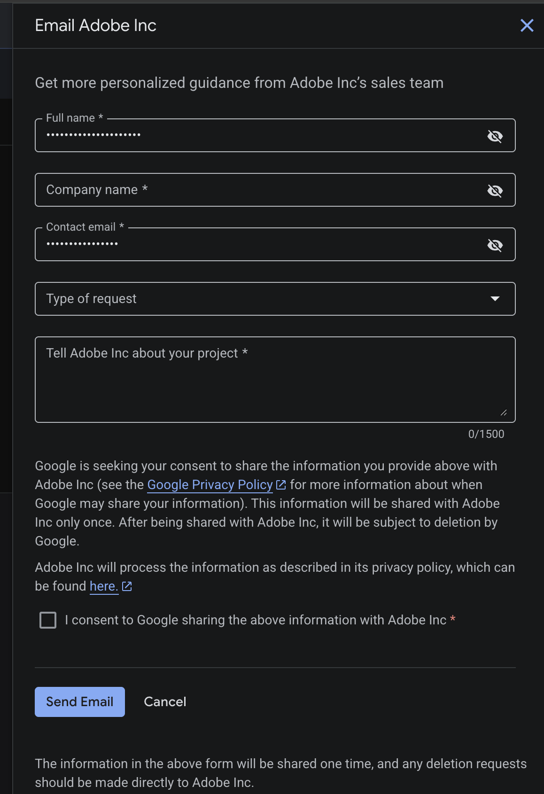

# Adobe CX Enterprise Coworker pour les plateformes d’IA

Utilisez Adobe CX Enterprise Coworker for AI Platform pour obtenir des informations marketing dans les outils d’IA que vous utilisez déjà. Posez vos questions en langage naturel sans changer d&#39;outil. Recherchez le produit répertorié comme Adobe CX Enterprise Coworker dans chaque plateforme.

Recherchez les plateformes disponibles et leurs instructions de configuration dans [Configuration de Coworker](#set-up-coworker).

L’utilisation de Coworker dans les plateformes d’IA n’entraîne aucun coût supplémentaire. Il est inclus dans votre licence CX Enterprise Coworker et l’utilisation puise dans les mêmes crédits d’IA que les autres fonctionnalités de Coworker. Pour plus d’informations, voir [Tâches de l’agent Adobe Experience Platform et consommation des crédits AI](https://experienceleague.adobe.com/fr/docs/cx-enterprise-ai/experience-cloud-ai/overview/ai-credit-consumption){target="_blank"}.

<!-- TODO: architecture diagram pending from engineering. KT page notes "to be provided on 8/28"; still outstanding as of 8/31. Insert here once received. -->

## Conditions préalables {#prerequisites}

Avant de pouvoir utiliser Coworker dans une plateforme d’IA, vérifiez que vous disposez des éléments suivants.

* Adobe CX Enterprise Coworker est configuré pour votre organisation. Vous pouvez y accéder directement dans Adobe.
* Adobe Experience Platform et au moins l’un des composants suivants : Adobe Real-Time CDP, Adobe Journey Optimizer ou Adobe Customer Journey Analytics.
* Accès à une plateforme d’IA répertoriée dans [Configurer Coworker](#set-up-coworker).

## Accès aux données et autorisations {#data-access-and-permissions}

Les collègues dans les plateformes d’IA reflètent les mêmes données et niveaux d’accès liés à votre identité Adobe. Ce que vous pouvez interroger et voir correspond à ce à quoi vous avez déjà droit dans Experience Platform et ses solutions associées. Coworker hérite de ces autorisations, de sorte qu’aucune configuration d’autorisations distincte n’est requise pour l’intégration de la plateforme d’IA. Coworker renvoie des informations en lecture seule et ne modifie pas vos données client. Passez en revue tous les résumés et analyses générés avant de les utiliser pour prendre des décisions commerciales.

<!-- Confirmed by PM (Siddhartha Srivastava) on 2026-09-02 for Microsoft 365 Copilot, Claude, and ChatGPT. Validate this permissions model for each additional platform before adding its setup section. -->

## Cas d’usage clés {#key-use-cases}

Utilisez Coworker dans les plateformes d’IA pour accélérer les workflows marketing courants sans quitter vos outils quotidiens.

| Cas d’utilisation | Description |
| --- | --- |
| Planification et révision des campagnes | Planifiez des campagnes, y compris les révisions de campagnes des partenaires et les prévisions d’audience. Comparez les performances des campagnes au fil du temps et identifiez les points de contact qui génèrent les conversions. |
| Surveiller les parcours et la préparation aux campagnes | Examinez et surveillez les campagnes actives, analysez les parcours des clients et évaluez la préparation de la campagne. Suivez les performances du parcours et les abandons pour identifier les opportunités d’optimisation. |
| Récupération des informations opérationnelles | Identifiez les audiences les plus importantes ou les plus engagées afin de hiérarchiser les domaines sur lesquels concentrer vos efforts et de suivre la croissance ou le rétrécissement de vos segments au fil du temps. |
| Optimisation des workflows et du contenu | Optimisez les workflows et identifiez les besoins en ressources et en contenu pour les campagnes CX. Générer des rapports visuels sur les performances des campagnes sans créer manuellement de requêtes ou de tableaux de bord. |
| Collaborez et décidez plus rapidement | Utilisez les invites suggérées pour explorer les audiences, les campagnes et le trafic web. Partagez des informations avec votre équipe lors des réunions de planification et répondez en temps réel à des questions ad hoc lors de l’examen des plans ou des présentations. |

<!-- Use cases approved by PM Siddhartha Srivastava on 2026-08-31 and confirmed for Microsoft 365 Copilot, Claude, and ChatGPT on 2026-09-02. Validate applicability for each additional platform before adding its setup section. -->

## Configurer un collègue {#set-up-coworker}

Sélectionnez une plateforme disponible pour obtenir des instructions de configuration. Après la configuration, essayez les invites [exemple](#example-prompts).

* [Copilote Microsoft 365](#microsoft-365-copilot)
* [ChatGPT](#chatgpt)
* [Claude](#claude)
* [Gemini Enterprise](#gemini-enterprise)
* [Amazon Quick](#amazon-quick)
* [IBM watsonx Orchestration](#ibm-watsonx-orchestrate)
* [Databricks](#databricks)

### [!DNL Microsoft 365 Copilot] {#microsoft-365-copilot}

Utilisez [!DNL Adobe CX Enterprise Coworker for Copilot] pour obtenir des informations marketing dans [!DNL Microsoft 365 Copilot].

Avant de commencer, vérifiez que vous avez accès à [!DNL Microsoft 365 Copilot].

#### Configurer l’accès à l’organisation {#copilot-organization-setup}

Un administrateur doit effectuer ces étapes avant que les utilisateurs finaux puissent accéder à Coworker dans [!DNL Microsoft 365 Copilot].

1. Dans la [!DNL Microsoft 365 admin center], vérifiez que vos paramètres client autorisent les applications et les agents créés par des éditeurs externes.
1. Approuvez **** à la fois dans le [!DNL Microsoft 365 admin center] et dans le [!DNL Teams admin center]. En règle générale, vous pouvez trouver l’agent par le biais du [!DNL Microsoft Commercial Marketplace] ou de la liste **[!UICONTROL Applications intégrées]** de votre organisation.
1. Déployez l’agent auprès des utilisateurs finaux. Vous pouvez le déployer sur des utilisateurs ou groupes spécifiques, ou sur l’ensemble de votre organisation. Le nombre d’utilisateurs que vous activez n’a aucune incidence sur la configuration ou le coût.

>[!NOTE]
>
>Si [!DNL Microsoft] publie une mise à jour pour un collègue qui nécessite de nouvelles autorisations, votre administrateur doit approuver la mise à jour dans le [!DNL Agent Registry] avant qu’elle ne soit déployée pour vos utilisateurs.

#### Accéder à un collègue {#copilot-access}

Une fois que votre administrateur a activé Coworker, vous pouvez y accéder à travers [!DNL Microsoft 365 Copilot] surfaces, y compris [!DNL Teams], [!DNL Word], [!DNL Excel], [!DNL PowerPoint] et le chat web.

Dans [!DNL Microsoft 365 Copilot], sélectionnez **[!UICONTROL Agents]**, puis sélectionnez **[!UICONTROL Autres agents]**.

Sélectionnez ensuite **** dans le catalogue d’agents.

Enfin, sélectionnez **[!UICONTROL Ajouter]** pour ajouter un collègue à vos agents.

### [!DNL ChatGPT] {#chatgpt}

Utilisez [!DNL Adobe CX Enterprise Coworker for ChatGPT] pour obtenir des informations marketing dans [!DNL ChatGPT].

Avant de commencer, vérifiez que vous avez accès à [!DNL ChatGPT].

#### Configurer l’accès à l’organisation {#chatgpt-organization-setup}

Votre administrateur doit approuver Coworker avant de l’ajouter.

* Demandez à votre administrateur [!DNL ChatGPT] d’approuver **[!UICONTROL Adobe CX Enterprise Coworker]** pour les utilisateurs sélectionnés ou l’ensemble de votre organisation.

#### Accéder à un collègue {#chatgpt-access}

Dans [!DNL ChatGPT], sélectionnez **[!UICONTROL Modules externes]**.

Recherchez et sélectionnez ensuite **** dans le catalogue de modules externes.

Enfin, sélectionnez **[!UICONTROL Installer le plug-in]** pour ajouter Coworker à [!DNL ChatGPT].

### [!DNL Claude] {#claude}

Utilisez Coworker pour obtenir des informations marketing dans [!DNL Claude].

Avant de commencer, vérifiez que vous avez accès à [!DNL Claude].

#### Configurer l’accès à l’organisation {#claude-organization-setup}

Votre administrateur doit approuver Coworker avant de l’ajouter.

* Demandez à votre administrateur [!DNL Claude] d’approuver **[!UICONTROL Adobe CX Enterprise Coworker]** pour les utilisateurs sélectionnés ou l’ensemble de votre organisation.

#### Accéder à un collègue {#claude-access}

1. Dans [!DNL Claude], sélectionnez **[!UICONTROL Personnaliser]**.

   

1. Sélectionnez **[!UICONTROL Connecteurs]**, puis **[!UICONTROL Découvrir]** et utilisez **[!UICONTROL Rechercher]** pour rechercher Adobe CX Enterprise Coworker.

   

1. Sélectionnez ****, puis sélectionnez **[!UICONTROL Se connecter à Claude]**.

   

1. Connectez-vous avec vos informations d’identification Adobe pour connecter Coworker à [!DNL Claude].

### [!DNL Gemini Enterprise] {#gemini-enterprise}

Utilisez Coworker pour obtenir des informations marketing dans [!DNL Gemini Enterprise].

Avant de commencer, vérifiez que vous avez accès à [!DNL Gemini Enterprise].

#### Configurer l’accès à l’organisation {#gemini-organization-setup}

En tant qu’administrateur [!DNL Gemini Enterprise], procédez comme suit pour mettre Coworker à disposition de votre entreprise.

1. Accédez à la [marketplace des agents d’IA d’entreprise Gemini](https://console.cloud.google.com/marketplace/browse?filter=solution-type:ai-agent-service).
1. Recherchez Adobe CX Enterprise Coworker, puis sélectionnez la vignette de l’agent **[!UICONTROL Adobe CX Enterprise Coworker]**.
1. Sur la carte de l’agent, sélectionnez **[!UICONTROL Contacter le service commercial]**.

   {width="700"}

1. Remplissez le formulaire pour envoyer votre demande à Adobe.

   {width="600"}.

   Adobe crée gratuitement une offre privée et vous envoie un lien par email.

1. Ouvrez le lien envoyé par e-mail et validez l’offre privée.

   Une fois l’offre validée, Adobe active l’agent pour votre compte [!DNL Gemini Enterprise].

1. Publiez l’agent pour les utilisateurs sélectionnés ou pour tous les utilisateurs d’entreprise de votre organisation.

#### Accéder à un collègue {#gemini-access}

Une fois que votre administrateur vous a envoyé un e-mail, ouvrez-le dans [!DNL Gemini Enterprise] pour commencer à poser des questions.

1. Dans [!DNL Gemini Enterprise], accédez au catalogue **[!UICONTROL Agents]**.
1. Recherchez Adobe CX Enterprise Coworker.
1. Sélectionnez **** et saisissez une invite pour commencer.

Pour obtenir des idées, explorez les [cas d’utilisation clés](#key-use-cases) et [invites d’exemple](#example-prompts).

### [!DNL Amazon Quick] {#amazon-quick}

Utilisez Coworker pour obtenir des informations marketing dans [!DNL Amazon Quick].

Avant de commencer, vérifiez que vous avez accès à [!DNL Amazon Quick] et à votre compte Adobe.

#### Connecter un collègue {#amazon-quick-connection}

Connectez Coworker dans [!DNL Amazon Quick] à l’aide de Model Context Protocol (MCP). Adobe a déjà approuvé [!DNL Amazon Quick] connexion.

1. Dans [!DNL Amazon Quick], accédez à **[!UICONTROL Connecteurs]**.
1. Recherchez MCP et ouvrez la configuration du connecteur.
1. Saisissez `https://mcp.coworker.experience.adobe.io` comme URL du serveur MCP.

   Patientez quelques minutes pour que la connexion se termine et s’enregistre.

1. Suivez les invites de configuration et connectez-vous avec vos identifiants Adobe.
1. Vérifiez que la connexion a bien été établie avant de commencer à poser des questions.

#### Accéder à un collègue {#amazon-quick-access}

Une fois que vous avez connecté Coworker, utilisez-le dans [!DNL Amazon Quick] pour poser des questions sur vos données Adobe.

Pour obtenir des idées, explorez les [cas d’utilisation clés](#key-use-cases) et [invites d’exemple](#example-prompts).

### [!DNL IBM watsonx Orchestrate] {#ibm-watsonx-orchestrate}

Utilisez Coworker pour obtenir des informations marketing dans [!DNL IBM watsonx Orchestrate].

Avant de commencer, vérifiez que vous avez accès à [!DNL IBM watsonx Orchestrate] et à votre compte Adobe.

Vous devez également disposer des autorisations nécessaires pour gérer les connexions, enregistrer les serveurs MCP et modifier un agent. Confirmez les paramètres de votre client OAuth auprès de votre représentant Adobe avant la configuration.

#### Créer votre connexion Collègue {#ibm-connection}

Connectez un collègue à l’aide d’OAuth, puis authentifiez-vous avec votre compte Adobe. Les étapes suivantes préparent la connexion pour le test dans l’environnement de brouillon.

1. Dans [!DNL IBM watsonx Orchestrate], accédez à **[!UICONTROL Connexions]**, puis sélectionnez **[!UICONTROL Ajouter une connexion]**.
1. Saisissez un **[!UICONTROL Identifiant de connexion]**, **[!UICONTROL Nom d’affichage]** et un **[!UICONTROL Description de la connexion]** facultatif, puis sélectionnez **[!UICONTROL Enregistrer et continuer]**.
1. Dans **[!UICONTROL Configurer le brouillon d’environnement]**, sélectionnez **[!UICONTROL Code d’autorisation OAuth2]** comme **[!UICONTROL Type d’authentification]**.
1. Saisissez les paramètres de connexion.

   | Champ | Valeur |
   | --- | --- |
   | [!UICONTROL URL du serveur] | `https://mcp.coworker.experience.adobe.io` |
   | [!UICONTROL URL du jeton] | Point d’entrée de jeton confirmé pour votre client OAuth. |
   | [!UICONTROL  URL d’autorisation ] | Point d’entrée d’autorisation confirmé pour votre client OAuth. |
   | [!UICONTROL Identifiant du client] | Votre identifiant client OAuth approuvé. |
   | [!UICONTROL Secret du client] | Votre secret client OAuth approuvé. |

   {width="700"}

1. Sélectionnez **[!UICONTROL PKCE]** et **[!UICONTROL Informations d’identification du membre]**, puis sélectionnez **[!UICONTROL Suivant]**.
1. Terminez **[!UICONTROL Configurer l’environnement actif]**, puis sélectionnez **[!UICONTROL Terminer]** pour enregistrer la connexion.

<!-- Confirm the customer process for obtaining OAuth settings before publication. -->

#### Se connecter avec Adobe {#ibm-sign-in}

Ajoutez les informations d’identification de votre membre pour authentifier la connexion à votre identité Adobe.

1. Accédez à **[!UICONTROL Paramètres]** > **[!UICONTROL Informations d’identification du membre]**, puis sélectionnez **[!UICONTROL Ajouter des informations d’identification du membre]**.
1. Sélectionnez votre connexion Collègue et passez à **[!UICONTROL Définition des informations d’identification]**.
1. Sélectionnez **[!UICONTROL Se connecter et enregistrer]**, puis connectez-vous avec vos informations d’identification Adobe lorsque vous y êtes invité.
1. Revenez à [!DNL IBM watsonx Orchestrate] et confirmez que vos informations d’identification ont bien été ajoutées.

#### Enregistrement du serveur MCP {#ibm-register-server}

Enregistrez un collègue via le protocole MCP (Model Context Protocol) pour importer ses outils dans [!DNL IBM watsonx Orchestrate].

1. Accédez à **[!UICONTROL PASSERELLE IA]** > **[!UICONTROL Serveurs MCP]**, puis sélectionnez **[!UICONTROL Enregistrer le serveur]**.
1. Saisissez les paramètres du serveur.

   | Champ | Valeur |
   | --- | --- |
   | [!UICONTROL  Nom du serveur ] | Nom descriptif, tel que `cx-coworker`. |
   | [!UICONTROL Type de transport] | [!UICONTROL HTTP diffusable] |
   | [!UICONTROL  URL du serveur MCP ] | `https://mcp.coworker.experience.adobe.io` |
   | [!UICONTROL Connexion] | Connexion de collègue que vous avez authentifiée. |

1. Sélectionnez **[!UICONTROL Enregistrer]** et attendez la fin de l’enregistrement du serveur et de l’importation de l’outil.

   {width="700"}

#### Ajouter des outils à votre agent {#ibm-agent-tools}

Ajoutez les outils importés à votre agent, puis testez la connexion avant de déployer l’agent.

1. Accédez à **[!UICONTROL Inventaire actif]** > **[!UICONTROL Agents]** et ouvrez l’agent que vous souhaitez configurer.
1. Dans **[!UICONTROL Créer]**, sélectionnez **[!UICONTROL Outils]**, puis **[!UICONTROL Ajouter un outil]**.
1. Sélectionnez **[!UICONTROL Serveur MCP]** et recherchez les outils sur le serveur Coworker enregistré.
1. Sélectionnez les outils de collègue dont vous avez besoin, puis sélectionnez **[!UICONTROL Ajouter à l’agent]**.
1. Saisissez une invite dans **[!UICONTROL Aperçu du brouillon]** et examinez la réponse pour confirmer que la connexion fonctionne.

Pour obtenir des idées, explorez les [cas d’utilisation clés](#key-use-cases) et [invites d’exemple](#example-prompts).

### [!DNL Databricks] {#databricks}

Utilisez Coworker pour obtenir des informations marketing dans [!DNL Databricks Genie One].

Avant de commencer, vérifiez que vous avez accès à [!DNL Databricks Genie One] et à votre compte Adobe. Vous devez également disposer de l’autorisation d’installer un service MCP dans le catalogue [!DNL Unity Catalog] et le schéma de votre choix.

Confirmez les paramètres de votre client OAuth auprès de votre représentant Adobe avant la configuration.

#### Installer un collègue {#databricks-install}

Installez le service MCP de Coworker à partir de [!DNL Databricks Marketplace].

1. Dans [!DNL Databricks], accédez à **[!UICONTROL Marketplace]** et recherchez Adobe Coworker.
1. Sélectionnez ****, puis sélectionnez **[!UICONTROL Installer]**.
1. Sélectionnez un **[!UICONTROL Catalogue]** et un **[!UICONTROL Schéma]**, puis saisissez un **[!UICONTROL Nom du service MCP]**.
1. Conservez les paramètres de connexion fournis par la liste, y compris les valeurs suivantes.

   | Champ | Valeur |
   | --- | --- |
   | [!UICONTROL Hôte] | `https://mcp.coworker.experience.adobe.io` |
   | [!UICONTROL  Chemin de base ] | `/mcp` |
   | [!UICONTROL Type d’informations d’identification] | [!UICONTROL OAuth U2M] |

   {width="700"}

1. Saisissez vos **[!UICONTROL Identifiant client]** et **[!UICONTROL Secret client]**.
1. Vérifiez et acceptez les conditions, puis sélectionnez **[!UICONTROL Installer]**.

<!-- Confirm the customer process for obtaining OAuth settings before publication. -->

#### Connexion à votre compte Adobe {#databricks-adobe-connection}

Chaque utilisateur se connecte avec son compte Adobe. Les requêtes de collègues utilisent les autorisations Adobe de cet utilisateur.

1. Dans **[!UICONTROL Catalogue]**, ouvrez le service Coworker installé sous le catalogue et le schéma sélectionnés.
1. Connectez-vous à Adobe lorsque vous y êtes invité.
1. Vérifiez que le service **[!UICONTROL Statut]** est **[!UICONTROL Actif]** et que ses outils sont répertoriés.
1. Dans **[!UICONTROL Commencer]**, sélectionnez **[!UICONTROL Génie]**, puis **[!UICONTROL Génie One]**, et sélectionnez **[!UICONTROL Ajouter à Génie One]**.

#### Accéder à un collègue {#databricks-access}

Vérifiez que votre connecteur est disponible avant de poser des questions dans [!DNL Genie One].

1. Dans [!DNL Genie One], accédez à **[!UICONTROL Personnalisations]** > **[!UICONTROL Connecteurs]** et ouvrez votre connecteur Coworker.
1. Vérifiez que le connecteur affiche **[!UICONTROL Connecté]**. Examinez les paramètres d’approbation des outils en fonction des politiques de votre entreprise.

   {width="700"}

1. Sélectionnez **[!UICONTROL Nouvelle conversation]** et saisissez une invite, par exemple « À l’aide d’Adobe Coworker, répertorier les audiences publiées ».

Pour obtenir des idées, explorez les [cas d’utilisation clés](#key-use-cases) et [invites d’exemple](#example-prompts).

<!-- Setup steps for Microsoft 365 Copilot, ChatGPT, and Claude reflect the real customer-facing flow confirmed by PM (Siddhartha Srivastava) on 2026-09-02: an org admin approves the connector or plugin, then end users find and add it in their platform's catalog and sign in. The previous version of this file described a manual MCP-connector setup for ChatGPT (Settings > Connectors > paste server URL) -- PM clarified that flow is for internal testing only, not the customer path, so it was removed here. -->

<!-- Amazon Quick setup follows PM guidance from the October 28, 2026 email, "Coworker in AI Platforms screenshots - Gemini / Amazon Quick." End users connect through MCP and sign in with Adobe credentials. -->

## Exemples de prompts {#example-prompts}

Après avoir configuré Coworker dans une plateforme prise en charge, essayez ces invites ou écrivez les vôtres en langage naturel.

* Affichez vos cinq principales audiences.
* Afficher une mesure pour le mois dernier.
* Affichez vos projets Workfront actifs.
* Afficher les parcours avec audiences de fidélité.

## Limites connues {#known-limitations}

Coworker dans les plateformes d’IA ne prend pas en charge toutes les fonctionnalités disponibles dans l’interface de Coworker.

* Vous ne pouvez pas connecter Coworker à un faisceau d’agent personnalisé en dehors des plateformes d’IA prises en charge répertoriées dans ce document. Pour demander une prise en charge de plateformes d’IA ou de faisceaux d’agents supplémentaires par le biais de MCP, contactez votre représentant Adobe.
* La compétence Génération d’images Firefly n’est pas disponible lorsque vous accédez à Coworker via Claude. La compétence reste disponible dans l’interface Coworker et d’autres plateformes d’IA prises en charge décrites dans ce document. Pour utiliser la compétence de génération d’images Firefly, accédez à Coworker par le biais de l’interface Coworker ou d’une autre plateforme d’IA prise en charge.

## Dépannage de Coworker sur les plateformes d’IA {#troubleshoot}

Essayez ces étapes si vous rencontrez des problèmes lors de l’utilisation de Coworker dans une plateforme d’IA.

* Si une erreur s’affiche, déconnectez-vous et reconnectez-vous avec vos informations d’identification Adobe. La réauthentification résout la plupart des problèmes.
* Si vous ne pouvez pas accéder à Coworker ou à des données spécifiques, contactez votre administrateur Adobe pour confirmer l’accès et les autorisations de votre produit.

<!--
Editorial maintenance, 2026-10-27:
Only approved platforms with validated setup guidance belong in the platform sections.
Databricks setup follows the supplied "Adobe Coworker in Genie One.mp4" walkthrough. Confirm marketplace availability and customer OAuth provisioning before publication.

To add an approved platform:
* Confirm approval and obtain access to the customer flow.
* Validate prerequisites, organization approval, catalog discovery, listing name, installation, and Adobe sign-in.
* Confirm the shared licensing, permissions, use cases, prompts, limitations, and troubleshooting guidance applies.
* Add an H3 platform section with an explicit anchor under Set up Coworker and add it to the linked platform list.
* Follow the existing order: introduction, platform prerequisites, setup tasks, and user access. Use H4 task headings with unique anchors.
* Document any platform-specific requirements or exceptions within that section.
* Preview the section and verify its links and image references.
Keep the article introduction, metadata, and shared prerequisites free of platform lists so adding a section does not require duplicate updates.

Gemini Enterprise follow-up:
Administrator setup and end user access steps are documented. Confirm applicability of the shared guidance before expanding the section.
-->
