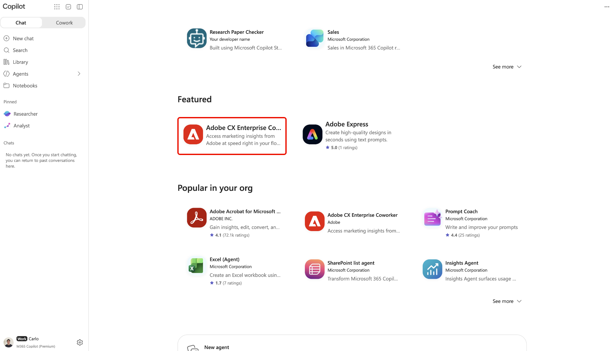

# Adobe CX Enterprise Coworker pour les plateformes d’IA

Utilisez Adobe CX Enterprise Coworker for AI Platform pour obtenir des informations marketing dans les outils d’IA que vous utilisez déjà. Posez vos questions en langage naturel sans changer d&#39;outil. Recherchez le produit répertorié comme Adobe CX Enterprise Coworker dans chaque plateforme.

Recherchez les plateformes disponibles et leurs instructions de configuration dans [Configuration de Coworker](#set-up-coworker).

L’utilisation de Coworker dans les plateformes d’IA n’entraîne aucun coût supplémentaire. Il est inclus dans votre licence CX Enterprise Coworker et l’utilisation puise dans les mêmes crédits d’IA que les autres fonctionnalités de Coworker. Pour plus d’informations, voir [Tâches de l’agent Adobe Experience Platform et consommation des crédits AI](https://experienceleague.adobe.com/fr/docs/cx-enterprise-ai/experience-cloud-ai/overview/ai-credit-consumption){target="_blank"}.

<!-- TODO: architecture diagram pending from engineering. KT page notes "to be provided on 8/28"; still outstanding as of 8/31. Insert here once received. -->

## Conditions préalables {#prerequisites}

Avant de pouvoir utiliser Coworker dans une plateforme d’IA, vérifiez que vous disposez des éléments suivants.

* Adobe CX Enterprise Coworker est configuré pour votre organisation. Vous pouvez y accéder directement dans Adobe.
* Adobe Experience Platform et au moins l’un des composants suivants : Adobe Real-Time CDP, Adobe Journey Optimizer ou Adobe Customer Journey Analytics.
* Accès à une plateforme d’IA répertoriée dans [Configurer Coworker](#set-up-coworker).

## Accès aux données et autorisations {#data-access-and-permissions}

Les collègues dans les plateformes d’IA reflètent les mêmes données et niveaux d’accès liés à votre identité Adobe. Ce que vous pouvez interroger et voir correspond à ce à quoi vous avez déjà droit dans Experience Platform et ses solutions associées. Coworker hérite de ces autorisations, de sorte qu’aucune configuration d’autorisations distincte n’est requise pour l’intégration de la plateforme d’IA. Coworker renvoie des informations en lecture seule et ne modifie pas vos données client. Passez en revue tous les résumés et analyses générés avant de les utiliser pour prendre des décisions commerciales.

<!-- Confirmed by PM (Siddhartha Srivastava) on 2026-09-02 for Microsoft 365 Copilot, Claude, and ChatGPT. Validate this permissions model for each additional platform before adding its setup tab. -->

## Cas d’usage clés {#key-use-cases}

Utilisez Coworker dans les plateformes d’IA pour accélérer les workflows marketing courants sans quitter vos outils quotidiens.

| Cas d’utilisation | Description |
| --- | --- |
| Planification et révision des campagnes | Planifiez des campagnes, y compris les révisions de campagnes des partenaires et les prévisions d’audience. Comparez les performances des campagnes au fil du temps et identifiez les points de contact qui génèrent les conversions. |
| Surveiller les parcours et la préparation aux campagnes | Examinez et surveillez les campagnes actives, analysez les parcours des clients et évaluez la préparation de la campagne. Suivez les performances du parcours et les abandons pour identifier les opportunités d’optimisation. |
| Récupération des informations opérationnelles | Identifiez les audiences les plus importantes ou les plus engagées afin de hiérarchiser les domaines sur lesquels concentrer vos efforts et de suivre la croissance ou le rétrécissement de vos segments au fil du temps. |
| Optimisation des workflows et du contenu | Optimisez les workflows et identifiez les besoins en ressources et en contenu pour les campagnes CX. Générer des rapports visuels sur les performances des campagnes sans créer manuellement de requêtes ou de tableaux de bord. |
| Collaborez et décidez plus rapidement | Utilisez les invites suggérées pour explorer les audiences, les campagnes et le trafic web. Partagez des informations avec votre équipe lors des réunions de planification et répondez en temps réel à des questions ad hoc lors de l’examen des plans ou des présentations. |

<!-- Use cases approved by PM Siddhartha Srivastava on 2026-08-31 and confirmed for Microsoft 365 Copilot, Claude, and ChatGPT on 2026-09-02. Validate applicability for each additional platform before adding its setup tab. -->

## Configurer un collègue {#set-up-coworker}

Sélectionnez une plateforme disponible pour obtenir des instructions de configuration. Après la configuration, essayez les invites [exemple](#example-prompts).

>[!BEGINTABS]

>[!TAB Copilote Microsoft 365]

Utilisez [!DNL Adobe CX Enterprise Coworker for Copilot] pour obtenir des informations marketing dans [!DNL Microsoft 365 Copilot].

Avant de commencer, vérifiez que vous avez accès à [!DNL Microsoft 365 Copilot].

**Configurer Coworker pour votre organisation**

Un administrateur doit effectuer ces étapes avant que les utilisateurs finaux puissent accéder à Coworker dans [!DNL Microsoft 365 Copilot].

1. Dans la [!DNL Microsoft 365 admin center], vérifiez que vos paramètres client autorisent les applications et les agents créés par des éditeurs externes.
1. Approuvez **** à la fois dans le [!DNL Microsoft 365 admin center] et dans le [!DNL Teams admin center]. En règle générale, vous pouvez trouver l’agent par le biais du [!DNL Microsoft Commercial Marketplace] ou de la liste **[!UICONTROL Applications intégrées]** de votre organisation.
1. Déployez l’agent auprès des utilisateurs finaux. Vous pouvez le déployer sur des utilisateurs ou groupes spécifiques, ou sur l’ensemble de votre organisation. Le nombre d’utilisateurs que vous activez n’a aucune incidence sur la configuration ou le coût.

>[!NOTE]
>
>Si [!DNL Microsoft] publie une mise à jour pour un collègue qui nécessite de nouvelles autorisations, votre administrateur doit approuver la mise à jour dans le [!DNL Agent Registry] avant qu’elle ne soit déployée pour vos utilisateurs.

**Accéder à un collègue dans[!DNL Copilot]**

Une fois que votre administrateur a activé Coworker, vous pouvez y accéder à travers [!DNL Microsoft 365 Copilot] surfaces, y compris [!DNL Teams], [!DNL Word], [!DNL Excel], [!DNL PowerPoint] et le chat web.

Dans [!DNL Microsoft 365 Copilot], sélectionnez **[!UICONTROL Agents]**, puis sélectionnez **[!UICONTROL Autres agents]**.

Sélectionnez ensuite **** dans le catalogue d’agents.

Enfin, sélectionnez **[!UICONTROL Ajouter]** pour ajouter un collègue à vos agents.

>[!TAB ChatGPT]

Utilisez [!DNL Adobe CX Enterprise Coworker for ChatGPT] pour obtenir des informations marketing dans [!DNL ChatGPT].

Avant de commencer, vérifiez que vous avez accès à [!DNL ChatGPT].

**Configurer Coworker pour votre organisation**

* Demandez à votre administrateur [!DNL ChatGPT] d’approuver **[!UICONTROL Adobe CX Enterprise Coworker]** pour les utilisateurs sélectionnés ou l’ensemble de votre organisation.

**Accéder à un collègue dans[!DNL ChatGPT]**

Dans [!DNL ChatGPT], sélectionnez **[!UICONTROL Modules externes]**.

Recherchez et sélectionnez ensuite **** dans le catalogue de modules externes.

Enfin, sélectionnez **[!UICONTROL Installer le plug-in]** pour ajouter Coworker à [!DNL ChatGPT].

>[!TAB  Claude ]

Utilisez Coworker pour obtenir des informations marketing dans [!DNL Claude].

Avant de commencer, vérifiez que vous avez accès à [!DNL Claude].

**Configurer Coworker pour votre organisation**

* Demandez à votre administrateur [!DNL Claude] d’approuver **[!UICONTROL Adobe CX Enterprise Coworker]** pour les utilisateurs sélectionnés ou l’ensemble de votre organisation.

**Accéder à un collègue dans[!DNL Claude]**

1. Dans [!DNL Claude], sélectionnez **[!UICONTROL Personnaliser]**.

   

1. Sélectionnez **[!UICONTROL Connecteurs]**, puis **[!UICONTROL Découvrir]** et utilisez **[!UICONTROL Rechercher]** pour rechercher Adobe CX Enterprise Coworker.

   

1. Sélectionnez ****, puis sélectionnez **[!UICONTROL Se connecter à Claude]**.

   

1. Connectez-vous avec vos informations d’identification Adobe pour connecter Coworker à [!DNL Claude].

>[!ENDTABS]

<!-- Setup steps above reflect the real customer-facing flow confirmed by PM (Siddhartha Srivastava) on 2026-09-02: an org admin approves the connector or plugin, then end users find and add it in their platform's catalog and sign in. The previous version of this file described a manual MCP-connector setup for ChatGPT (Settings > Connectors > paste server URL) -- PM clarified that flow is for internal testing only, not the customer path, so it was removed here. -->

## Exemples de prompts {#example-prompts}

Après avoir configuré Coworker dans une plateforme prise en charge, essayez ces invites ou écrivez les vôtres en langage naturel.

* Affichez vos cinq principales audiences.
* Afficher une mesure pour le mois dernier.
* Affichez vos projets Workfront actifs.
* Afficher les parcours avec audiences de fidélité.

## Limites connues {#known-limitations}

Coworker sur les plateformes d’IA ne prend pas en charge tous les modèles d’intégration.

* Vous ne pouvez pas connecter Coworker à votre propre harnais agentique à l&#39;aide de MCP.

## Dépannage de Coworker sur les plateformes d’IA {#troubleshoot}

Essayez ces étapes si vous rencontrez des problèmes lors de l’utilisation de Coworker dans une plateforme d’IA.

* Si une erreur s’affiche, déconnectez-vous et reconnectez-vous avec vos informations d’identification Adobe. La réauthentification résout la plupart des problèmes.
* Si vous ne pouvez pas accéder à Coworker ou à des données spécifiques, contactez votre administrateur Adobe pour confirmer l’accès et les autorisations de votre produit.

<!--
Editorial maintenance, 2026-10-27:
Only approved platforms with validated setup guidance belong in the rendered tab set.
Remaining platforms to add: Gemini, Amazon Quick, IBM, and Databricks.

To add an approved platform:
* Confirm approval and obtain access to the customer flow.
* Validate prerequisites, organization approval, catalog discovery, listing name, installation, and Adobe sign-in.
* Confirm the shared licensing, permissions, use cases, prompts, limitations, and troubleshooting guidance applies.
* Add one tab before ENDTABS, following the existing order: introduction, platform prerequisites, organization setup, and user access.
* Document any platform-specific requirements or exceptions within that tab.
* Preview the tab and verify its links and image references.
Keep the introduction, metadata, and shared prerequisites free of platform lists so adding a tab does not require duplicate updates.

Gemini draft scope:
No setup steps are confirmed. Validate the complete customer flow and all shared guidance before adding the tab.
Do not infer the flow from another platform.
-->
