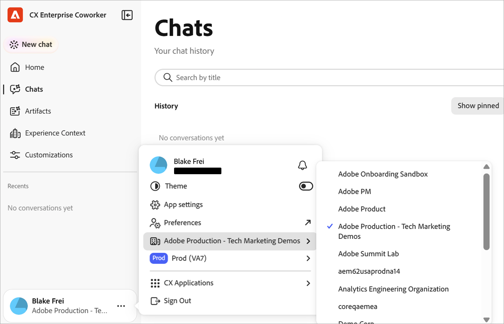

# Prise en main du chat des collègues {#ui-guide}

Le Module de conversation avec un collègue vous permet de travailler avec vos données et outils Adobe CX Enterprise en vous demandant ce dont vous avez besoin en langage clair. Utilisez cette page pour ouvrir le Chat des collègues, envoyer votre premier message et le configurer comme vous le faites.

## Disponibilité

[!DNL Coworker] [!UICONTROL Chat] est disponible en tant qu’expérience immersive, espace de travail de pleine page et expérience intégrée au produit dans certaines applications [!DNL CX Enterprise].

Le tableau suivant indique où chaque expérience est disponible.

| Application CX Enterprise | Expérience immersive | Expérience intégrée au produit |
|---|---|---|
| Real-Time CDP | Disponible maintenant | Bientôt disponible |
| Adobe Journey Optimizer | Disponible maintenant | Bientôt disponible |
| Customer Journey Analytics | Disponible maintenant | Bientôt disponible |
| Workfront | Disponible maintenant | Disponible maintenant |
| Cible | Disponible maintenant | Disponible maintenant |
| AEM | Disponible maintenant | Disponible maintenant |
| Marketo Engage | Disponible maintenant | Bientôt disponible |

## Se connecter à [!DNL Coworker] {#sign-in}

Connectez-vous à [!DNL Coworker] à l’aide de vos informations d’identification Adobe.

1. [Connectez-vous](https://experienceleague.adobe.com/fr/docs/core-services/interface/experience-cloud#sign-in-to-cx-enterprise) à CX Enterprise à l’aide de votre Adobe ID.

   Après vous être connecté, vous pouvez ouvrir le [!DNL Coworker] à partir du menu de l’application [!DNL CX Enterprise] ou à l’aide d’un lien direct :

   * Dans [!DNL CX Enterprise], cliquez sur le menu du sélecteur d’applications , puis cliquez sur **[!DNL Coworker]**.

   * Pour utiliser un lien direct, accédez à [&#128279;](https://experience.adobe.com/#/coworker).

1. Pour démarrer une conversation, cliquez sur **[!UICONTROL Nouvelle conversation]** dans le rail de navigation.

## En savoir plus sur les principes de base du chat des collègues

>[!VIDEO](https://video.tv.adobe.com/v/3498558?learn=on)

## Spécifier les préférences de vos collègues {#preferences}

En bas à gauche de l’interface, vous pouvez spécifier les options et les préférences qui déterminent les données, les compétences et les outils connectés auxquels une conversation peut accéder.

| Paramètre / option | Cas d’usage |
| --- | --- |
| Nom et adresse e-mail du compte | Confirmez le compte Adobe avec lequel vous êtes connecté. |
| **[!UICONTROL Notifications]** (icône représentant une cloche) | Affichez vos [notifications](https://experienceleague.adobe.com/fr/docs/core-services/interface/features/account-preferences#subscribe-to-notifications-in-experience-cloud). |
| **[!UICONTROL Thème]** | Basculez entre les thèmes Clair et Sombre. |
| **[!UICONTROL Paramètres de l’application]** | Affichez les détails du compte et les paramètres de l’espace de travail. |
| **[!UICONTROL Préférences]** | Ouvrez votre compte [préférences](https://experienceleague.adobe.com/fr/docs/core-services/interface/features/account-preferences). La flèche indique que la page s’ouvre en dehors de Coworker. |
| **[!UICONTROL Organisation]** | Choisissez l’IMS [organisation](https://experienceleague.adobe.com/fr/docs/core-services/interface/administration/organizations) dans lequel vous souhaitez travailler. Le menu affiche l’organisation actuelle et une coche identifie l’organisation sélectionnée dans la liste. |
| **[!UICONTROL Sandbox]** | Choisissez l’Experience Platform [sandbox](https://experienceleague.adobe.com/fr/docs/experience-platform/sandbox/home) dans laquelle vous souhaitez travailler. Le menu affiche le sandbox actuel et son type, par exemple **Prod**. |
| **[!UICONTROL Applications CX]** | Accédez à une autre application CX Enterprise connectée à votre compte . |
| **[!UICONTROL Se déconnecter]** | Déconnectez-vous de votre compte Adobe. |

## Se familiariser avec les fonctionnalités de Coworker {#interface-features}

Coworker comporte deux zones principales : le rail de navigation à gauche et la fenêtre de conversation qui remplit le reste de l’écran. Pour réduire le rail de navigation afin qu’il n’affiche que les icônes, cliquez sur l’icône Réduire en regard du nom du produit.

* Rail de navigation :

  

* Fenêtre de conversation (affichée ici avec la page **[!UICONTROL Conversations]** ouverte) :

  

Dans le rail de navigation, les fonctionnalités suivantes vous permettent de discuter avec un collègue et de revenir à un travail récent :

| Option | Cas d’usage |
| --- | --- |
| **[!UICONTROL Nouvelle conversation]** | Démarrer une conversation. [!UICONTROL Conversation avec un collègue] enregistre votre conversation actuelle dans votre historique. |
| **[!UICONTROL Accueil]** | Revenez à la salutation, à la zone de saisie et aux invites suggérées. |
| **[!UICONTROL Conversations]** | Rechercher, épingler, archiver ou supprimer des conversations antérieures. |
| **[!UICONTROL Artefacts]** | Ouvrez les artefacts créés par le Module de conversation des collègues dans vos conversations. |
| **[!UICONTROL Experience Context]** | <!-- TODO: describe Experience Context --> |
| **[!UICONTROL Personnalisations]** | Gérez les compétences, les intégrations, les places de marché, les modules externes et la mémoire. |
| **[!UICONTROL Récents]** | Ouvrez vos dernières conversations. Cliquez sur **[!UICONTROL Afficher tout]** pour ouvrir la page Conversations . |
| **[!UICONTROL Épinglé]** | Ouvrez les conversations que vous avez démarrées. Cliquez sur **[!UICONTROL Afficher tout]** pour les voir sur la page Conversations. |

## Demander quelque chose à Coworker {#message}

Sur la page d’accueil de Coworker, vous pouvez saisir votre question ou sélectionner une invite suggérée, en fonction de ce que Coworker Chat peut faire dans votre sandbox.

Pour poser une question à Coworker :

1. [Ouvrir un collègue](#sign-in).
1. Effectuez l’une des opérations suivantes :

   * Sélectionnez une invite sous **[!UICONTROL Suggérée pour vous]**. La discussion avec les collègues l’ajoute à la zone de saisie, où vous pouvez le modifier.
   * Saisissez votre propre demande dans le champ **[!UICONTROL Demander à un collègue]**.

1. (Facultatif) Ajoutez du contexte, choisissez la manière dont le Module de conversation des collègues répond ou dictez votre message. Voir [&#x200B; Ajouter du contexte et choisir un style de réponse](#input-options).
1. Cliquez sur **[!UICONTROL Envoyer]**.

>[!TIP]
>
>Les invites suggérées indiquent les types de tâches pris en charge par la discussion entre collaborateurs, comme le déplacement de schémas entre des sandbox, la recherche d’anomalies dans un parcours et la validation d’un jeu de données.

Pour pointer la conversation avec un collègue vers un objet spécifique dans votre sandbox, saisissez **+** dans la zone de saisie, puis cliquez sur un schéma, un parcours, un jeu de données ou un autre objet. Il s’agit d’une mention d’entité. Il indique à Coworker Chat exactement quel objet vous voulez dire.

## Ajouter du contexte et choisir un style de réponse {#input-options}

La barre d’outils située sous la zone de saisie contrôle les éléments joints, la manière dont la discussion entre collègues aborde la tâche et le volume de travail qu’elle affiche.

| Commande | Cas d’usage |
| --- | --- |
| **[!UICONTROL +]** (Joindre) | Ajoutez un fichier ou un objet sandbox à votre message. |
| **[!UICONTROL Mode Plan]** | Examinez un plan étape par étape avant que le Chat des collègues n’agisse. |
| **[!UICONTROL Vue Transcription]** (étiquetée avec la vue actuelle, par exemple **[!UICONTROL Normale]**) | Choisissez le niveau d’activité du Chat des collègues que vous voyez. |
| **[!UICONTROL Microphone]** | Dictez votre message. Cliquez à nouveau dessus pour arrêter l’enregistrement. |
| **[!UICONTROL Envoyer]** (icône de flèche) | Envoyez votre message. Le contrôle n&#39;est pas disponible tant que vous n&#39;avez pas saisi un message. Lorsque le Module de conversation du collègue répond, ce contrôle devient **[!UICONTROL Arrêter]**, ce qui interrompt la réponse. |

### Joindre un fichier ou un objet

Joignez un fichier ou un objet lorsque la discussion avec un collègue a besoin d’informations supplémentaires pour effectuer le travail.

1. Cliquez sur **[!UICONTROL +]** dans la zone de saisie.
1. Cliquez sur l’une des options suivantes :

   * **[!UICONTROL Joindre un fichier]** : téléchargez un fichier pour que le chat des collègues puisse le lire et le référencer.
   * **[!UICONTROL Ajouter des données ou un objet]** : référencez un objet dans votre sandbox, tel qu’un jeu de données ou un schéma, afin que la conversation avec les collègues fonctionne avec vos données actives.

### Examiner un plan avant l’action du Chat des collègues {#plan-mode}

Utilisez le mode Plan pour les tâches complexes ou les tâches qui modifient les données. Lorsque le mode Plan est activé, le Chat des collaborateurs propose un plan et attend votre approbation avant de l&#39;exécuter. Lorsque le mode Plan est désactivé, la discussion avec les collègues démarre le travail immédiatement.

1. Cliquez sur **[!UICONTROL Mode Plan]** dans la barre d’outils de saisie pour l’activer.
1. Envoyez votre message.
1. Examinez le plan et approuvez-le pour continuer.

### Choisir une vue de relevé de notes

La vue des transcriptions contrôle la proportion du raisonnement et de l’activité des outils du Chat des collègues qui apparaît dans la conversation.

1. Dans la barre d’outils de saisie, cliquez sur le contrôle d’affichage de transcription. Il affiche la vue actuelle, telle que **[!UICONTROL Normal]**.
1. Cliquez sur une vue :

   | Voir | Ce que vous voyez |
   | --- | --- |
   | **[!UICONTROL Normal]** | Résumé des principales étapes de réflexion et de l’activité des outils. |
   | **[!UICONTROL Focus]** | Surtout la réponse. La conversation avec un collègue masque la plupart des étapes intermédiaires. |
   | **[!UICONTROL Verbose]** | Chaque étape de réflexion, la charge de compétence, la lecture de fichier et la requête. |

## Vérifier une réponse

Le Chat des collègues affiche son travail au fur et à mesure, puis renvoie une réponse. Une réponse peut inclure son raisonnement, un enregistrement des outils utilisés, des artefacts et un résumé.

Lorsqu’une réponse est longue, cliquez sur la flèche qui s’affiche au-dessus de la réponse pour accéder à la fin. Le Module de conversation des collègues affiche l’avis suivant sous la zone de saisie : « Les réponses sont générées à l’aide de l’IA et peuvent être inexactes. Vérifiez avant d’utiliser. » Examinez les réponses avant d’agir dessus.

### Suivre l’activité

Pendant que le Chat des collègues fonctionne, vous pouvez suivre et vérifier ce qu&#39;il fait. Dans la vue **[!UICONTROL Normale]**, un résumé d’une ligne de son activité s’affiche au-dessus de la réponse, par exemple « Compétences chargées 3, lecture d’un fichier et de 2 étapes supplémentaires ». Cliquez sur le résumé pour le développer, puis développez n’importe quelle entrée pour afficher plus de détails. Les entrées incluent :

* **Réfléchi pour** : Un bloc réductible avec le raisonnement de Coworker Chat et combien de temps cela a pris.
* **Compétence chargée** : fonctionnalité spécialisée Conversation avec le collègue utilisée pour la tâche.
* **Lire le fichier** et **Exécuter 1 requête** : les fichiers lus par Coworker Chat et les requêtes qu’il a exécutées, avec le temps que chacun a pris.

>[!TIP]
>
>Définissez **[!UICONTROL Vue Transcription]** sur **[!UICONTROL Verbose]** pour afficher chaque étape ou sur **[!UICONTROL Focus]** pour les masquer.

### Utilisation d’artefacts

La discussion avec les collègues affiche les résultats, tels qu’un tableau d’audiences, sous forme de cartes d’artefact dans la réponse. Vous pouvez télécharger un artefact de table sous la forme d’un fichier CSV à partir de sa carte. Lorsqu’une réponse comprend plusieurs artefacts, utilisez **[!UICONTROL Précédent]** et **[!UICONTROL Suivant]** pour passer d’un artefact à l’autre.

### Utiliser le résumé

Sous les artefacts, Coworker Chat explique ce que signifient les résultats, met en évidence les découvertes notables et suggère des actions de suivi. Utilisez ces suggestions pour poursuivre la conversation.

### Évaluer et copier une réponse

Chaque réponse inclut des contrôles que vous pouvez utiliser pour donner des commentaires ou réutiliser le contenu.

* Cliquez sur **[!UICONTROL Pouces vers le haut]** ou **[!UICONTROL Pouces vers le bas]** pour évaluer la réponse. Votre évaluation permet d’améliorer les réponses futures.
* Cliquez sur **[!UICONTROL Copier]**, puis choisissez **[!UICONTROL Copier en tant que Markdown]** pour conserver la mise en forme ou **[!UICONTROL Copier en tant que texte brut]** pour le supprimer.

## Gérer vos conversations

Votre historique de conversation conserve les conversations passées afin que vous puissiez y revenir. Cliquez sur **[!UICONTROL Conversations]** dans le rail de navigation pour l’ouvrir. Les conversations sont regroupées par date, et chaque ligne affiche le titre et le nombre de tours.

Sur la page Conversations, vous pouvez :

* Saisissez un nom dans **[!UICONTROL Rechercher par titre]** pour trouver une conversation.
* Cliquez sur **[!UICONTROL Afficher épinglé]** pour n’afficher que les conversations que vous avez démarrées.
* Cliquez sur **[!UICONTROL Afficher archivées]** pour afficher les conversations archivées.
* Cliquez sur **[!UICONTROL Nouveau chat]** pour démarrer une conversation.

Pour épingler, renommer, archiver ou supprimer une conversation, cliquez sur le menu de ligne (**[!UICONTROL ...]**) sur sa ligne et choisissez une option.

## Personnaliser la conversation avec un collègue

[!UICONTROL Personnalisations] vous permet de contrôler ce que [!UICONTROL Conversation avec vos collègues] peut faire. Cliquez sur **[!UICONTROL Personnalisations]** dans le rail de navigation, puis choisissez un onglet : **[!UICONTROL Compétences]**, **[!UICONTROL Intégrations]**, **[!UICONTROL Marketplaces]**, **[!UICONTROL Plugins]** ou **[!UICONTROL Memory]**.

### Ajout et affichage des compétences

Les compétences sont des fonctionnalités spécialisées que le Module de conversation des collègues utilise automatiquement lorsqu’elles s’appliquent. Vous pouvez également commencer une compétence vous-même en tapant **/** dans le chat. L’onglet **[!UICONTROL Compétences]** répertorie chaque compétence installée.

1. Dans l’onglet **[!UICONTROL Compétences]**, cliquez sur **[!UICONTROL Ajouter des compétences]** pour installer des compétences à partir d’une nouvelle source.
1. Saisissez un nom dans **[!UICONTROL Rechercher]** pour trouver une compétence.
Utilisez le bouton d’affichage pour basculer entre les dispositions de grille et de liste.
1. Sélectionnez une compétence pour voir le plug-in auquel il appartient, quand le Chat des collègues l’utilise, et les fichiers qu’il inclut.

1. (Facultatif) Cliquez sur **[!UICONTROL Afficher le fichier SKILL.md]** pour lire la définition complète de la compétence, ou cliquez sur **[!UICONTROL Supprimer Source]** pour désinstaller la compétence.

### Connexion à un serveur {#server}

L’intégration du serveur a connecte le Module de conversation des collaborateurs à des outils et services externes, tels que Adobe Journey Optimizer, Real-Time CDP, Target et Workfront.

1. Accédez à **[!UICONTROL Personnalisations]** > **[!UICONTROL Utilisateur]** > **[!UICONTROL Intégrations]**

   

   L’onglet **[!UICONTROL Intégrations]** répertorie les serveurs connectés et le nombre de connexions actives. Chaque carte affiche le nom du serveur, son point d’entrée et les balises qui décrivent ce qu’elle fournit.

1. Dans Personnalisations, cliquez sur **[!UICONTROL Ajouter un serveur]**.

   

1. Renseignez les champs et options suivants :

   * **[!UICONTROL Nom du serveur]** (obligatoire) : saisissez un nom qui identifie le serveur dans votre liste d’intégrations, par exemple `github` ou `slack`.
   * **[!UICONTROL URL ou commande]** (obligatoire) : saisissez l’adresse à laquelle se connecte le Module de conversation des collègues, par exemple `https://mcp.example.com/sse`.
   * **[!UICONTROL Type de connexion]** : sélectionnez le protocole utilisé par le serveur pour communiquer avec la conversation des collègues, soit **[!UICONTROL SSE]** (événements envoyés par le serveur), soit **[!UICONTROL HTTP]**. La valeur par défaut est **[!UICONTROL SSE]**.
   * **[!UICONTROL Délai d’expiration de l’outil (secondes)]** : définissez la durée pendant laquelle le Module de conversation des collègues attend qu’un outil de ce serveur réponde avant d’arrêter la requête. La valeur par défaut est de 60 secondes.
   * **[!UICONTROL Authentification]** : sélectionnez la manière dont le Module de conversation des collègues prouve son identité au serveur. La valeur par défaut est **[!UICONTROL Aucune]**, ce qui n’envoie aucune information d’identification. Sélectionnez une autre méthode si le serveur requiert des informations d’identification.
   * **[!UICONTROL En-têtes]** : cliquez sur **[!UICONTROL Ajouter un en-tête]** pour envoyer des en-têtes HTTP supplémentaires, tels qu’une clé API, avec chaque requête au serveur. Cette option est facultative.

1. Cliquez sur **[!UICONTROL Ajouter]**.

### Ajouter un marketplace

Un marketplace est un registre de modules externes que vous pouvez parcourir et installer. Dans l’onglet **[!UICONTROL Marketplaces]**, cliquez sur **[!UICONTROL Ajouter un marché]** pour en enregistrer un nouveau. Utilisez **[!UICONTROL Rechercher]** ou filtrer par groupe pour affiner la liste. Une marketplace avec le statut **Prêt** peut être installée à partir de.

### Gestion des modules externes

Un plug-in regroupe les compétences et les serveurs afin que vous puissiez les installer et les gérer ensemble. L’onglet **[!UICONTROL Modules externes]** affiche les modules externes installés.

* Cliquez sur **[!UICONTROL Parcourir les marchés]** pour trouver de nouveaux modules externes.
* Filtrez par marketplace pour voir d&#39;où vient chaque plug-in.
* Cliquez sur **[!UICONTROL Désinstaller]** pour supprimer un plug-in et tout ce qu’il regroupe.

### Gestion de la mémoire

La mémoire permet au Module de conversation des collègues de mémoriser vos préférences dans les conversations, afin que les réponses restent pertinentes au fil du temps. Utilisez l’onglet **[!UICONTROL Memory]** pour contrôler ce qu’il conserve.

1. Cliquez sur **[!UICONTROL Mémoire]** dans la page Personnalisations.
1. Activez **[!UICONTROL Activer la mémoire]**. Désactivez-le pour empêcher le Module de conversation des collègues de se souvenir d’une session à l’autre.
1. Sous **[!UICONTROL Préférences stockées]**, passez en revue les informations enregistrées dans la conversation des collègues. Vous pouvez modifier, supprimer ou inspecter chaque entrée, et filtrer les entrées par catégorie.
1. Utilisez **[!UICONTROL Historique des mémoires enregistrées]** pour afficher une chronologie des modifications apportées à vos mémoires.

