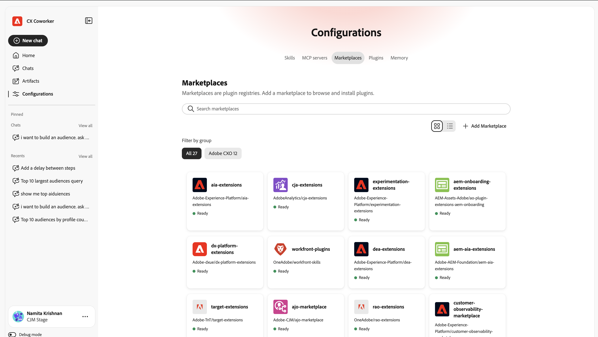

# Prise en main du chat des collègues {#ui-guide}

Le Module de conversation avec un collègue vous permet de travailler avec vos données et outils Adobe CX Enterprise en vous demandant ce dont vous avez besoin en langage clair. Utilisez cette page pour ouvrir le Chat des collègues, envoyer votre premier message et le configurer comme vous le faites.

>[!VIDEO](https://video.tv.adobe.com/v/3498558?learn=on)

## Disponibilité

Le Module de conversation avec un collègue est disponible sous la forme d’une expérience immersive, d’un espace de travail pleine page et d’une expérience intégrée au produit dans certaines applications CX Enterprise. Pour ouvrir l’expérience intégrée au produit, cliquez sur l’icône Coworker  en haut à droite de l’application.

Le tableau suivant indique où chaque expérience est disponible.

| Application CX Enterprise | Expérience immersive | Expérience intégrée au produit |
|---|---|---|
| Real-Time CDP | Disponible maintenant | Bientôt disponible |
| Adobe Journey Optimizer | Disponible maintenant | Bientôt disponible |
| Customer Journey Analytics | Disponible maintenant | Bientôt disponible |
| Workfront | Disponible maintenant | Prochainement :  * début septembre 2026 dans l’instance d’aperçu pour certains administrateurs système Workfront éligibles  * mi-septembre 2026 dans l’instance de production pour les clients Workfront à version rapide éligibles  * mi-octobre 2026 dans l’instance de production pour les clients Workfront à version trimestrielle éligibles |
| Cible | Disponible maintenant | Disponible maintenant |
| AEM | Disponible maintenant | Disponible maintenant |
| Marketo Engage | Disponible maintenant | Bientôt disponible |

## Ouvrir la conversation avec un collègue {#immersive}

Pour utiliser l’expérience immersive, connectez-vous avec vos informations d’identification Adobe. Vous pouvez l’ouvrir à partir d’un lien direct ou dans CX Enterprise.

1. Accédez à [&#128279;](https://experience.adobe.com/#/coworker).
1. Connectez-vous avec votre Adobe ID.

Vous pouvez également cliquer sur **[!UICONTROL Collègue]** dans le sélecteur d’applications de l’en-tête CX Enterprise.

## Choisissez votre organisation

Votre [organisation](https://experienceleague.adobe.com/fr/docs/core-services/interface/administration/organizations) et votre sandbox déterminent quelles données, compétences et outils connectés une conversation peut atteindre. Vérifiez-les avant de commencer. Le contexte actuel s’affiche au bas du rail de navigation de gauche, sous votre nom.

Pour modifier votre contexte :

1. Cliquez sur votre nom au bas du rail de navigation pour ouvrir le menu du compte.
1. Cliquez sur **[!UICONTROL Organisation]** et sélectionnez l’organisation IMS dans laquelle vous souhaitez travailler.

   

1. Cliquez sur **[!UICONTROL Sandbox]** et sélectionnez le sandbox AEP dans lequel vous souhaitez travailler.

   

Le menu du compte comprend également les options suivantes :

| Option | Utilisez-le pour |
| --- | --- |
| **[!UICONTROL Thème]** | Basculez entre les thèmes Clair et Sombre. |
| **[!UICONTROL Paramètres]** | Affichez les détails du compte et les paramètres de l’espace de travail. |
| **[!UICONTROL Applications CX]** | Accédez à une autre application CX Enterprise connectée à votre compte . |
| **[!UICONTROL Se déconnecter]** | Déconnectez-vous de votre compte Adobe. |

## Trouvez votre chemin

L’espace de travail comporte deux zones : le rail de navigation à gauche et la zone de travail de conversation qui remplit le reste de la fenêtre.

Utilisez le rail de navigation pour vous déplacer entre les parties du produit et revenir aux travaux récents.

| Option | Utilisez-le pour |
| --- | --- |
| **[!UICONTROL Nouvelle conversation]** | Démarrer une conversation. Chat Coworker enregistre votre chat actuel dans votre historique. |
| **[!UICONTROL Accueil]** | Revenez à la salutation, à la zone de saisie et aux invites suggérées. |
| **[!UICONTROL Conversations]** | Rechercher, épingler, archiver ou supprimer des conversations antérieures. |
| **[!UICONTROL Configurations]** | Gérez les compétences, les serveurs MCP, les places de marché, les modules externes et la mémoire. |
| **[!UICONTROL Épinglé]** | Ouvrez les conversations que vous avez démarrées. Cliquez sur **[!UICONTROL Afficher tout]** pour les voir sur la page Conversations. |
| **[!UICONTROL Récents]** | Ouvrez vos dernières conversations. Cliquez sur **[!UICONTROL Afficher tout]** pour ouvrir la page Conversations . |

## Envoyer votre premier message

L’écran d’accueil affiche un message d’accueil, la zone de saisie ([!UICONTROL Conversation]) et les invites suggérées en fonction de ce que la discussion entre collègues peut faire dans votre sandbox. Vous pouvez commencer par une suggestion ou écrire votre propre message.

Pour envoyer un message :

1. Cliquez sur **[!UICONTROL Accueil]** dans le rail de navigation.
1. Effectuez l’une des opérations suivantes :

   * Sélectionnez une invite sous **[!UICONTROL Suggérée pour vous]**. La discussion avec les collègues l’ajoute à la zone de saisie, où vous pouvez le modifier.
   * Saisissez votre propre demande dans le champ **[!UICONTROL Demander à un collègue]**.

1. (Facultatif) Ajoutez du contexte, choisissez la manière dont le Module de conversation des collègues répond ou dictez votre message. Voir [&#x200B; Ajouter du contexte et choisir un style de réponse](#input-options).
1. Cliquez sur **[!UICONTROL Envoyer]**.

>[!TIP]
>
>Les invites suggérées indiquent les types de tâches pris en charge par la discussion entre collaborateurs, comme le déplacement de schémas entre des sandbox, la recherche d’anomalies dans un parcours et la validation d’un jeu de données.

Pour pointer la conversation avec un collègue vers un objet spécifique dans votre sandbox, saisissez **+** dans la zone de saisie, puis cliquez sur un schéma, un parcours, un jeu de données ou un autre objet. Il s’agit d’une mention d’entité. Il indique à Coworker Chat exactement quel objet vous voulez dire.

## Ajouter du contexte et choisir un style de réponse {#input-options}

La barre d’outils située sous la zone de saisie contrôle les éléments joints, la manière dont la discussion entre collègues aborde la tâche et le volume de travail qu’elle affiche.

| Commande | Utilisez-le pour |
| --- | --- |
| **[!UICONTROL +]** (Joindre) | Ajoutez un fichier ou un objet sandbox à votre message. |
| **[!UICONTROL Mode Plan]** | Examinez un plan étape par étape avant que le Chat des collègues n’agisse. |
| **[!UICONTROL Vue Transcription]** | Choisissez le niveau d’activité du Chat des collègues que vous voyez. |
| **[!UICONTROL Microphone]** | Dictez votre message. Cliquez à nouveau dessus pour arrêter l’enregistrement. |
| **[!UICONTROL Envoyer]** | Envoyez votre message. Lorsque le Module de conversation du collègue répond, ce contrôle devient **[!UICONTROL Arrêter]**, ce qui interrompt la réponse. |

### Joindre un fichier ou un objet

Joignez un fichier ou un objet lorsque la discussion avec un collègue a besoin d’informations supplémentaires pour effectuer le travail.

1. Cliquez sur **[!UICONTROL +]** dans la zone de saisie.
1. Cliquez sur l’une des options suivantes :

   * **[!UICONTROL Joindre un fichier]** : téléchargez un fichier pour que le chat des collègues puisse le lire et le référencer.
   * **[!UICONTROL Ajouter des données ou un objet]** : référencez un objet dans votre sandbox, tel qu’un jeu de données ou un schéma, afin que la conversation avec les collègues fonctionne avec vos données actives.

### Examiner un plan avant l’action du Chat des collègues {#plan-mode}

Utilisez le mode Plan pour les tâches complexes ou les tâches qui modifient les données. Lorsque le mode Plan est activé, le Chat des collaborateurs propose un plan et attend votre approbation avant de l&#39;exécuter. Lorsque le mode Plan est désactivé, la discussion avec les collègues démarre le travail immédiatement.

1. Cliquez sur **[!UICONTROL Mode Plan]** dans la barre d’outils de saisie pour l’activer.
1. Envoyez votre message.
1. Examinez le plan et approuvez-le pour continuer.

### Choisir une vue de relevé de notes

La vue des transcriptions contrôle la proportion du raisonnement et de l’activité des outils du Chat des collègues qui apparaît dans la conversation.

1. Cliquez sur **[!UICONTROL Vue Transcription]** dans la barre d’outils de saisie.
1. Cliquez sur une vue :

   | Afficher | Ce que vous voyez |
   | --- | --- |
   | **[!UICONTROL Normal]** | Résumé des principales étapes de réflexion et de l’activité des outils. |
   | **[!UICONTROL Focus]** | Surtout la réponse. La conversation avec un collègue masque la plupart des étapes intermédiaires. |
   | **[!UICONTROL Verbose]** | Chaque étape de réflexion, la charge de compétence, la lecture de fichier et la requête. |

## Vérifier une réponse

Le Chat des collègues affiche son travail au fur et à mesure, puis renvoie une réponse. Une réponse peut inclure son raisonnement, un enregistrement des outils utilisés, des artefacts et un résumé.

### Suivre l’activité

Pendant que le Chat des collègues fonctionne, vous pouvez suivre et vérifier ce qu&#39;il fait. Développez une entrée pour afficher plus de détails.

* **Réfléchi pour** : Un bloc réductible avec le raisonnement de Coworker Chat et combien de temps cela a pris.
* **Compétence chargée** : fonctionnalité spécialisée Conversation avec le collègue utilisée pour la tâche.
* **Lire le fichier** et **Exécuter 1 requête** : les fichiers lus par Coworker Chat et les requêtes qu’il a exécutées, avec le temps que chacun a pris.

>[!TIP]
>
>Définissez **[!UICONTROL Vue Transcription]** sur **[!UICONTROL Verbose]** pour afficher chaque étape ou sur **[!UICONTROL Focus]** pour les masquer.

### Utilisation d’artefacts

La discussion avec les collègues affiche les résultats, tels qu’un tableau d’audiences, sous forme de cartes d’artefact dans la réponse. Vous pouvez télécharger un artefact de table sous la forme d’un fichier CSV à partir de sa carte. Lorsqu’une réponse comprend plusieurs artefacts, utilisez **[!UICONTROL Précédent]** et **[!UICONTROL Suivant]** pour passer d’un artefact à l’autre.

### Utiliser le résumé

Sous les artefacts, Coworker Chat explique ce que signifient les résultats, met en évidence les découvertes notables et suggère des actions de suivi. Utilisez ces suggestions pour poursuivre la conversation.

### Évaluer et copier une réponse

Chaque réponse inclut des contrôles que vous pouvez utiliser pour donner des commentaires ou réutiliser le contenu.

* Cliquez sur **[!UICONTROL Pouces vers le haut]** ou **[!UICONTROL Pouces vers le bas]** pour évaluer la réponse. Votre évaluation permet d’améliorer les réponses futures.
* Cliquez sur **[!UICONTROL Copier]**, puis choisissez **[!UICONTROL Copier en tant que Markdown]** pour conserver la mise en forme ou **[!UICONTROL Copier en tant que texte brut]** pour le supprimer.

## Gérer vos conversations

Votre historique de conversation conserve les conversations passées afin que vous puissiez y revenir. Cliquez sur **[!UICONTROL Conversations]** dans le rail de navigation pour l’ouvrir. Les conversations sont regroupées par date, et chaque ligne affiche le titre et le nombre de tours.

Sur la page Conversations, vous pouvez :

* Saisissez un nom dans **[!UICONTROL Rechercher par titre]** pour trouver une conversation.
* Cliquez sur **[!UICONTROL Afficher épinglé]** pour n’afficher que les conversations que vous avez démarrées.
* Cliquez sur **[!UICONTROL Afficher archivées]** pour afficher les conversations archivées.
* Cliquez sur **[!UICONTROL Nouveau chat]** pour démarrer une conversation.

Pour épingler, renommer, archiver ou supprimer une conversation, cliquez sur le menu de ligne (**[!UICONTROL ...]**) sur sa ligne et choisissez une option.

## Personnaliser la conversation avec un collègue

Les configurations vous permettent de contrôler ce que peut faire le Module de conversation des collègues. Cliquez sur **[!UICONTROL Configurations]** dans le rail de navigation, puis choisissez un onglet : **[!UICONTROL Compétences]**, **[!UICONTROL Serveurs MCP]**, **[!UICONTROL Marketplaces]**, **[!UICONTROL Plugins]** ou **[!UICONTROL Memory]**.

### Ajout et affichage des compétences

Les compétences sont des fonctionnalités spécialisées que le Module de conversation des collègues utilise automatiquement lorsqu’elles s’appliquent. Vous pouvez également commencer une compétence vous-même en tapant **/** dans le chat. L’onglet **[!UICONTROL Compétences]** répertorie chaque compétence installée.

1. Dans l’onglet **[!UICONTROL Compétences]**, cliquez sur **[!UICONTROL Ajouter Source]** pour installer des compétences à partir d’une nouvelle source.
1. Saisissez un nom dans **[!UICONTROL Rechercher]** pour trouver une compétence. Utilisez le bouton d’affichage pour basculer entre les dispositions de grille et de liste.
1. Sélectionnez une compétence pour voir le plug-in auquel il appartient, quand le Chat des collègues l’utilise, et les fichiers qu’il inclut.

   

1. (Facultatif) Cliquez sur **[!UICONTROL Afficher le fichier SKILL.md]** pour lire la définition complète de la compétence, ou cliquez sur **[!UICONTROL Supprimer Source]** pour désinstaller la compétence.

   

### Connexion des serveurs MCP

Les serveurs MCP (Model Context Protocol) connectent le Module de conversation des collaborateurs à des outils et services externes, tels que Adobe Journey Optimizer, Real-Time CDP, Target et Workfront. L’onglet **[!UICONTROL Serveurs MCP]** répertorie les serveurs connectés et le nombre de connexions actives. Chaque carte affiche le nom du serveur, son point d’entrée et les balises qui décrivent ce qu’elle fournit.

Pour connecter un serveur, cliquez sur **[!UICONTROL Ajouter un serveur]** et suivez les invites.

### Ajouter un marketplace

Un marketplace est un registre de modules externes que vous pouvez parcourir et installer. Dans l’onglet **[!UICONTROL Marketplaces]**, cliquez sur **[!UICONTROL Ajouter un marché]** pour en enregistrer un nouveau. Utilisez **[!UICONTROL Rechercher]** ou filtrer par groupe pour affiner la liste. Une marketplace avec le statut **Prêt** peut être installée à partir de.

### Gestion des modules externes

Un plug-in regroupe les compétences et les serveurs MCP afin que vous puissiez les installer et les gérer ensemble. L’onglet **[!UICONTROL Modules externes]** affiche les modules externes installés.

* Cliquez sur **[!UICONTROL Parcourir les marchés]** pour trouver de nouveaux modules externes.
* Filtrez par marketplace pour voir d&#39;où vient chaque plug-in.
* Cliquez sur **[!UICONTROL Désinstaller]** pour supprimer un plug-in et tout ce qu’il regroupe.

### Gestion de la mémoire

La mémoire permet au Module de conversation des collègues de mémoriser vos préférences dans les conversations, afin que les réponses restent pertinentes au fil du temps. Utilisez l’onglet **[!UICONTROL Memory]** pour contrôler ce qu’il conserve.

1. Cliquez sur **[!UICONTROL Mémoire]** sur la page Configurations.
1. Activez **[!UICONTROL Activer la mémoire]**. Désactivez-le pour empêcher le Module de conversation des collègues de se souvenir d’une session à l’autre.
1. Sous **[!UICONTROL Préférences stockées]**, passez en revue les informations enregistrées dans la conversation des collègues. Vous pouvez modifier, supprimer ou inspecter chaque entrée, et filtrer les entrées par catégorie.
1. Utilisez **[!UICONTROL Historique des mémoires enregistrées]** pour afficher une chronologie des modifications apportées à vos mémoires.

