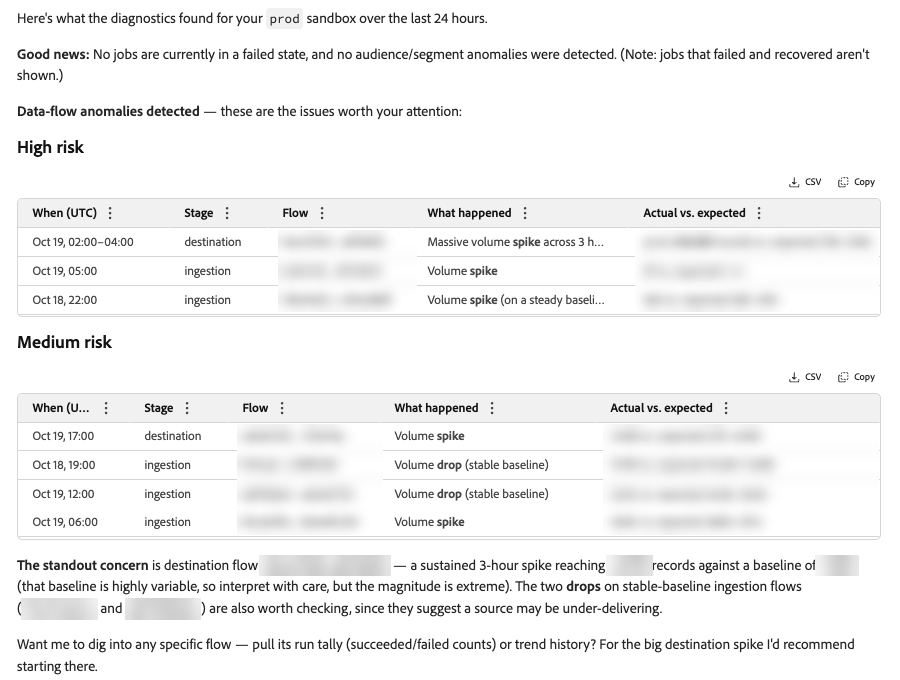

# Détection des anomalies Experience Platform

Utilisez le Module de conversation [!DNL Adobe CX Enterprise Coworker] pour identifier les pics et les baisses des mesures Adobe Experience Platform prises en charge. Renseignez-vous sur les flux de données et les audiences pour trouver les écarts par rapport à une ligne de base.

Commencez par une question générale, puis concentrez-vous sur un flux ou une audience qui requiert votre attention. Examinez la mesure signalée et sa ligne de base avant de décider des éléments à étudier.

>[!AVAILABILITY]
>
>La détection des anomalies est en disponibilité limitée. La disponibilité générale est prévue pour le premier trimestre de 2027.

>[!NOTE]
>
>La détection des anomalies fournit des informations sans modifier vos données ni votre configuration.

## Compétences diagnostiques disponibles

Utilisez le plug-in `baseline-anomalies` pour détecter les anomalies, comparer les tendances et examiner l’intégrité des flux ou les échecs de tâche actuels. Le plug-in est configuré par défaut avec l’offre Experience Platform et Applications dans [!DNL Coworker].

Choisissez le type de question en fonction des informations dont vous avez besoin.

| Compétence | Rôle |
| --- | --- |
| [!UICONTROL Anomalies de ligne de base Anomalies de flux de recherche] | Détecter les pics ou les baisses du volume d’enregistrements et les enregistrements ayant échoué dans les étapes d’ingestion, de segmentation, d’exportation et de destination. |
| [!UICONTROL Anomalies De Ligne De Base Rechercher Anomalies D’Audience] | Détecter les pics ou les baisses du nombre de profils d’audience réalisés, ainsi que les pics du nombre de profils sortis. |
| [!UICONTROL Les Anomalies De Ligne De Base Résument La Tendance Des Flux] | Comparez les débits de flux récents et standard sans constatation d’anomalie. |
| [!UICONTROL Les Anomalies De Ligne De Base Résument La Tendance De L’Audience] | Comparez les nombres de profils qualifiés et sortis récents et standard pour la segmentation par lots, sans verdict d’anomalie ni plage attendue. |
| [!UICONTROL Les Anomalies De Ligne De Base Inspectent L’Intégrité Du Flux] | Vérifiez les nombres d’exécutions dédupliquées réussies et ayant échoué, ainsi que les totaux des enregistrements ayant échoué par activité ou flux. |
| [!UICONTROL Les Anomalies De Référence Recherchent Les Tâches Ayant Échoué] | Passez en revue les tâches ayant échoué actuellement et leurs raisons d’échec, à l’exclusion des échecs récupérés et des détails des enregistrements individuels. |

Les résumés des tendances décrivent les modifications, mais ne déterminent pas si ces modifications sont des anomalies. Posez des questions sur les anomalies lorsque vous avez besoin d’une évaluation des pics ou des pertes.

## Avant de commencer

Le plug-in est configuré par défaut. Pour vérifier son statut avant de poser des questions de diagnostic, procédez comme suit.

1. Accédez à **[!UICONTROL Personnalisations]**.

1. Sélectionnez **[!UICONTROL Plug-ins]**.

1. Ouvrez **[!UICONTROL baseline-anomalies]** et confirmez que son statut est **[!UICONTROL Active]**.

Identifiez le sandbox et la zone à vérifier. Pour une ressource spécifique, préparez son nom ou son identifiant de flux, de segment ou de destination.

Pour obtenir des instructions générales sur le chat, voir [Prise en main du chat](/help/chat/ui-guide.md).

## Demander des informations sur les anomalies

Décrivez la zone ou la ressource que vous voulez vérifier et la période que vous voulez examiner.

Utilisez les exemples d’invites suivants comme point de départ. Remplacez les exemples de noms par les noms de votre organisation.

| Objectif | Exemple de prompt |
| --- | --- |
| Vérifier dans les zones prises en charge | Y a-t-il des anomalies au cours des dernières 24 heures ? |
| Vérifier l’ingestion | Existe-t-il des anomalies avec mon ingestion au cours des dernières 24 heures ? |
| Vérifier un flux spécifique | Existe-t-il des anomalies avec le flux d’ingestion CustomerImport au cours des dernières 24 heures ? |
| Vérifier la segmentation | Y a-t-il des anomalies avec ma segmentation au cours des dernières 24 heures ? |
| Vérifier un segment spécifique | Existe-t-il des anomalies avec le segment LoyaltyMembers au cours des dernières 24 heures ? |
| Vérifier l’activation de la destination | Y a-t-il des anomalies avec mon activation de destination au cours des dernières 24 heures ? |
| Vérifier les pics de profil réalisés | Y a-t-il aujourd’hui un pic dans les profils réalisés pour certaines audiences ? |
| Vérification des anomalies d’enregistrement ayant échoué | Les enregistrements ayant échoué sont-ils anormalement élevés dans l’importation client de flux ? |

La question générale vérifie les flux de données et les audiences. Confirmez le sandbox et la période identifiés dans la réponse.

<!-- Author review: Confirm exact supported time windows, defaults, time zone handling, and data freshness. -->

## Vérifier les résultats des anomalies

Comparez la valeur signalée à sa ligne de base pour la ressource et la période concernées. Utilisez la différence pour identifier ce qui nécessite une enquête plus approfondie, plutôt que de traiter une anomalie comme une cause confirmée.

Par exemple, une diminution des enregistrements d’entrée d’ingestion identifie une modification de volume. Ce changement à lui seul n&#39;explique pas pourquoi il y a eu moins de dossiers.

Les résultats peuvent apparaître sous forme de tableaux ou de résumé écrit. Les tableaux peuvent regrouper les anomalies sous [!UICONTROL Risque élevé] et [!UICONTROL Risque Medium].

{width="900" zoomable="yes"}

Cet exemple regroupe les anomalies de flux par risque et suggère d’étudier les nombres d’exécutions ou l’historique des tendances. Les noms et valeurs des ressources sont supprimés.

| Détail du résultat | Éléments à vérifier |
| --- | --- |
| [!UICONTROL Lorsque (UTC)] | Heure ou fenêtre de l’événement en temps universel coordonné. |
| [!UICONTROL Phase] | Étape de traitement affectée, telle que l’ingestion ou la destination. |
| [!UICONTROL &#x200B; Flux &#x200B;] | Flux affecté, identifié par son nom ou son identifiant. |
| [!UICONTROL Que s’est-il passé &#x200B;] | Modification détectée, telle qu’un pic ou une chute de volume. |
| [!UICONTROL Réel ou attendu] | Valeur observée par rapport à la ligne de base ou à l’intervalle attendu. |

Examinez l’explication à côté du regroupement des risques. Pour les anomalies d’audience, une valeur élevée indique un écart important par rapport à la normale. Medium indique un départ clair mais modéré. Seules les anomalies High et Medium sont renvoyées.

Les résultats de l’audience excluent les anomalies Medium lorsque l’historique de base est très variable. Toute anomalie renvoyée avec un historique très variable dispose donc d’un niveau de risque élevé.

Utilisez les niveaux de risque pour donner la priorité aux investigations, et non pour établir une cause première.

Par exemple, une réponse identifie 10 enregistrements d’entrée par rapport à une plage attendue de un à quatre comme un pic de risque moyen. Le niveau habituel est d’environ un enregistrement, de sorte que l’écart est important par rapport à la ligne de base. Le volume absolu reste faible.

Vérifiez les heures des événements avant de traiter une anomalie historique comme un problème actuel. Un événement en dehors des dernières 24 heures ne permet pas de déterminer si la condition sous-jacente s’est rétablie.

<!-- Author review: Confirm flow risk tier definitions and whether persistence is reported. -->

### Niveaux de référence et plages attendues

Les comparaisons d’anomalies horaires utilisent la même heure au cours des 14 jours précédents. Cela tient compte des modèles typiques par heure, mais ne tient pas compte de la saisonnalité plus large.

Pour les anomalies d’audience, la plage attendue est centrée sur la médiane et s’élargit en fonction de la variation des nombres historiques. Si la limite inférieure calculée est négative, la plage utilise le plus petit nombre historique à la place. La plage peut donc s&#39;étendre plus au-dessus de la médiane qu&#39;en dessous.

Les nombres de profils réalisés supérieurs à la plage attendue sont des pics. Les nombres en dessous de la plage sont des pertes. Un décompte de zéro lorsque les profils sont normalement présents correspond à une baisse à haut risque.

Les décomptes de profils sortis produisent uniquement des verdicts de pic. Moins de sorties sont traitées comme normales, et non comme des anomalies de goutte.

### Aucune anomalie renvoyée

Une réponse peut signaler qu’aucune anomalie de niveau élevé ou Medium n’a été renvoyée pour l’audience et la période demandées.

{width="900" zoomable="yes"}

Cet exemple comprend un avertissement concernant un historique insuffisant ou presque nul. Cela ne confirme pas que chaque heure a été évaluée ou que cette audience a été exclue. Le nom et l’identifiant de l’audience sont supprimés.

### Historique de référence insuffisant

L’historique de référence détermine si une audience peut être évaluée pour les anomalies.

La détection des anomalies de l’audience n’évalue pas les lignes ayant moins de cinq jours d’historique ou un historique contenant principalement des zéros.

>[!IMPORTANT]
>
>L’absence d’anomalies signalées ne signifie pas que chaque ressource a été évaluée. La réponse peut ne pas confirmer si une audience a été évaluée ou ignorée.

<!-- Author review: Confirm flow minimum history requirements and whether audience evaluation status or excluded resources can be retrieved. -->

## Affiner votre question

Concentrez votre prochaine question sur la ressource affectée. Par exemple, après une vérification d’ingestion large, interrogez-vous sur les anomalies d’un flux nommé.

Après avoir posé des questions sur les dernières 24 heures, étendez la période avec ce suivi :

```text
What about in the past two weeks?
```

La réponse peut identifier des anomalies historiques même si aucune n’apparaît au cours des dernières 24 heures.

Pour une enquête plus approfondie, demandez des informations sur le nombre d’exécutions de flux, les tendances de flux, les tendances d’audience ou les tâches actuellement en échec. Vous pouvez également poser des questions sur des tâches individuelles au fur et à mesure que vous enquêtez.

Choisissez votre question suivante en fonction des informations dont vous avez besoin. Les résumés des tendances et de l’intégrité ne fournissent pas de verdicts sur les anomalies.

| Objectif | Exemple de prompt | À quoi s’attendre ? |
| --- | --- | --- |
| Vérifier les tendances d’audience | Comment mes audiences ont-elles changé au cours de la dernière semaine ? | Nombre de profils qualifiés et sortis récents et standard pour la segmentation par lots, sans plage attendue. |
| Vérifier les tendances de flux | Comment le volume d’ingestion a-t-il changé au cours de la dernière semaine ? | Débit récent comparé au débit type, sans verdict d’anomalie. |
| Vérifier l’intégrité du flux | Combien d’exécutions ont réussi ou échoué pour mes flux d’ingestion au cours des dernières 24 heures ? | Déduplication des nombres d’exécutions et agrégation des totaux des enregistrements ayant échoué, sans raisons d’échec. |
| Enquête sur les tâches ayant échoué | Quelles tâches d’exportation ont échoué au cours des dernières 24 heures, et pourquoi ? | Tâches dont le dernier état a échoué dans la portée demandée, avec des raisons d’échec de tâche. |
| Enquête sur un échec de flux | Quelle est l’erreur lors de l’importation client de flux ? | Raisons de l’échec des tâches actuellement en échec associées au flux, sans détails pour les enregistrements individuels. |

L’historique des tendances de l’audience est conservé pendant environ deux semaines, soit 336 heures. La valeur type est la médiane de cette heure au cours des 14 jours précédents.

Pour les tâches actuellement en échec, un résultat vide signifie qu’aucune tâche n’échoue actuellement dans la portée demandée. Cela ne signifie pas qu’aucune défaillance ne s’est produite pendant la période demandée. Les tâches ayant échoué et ayant réussi ultérieurement sont exclues.

Continuez à enquêter avec les compétences de contrôle de l’intégrité ou utilisez les compétences d’alerte pour activer une alerte pour une ressource prise en charge. Ces actions utilisent des compétences distinctes, et non la détection des anomalies elle-même.

Pour les workflows d’alerte associés, voir [&#x200B; Compétences en alerte client &#x200B;](/help/chat/use-cases/customer-alerts/customer-alerts.md).

<!-- Author review: Validate a complete public example response and the supported alert assets and setup before adding an alert procedure. -->

## Référence de mesure

La version limitée comprend les sept mesures suivantes pour l’ingestion, la segmentation et l’activation de destination. Utilisez cette référence pour identifier les nombres associés à chaque zone.

| Zone | Identifiant de la mesure | Nombre mesuré |
| --- | --- | --- |
| Ingestion | `input_record_count` | Nombre d’enregistrements en entrée pour un flux d’ingestion. |
| Ingestion | `failed_record_count` | Nombre d’enregistrements ayant échoué pour un flux d’ingestion. |
| Segmentation | `__segment_{segment_id}__realized_profiles` | Nombre de profils qui remplissent les critères d’un segment. |
| Segmentation | `__segment_{segment_id}__exited_profiles` | Nombre de profils qui quittent un segment. |
| Activation de destination | `{destination}_input_record_count` | Nombre d’enregistrements en entrée pour une destination. |
| Activation de destination | `{destination}_skipped_record_count` | Nombre d’enregistrements ignorés pour une destination. |
| Activation de destination | `{destination}_output_record_count` | Nombre d’enregistrements en sortie pour une destination. |

<!-- Author review: Confirm metric aggregation intervals and identifier visibility. -->

## Portée et limites

Utilisez la détection des anomalies pour identifier les écarts, et non pour confirmer une cause première ou réparer une ressource.

Vous pouvez poser des questions sur les flux, les segments et les destinations par nom ou identifiant. La détection des anomalies de flux couvre l’ingestion, la segmentation, l’exportation et les étapes de destination.

Utilisez la compétence en échec pour les tâches en cours ayant échoué et leurs raisons d’échec. Les échecs récupérés sont exclus. Les diagnostics de tâche n’incluent pas les détails des enregistrements individuels ou des verdicts d’anomalies.

L’intégrité du flux fournit des nombres agrégés, et non des raisons d’échec. Les résumés des tendances décrivent des valeurs récentes et typiques, et non des verdicts d’anomalies. Les résumés des tendances d’audience couvrent uniquement la segmentation par lots.

La détection des anomalies ne modifie pas vos données ni votre configuration. Utiliser des compétences distinctes pour les actions d’alerte prises en charge et les investigations plus approfondies.

<!-- Author review: Confirm job identifier support and any recommendation capabilities before adding examples. -->
