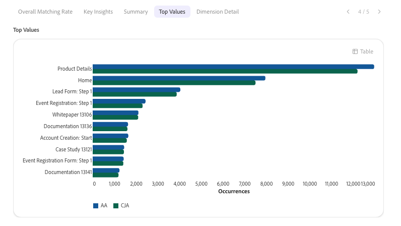

# Présentation de l’implémentation et de l’administration intelligentes

Utilisez le Module de conversation Adobe CX Enterprise Coworker pour configurer, migrer et gérer votre implémentation d’analyses, et pour vous assurer que vous pouvez faire confiance aux données qui se cachent derrière chaque réponse. Un collègue peut planifier votre implémentation, transformer ce plan en liste de contrôle que votre équipe peut suivre et valider vos données après leur collecte.

La mise en œuvre et l’administration intelligentes font partie des nombreux domaines d’analyse abordés dans le chat Coworker. Pour afficher tous les domaines, voir [Commencer à analyser dans le chat des collègues](/help/chat/use-cases/data-insights/analytics-overview.md#start-analyzing-in-coworker-chat) dans Analyser les données avec le chat des collègues.

**Idéal pour :** Admin

## Adéquation du workflow d’implémentation

Les cas d’utilisation de cette page suivent un workflow en trois étapes facultatif. Vous pouvez utiliser n’importe quelle étape seule. Par exemple, vous pouvez valider vos données sans générer au préalable de plan ou de liste de contrôle.

1. **Plan :** obtenez un plan de mise en œuvre ou de mise à niveau personnalisé et ordonné. Voir [Planifier la mise en œuvre avec un collègue](/help/chat/use-cases/data-insights/implementation-guide.md).
1. **Implémenter :** transformer votre plan en liste de contrôle dans les projets de collègues que votre équipe peut affecter et suivre. Voir [ Générer une liste de contrôle d’implémentation avec les projets de collègues](/help/chat/use-cases/data-insights/intelligent-checklist.md).
1. **Valider :** vérifiez que vos données sont correctement configurées et collectées. Voir les cas d’utilisation de validation dans le tableau [Cas d’utilisation](#use-cases).

## Conditions préalables

<!-- FLAG: Confidence: Medium for the shared bullets. They differ from the other domain pages on purpose: planning doesn't query your data, and Experience Platform validation uses Experience Platform datasets rather than data views or report suites. The permission inheritance for Experience Platform is inferred. High for the "Additional prerequisite" notes in the Use cases table, which are sourced from the "Before you begin" section of each linked article. Some of those articles flag their own prerequisites as unconfirmed (implementation-guide.md, intelligent-checklist.md, streaming-media-validation.md), so verify those rows when those flags are resolved. Validate dataset quality for Customer Journey Analytics is a video page with no stated prerequisites, so it isn't listed. -->

Pour utiliser les cas pratiques de cette page, vous avez besoin des éléments suivants :

* Accès au chat des collègues. Voir [Commencer à analyser les données avec la discussion entre collègues](/help/chat/use-cases/data-insights/analytics-chat.md).
* Affichez l’accès aux données que vous souhaitez valider. La discussion avec les collègues hérite de vos autorisations des applications Adobe auxquelles elle se connecte.

## Cas d’utilisation

| Cas d’utilisation | Fonction |
| --- | --- |
| [Planifier la mise en œuvre](/help/chat/use-cases/data-insights/implementation-guide.md)

 | Crée un plan détaillé et personnalisé pour la mise en œuvre de Customer Journey Analytics, la mise à niveau à partir d’Adobe Analytics ou la configuration de la collecte de Content Analytics, Marketing Campaign Analytics ou de médias en flux continu sur Edge. Les plans incluent des détails tels que les propriétaires, les estimations d&#39;effort, les dépendances et les étapes de validation.
**Exemple d’invite :** « Aide-moi à planifier l’implémentation de Customer Journey Analytics »

**Condition préalable supplémentaire :** en plus des [conditions préalables générales](#prerequisites), ce cas d’utilisation nécessite également que vous sachiez quel chemin d’implémentation vous concerne et des détails de base sur votre environnement actuel, tels que votre statut de licence ou votre chemin d’ingestion de données prévu.

Pour plus d’informations, voir [Planifier la mise en œuvre avec un collègue](/help/chat/use-cases/data-insights/implementation-guide.md).
 |
| [Générer une liste de contrôle d’implémentation](/help/chat/use-cases/data-insights/intelligent-checklist.md)

 
Expérimental
 | Transforme votre plan de mise en œuvre Customer Journey Analytics en une liste de contrôle dans les projets de collègues, où votre équipe peut affecter des étapes, suivre le statut et ajouter des points de contrôle d’approbation.
**Condition préalable supplémentaire :** en plus des [conditions préalables générales](#prerequisites), ce cas d’utilisation nécessite également une conversation sur le guide de mise en œuvre terminé et l’accès aux projets de collègues dans votre entreprise.

Pour plus d’informations, voir [Générer une liste de contrôle d’implémentation avec des projets collègues](/help/chat/use-cases/data-insights/intelligent-checklist.md).
 |
| [Valider les données lors de la mise à niveau d’Adobe Analytics vers Customer Journey Analytics](/help/chat/use-cases/data-insights/data-validation-aa-cja.md)

 | Compare les dimensions, mesures et tendances entre vos suites de rapports Adobe Analytics et vos vues de données Customer Journey Analytics, signale les incohérences, puis recommande des correctifs pour prendre en charge votre mise à niveau.
**Idéal pour :** administrateur, analyste

**Exemples d’invites :**
<ul><li>« Comparer ma suite de rapports AA à ma vue de données CJA »</li><li>« Quelles mesures ne correspondent pas entre AA et CJA ? »</li></ul>
**Condition préalable supplémentaire :** en plus des [conditions préalables générales](#prerequisites), ce cas d’utilisation nécessite également la suite de rapports Adobe Analytics que vous souhaitez valider, ainsi que la vue de données Customer Journey Analytics contenant les mêmes données.

Pour plus d’informations, consultez [Validation des données avec un collègue lors de la mise à niveau d’Adobe Analytics vers Customer Journey Analytics](/help/chat/use-cases/data-insights/data-validation-aa-cja.md).
 |
| [Valider la mise en œuvre de Streaming Media](/help/chat/use-cases/data-insights/streaming-media-validation.md)

 
Expérimental
 | Vérifie le flux de données, le schéma, le jeu de données, la vue de données et les données de session pour confirmer que le suivi des médias en flux continu est configuré et que la collecte de données est correcte.
**Exemple d’invite :** « Dans quelle mesure mon implémentation des médias en flux continu est-elle globalement saine ? »

**Condition préalable supplémentaire :** en plus des [conditions préalables générales](#prerequisites), ce cas d’utilisation nécessite également que les données Experience Platform et Customer Journey Analytics de votre organisation soient connectées à Coworker. Pour certains modes de validation, vous avez également besoin d’un identifiant de session vidéo ou d’un fichier journal.

Pour plus d’informations, voir [Valider l’implémentation de Streaming Media avec vos collègues](/help/chat/use-cases/data-insights/streaming-media-validation.md).
 |
| [Valider la qualité du jeu de données pour Customer Journey Analytics](/help/chat/use-cases/data-insights/validate-dataset-quality-for-cja.md)

 
Expérimental (la semaine prochaine)
 | Identifie les jeux de données qui alimentent vos rapports Customer Journey Analytics, puis vérifie les schémas, la qualité des identités et la qualité des champs afin que vous puissiez résoudre les problèmes avant de créer des tableaux de bord.
Pour plus d’informations, voir [Validation des données de Customer Journey Analytics avec les compétences de validation des données dans Coworker](/help/chat/use-cases/data-insights/validate-dataset-quality-for-cja.md).
 |
| [Valider les données après ingestion dans Experience Platform](/help/chat/use-cases/data-insights/data-validation-aep.md)

 | Exécute des contrôles statistiques et sémantiques sur les jeux de données et les champs d’Experience Platform pour identifier les problèmes de qualité des données, tels que des valeurs non valides ou des problèmes de mappage, après une nouvelle implémentation ou dans le cadre de la gestion continue des données.
**Exemples d’invites :**
<ul><li>« Valider le jeu de données [nom du jeu de données] »</li><li>« Valider le [champ de données] à partir du jeu de données [nom du jeu de données] »</li></ul>
**Condition préalable supplémentaire :** en plus des [conditions préalables générales](#prerequisites), ce cas d’utilisation nécessite également le nom ou l’identifiant du jeu de données à valider. Vous pouvez éventuellement fournir le nom d’un champ spécifique à valider.

Pour plus d’informations, voir [Valider vos données Experience Platform avec un collègue](/help/chat/use-cases/data-insights/data-validation-aep.md).
 |
| [Accélérer les informations sur les données](/help/chat/use-cases/data-insights/accelerate-data-insights.md) | Montre dans une vidéo comment Coworker planifie votre implémentation, exécute les actions prises en charge et guide les étapes de produit et de développement sur Adobe Experience Manager, Experience Platform, Web SDK et Customer Journey Analytics jusqu’à ce que les données d’engagement de votre site web soient prêtes à être analysées.
Pour plus d’informations, voir [Accélérer les informations sur les données avec Coworker, AEM et CJA](/help/chat/use-cases/data-insights/accelerate-data-insights.md).
 |

## Compétences utilisées

<!-- FLAG: Confidence: High for `aa-cja-validation` (listed in the Skills and limitations table and in workflows.md). Medium for `data-validation`: workflows.md lists it, but with a TODO to confirm the skill ID with engineering. Medium for the implementation guide skills and the Streaming Media Validation skill: the articles name them but don't give technical skill IDs, so they're listed by display name. Only `aa-cja-validation` currently appears in the Skills and limitations table on analytics-overview.md. Add the others there so the link below covers them. -->

Mon collègue utilise les compétences suivantes pour les cas d’utilisation décrits dans cet article. Pour obtenir la liste de toutes les compétences en analyse, y compris les autorisations dont ils ont besoin et ce qu’ils ne couvrent pas, voir [Compétences et limites](/help/chat/use-cases/data-insights/analytics-overview.md#skills-and-limitations) dans la section Analyser les données avec le chat d’un collègue.

| Compétence | Utilisé pour |
| --- | --- |
| Compétences du guide de mise en œuvre (une pour Customer Journey Analytics, une mise à niveau d’Adobe Analytics vers Customer Journey Analytics, Content Analytics, Marketing Campaign Analytics et Streaming Media) | Planification de la mise en œuvre |
| `aa-cja-validation` | Valider les données lors de la mise à niveau d’Adobe Analytics vers Customer Journey Analytics |
| Compétence de validation des médias en flux continu | Validation de la mise en œuvre de Streaming Media |
| Compétence en validation des données (`data-validation`) | Valider la qualité du jeu de données pour  Valider les données après ingestion dans Experience Platform |

## Conseils pour de meilleurs résultats

* Nommez la suite de rapports et la vue de données spécifiques que vous souhaitez comparer lors de la validation des données.
* Utilisez les résultats de validation comme guide pour vos propres modifications. Les compétences Validation des médias en flux continu et Validation des données identifient les problèmes, mais ne modifient pas votre configuration ou vos données.
* Réexécutez la validation Streaming Media après chaque modification d’implémentation. Il s’exécute à la demande et ne fournit pas de surveillance continue.
* Utilisez les compétences du guide de mise en œuvre uniquement à des fins de planification. Ils n’accèdent pas à vos systèmes Adobe et n’effectuent pas la mise en œuvre.

## Étapes suivantes

* Pour obtenir un aperçu de l’analyse des données avec le Module de conversation des collègues, y compris les autres domaines d’analyse et les bonnes pratiques, consultez [Analyse des données avec le Module de conversation des collègues](/help/chat/use-cases/data-insights/analytics-overview.md).
* Pour configurer le Chat Coworker et parcourir un exemple pratique, consultez [Commencer à analyser les données avec le Chat Coworker](/help/chat/use-cases/data-insights/analytics-chat.md).
