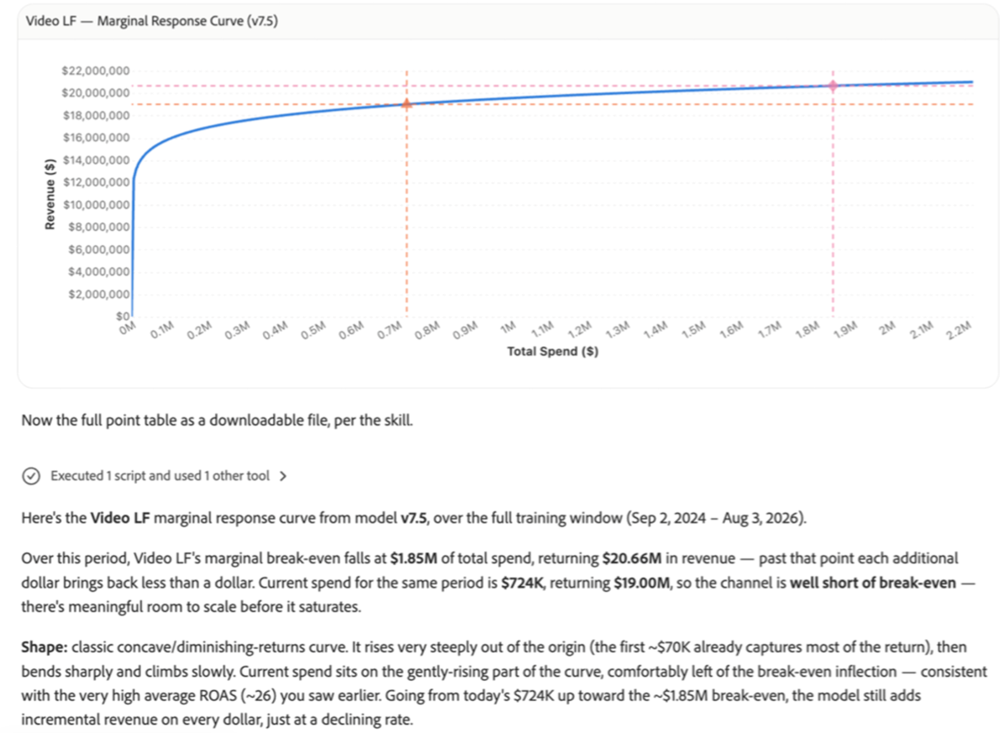

# Présentation de la mesure et de l’attribution marketing

<!-- FLAG: Confidence: High for the first sentence and "Best for" (carried over from analytics-overview.md). Medium for the second sentence, which summarizes the row descriptions from the slides. -->

Utilisez le Module de conversation Adobe CX Enterprise Coworker pour comprendre l’impact incrémentiel de chaque canal et campagne marketing afin que vous puissiez allouer des dépenses pour optimiser le retour sur investissement. Découvrez comment les canaux fonctionnent ensemble, où les dépenses supplémentaires ne rapportent plus et comment les différentes allocations budgétaires se comparent avant votre engagement.

La mesure et l’attribution marketing sont l’un des nombreux domaines d’analyse dans le chat des collègues. Pour afficher tous les domaines, voir [Commencer à analyser dans le chat des collègues](/help/chat/use-cases/data-insights/analytics-overview.md#start-analyzing-in-coworker-chat) dans Analyser les données avec le chat des collègues.

**Idéal pour :** Analyste, Utilisateur professionnel

## Conditions préalables

<!-- FLAG: Confidence: High for the shared bullets (sourced from analytics-chat.md and the Skills and limitations table). They're confirmed for Measure campaign performance only; whether the marketing mix modeling use cases also need a data view or report suite connection is unknown. Low for the "Additional prerequisite" notes on the four marketing mix modeling rows in the Use cases table: incremental impact, response curves, budget scenarios, and model retraining describe a marketing mix model, but no source names the product or data that these use cases need. It could be Adobe Mix Modeler or Marketing Campaign Analytics (listed as an implementation path in implementation-guide.md). Confirm with the PM before publishing. -->

Pour utiliser les cas pratiques de cette page, vous avez besoin des éléments suivants :

* La conversation avec un collègue est connectée à vos vues de données Customer Journey Analytics ou suites de rapports Adobe Analytics. Voir [Commencer à analyser les données avec la discussion entre collègues](/help/chat/use-cases/data-insights/analytics-chat.md).
* Accès en affichage aux vues de données ou aux suites de rapports à analyser. La discussion avec les collègues hérite de vos autorisations de Customer Journey Analytics ou d’Adobe Analytics.

## Cas d’utilisation

| Cas d’utilisation | Fonction |
| --- | --- |
| Découvrir l’impact incrémentiel de chaque canal | Affiche la valeur incrémentielle de chaque canal, la manière dont les canaux s’amplifient les uns les autres et le rôle des facteurs externes.
**Exemples d’invites :**
<ul><li>« Quels canaux ont généré le plus de conversions incrémentielles ? »</li><li>« Comment le référencement payant et l’affichage s’amplifient-ils mutuellement ? »</li></ul>
**Condition préalable supplémentaire :** outre les [conditions préalables générales](#prerequisites), ce cas d’utilisation nécessite également un modèle de mesure marketing formé. *[Les exigences en matière de produit et de configuration doivent être confirmées.]*
 |
| Trouver où les dépenses commencent à saturer

 | Affiche des courbes de réponse qui indiquent où les dépenses supplémentaires cessent de rapporter.
**Exemples d’invites :**
<ul><li>« Où les dépenses de référencement payant commencent-elles à saturer ? »</li><li>« Afficher les courbes de réponse pour chaque canal »</li></ul>
**Condition préalable supplémentaire :** outre les [conditions préalables générales](#prerequisites), ce cas d’utilisation nécessite également un modèle de mesure marketing formé. *[Les exigences en matière de produit et de configuration doivent être confirmées.]*
 |
| Créer des scénarios budgétaires de simulation | Compare les options d&#39;allocation côte à côte pour soutenir les décisions de planification.
**Idéal pour :** utilisateur professionnel

**Exemples d’invites :**
<ul><li>« Créer des scénarios de budget pour le trimestre prochain »</li><li>« Que se passerait-il si je déplaçais 10 % des dépenses de l’affichage vers la recherche ? »</li></ul>
**Condition préalable supplémentaire :** outre les [conditions préalables générales](#prerequisites), ce cas d’utilisation nécessite également un modèle de mesure marketing formé. *[Les exigences en matière de produit et de configuration doivent être confirmées.]*
 |
| Vérifier la qualité du modèle et quand effectuer une nouvelle formation | Inspecte la qualité du modèle, les détails de la formation et les mesures de score afin que vous sachiez à quel point une réponse est fiable.
**Idéal pour :** Analyste

**Exemples d’invites :**
<ul><li>« Y a-t-il d&#39;autres facteurs dont nous avons besoin pour ce modèle ? »</li><li>« Ce modèle a-t-il besoin d’être recyclé ? »</li></ul>
**Condition préalable supplémentaire :** outre les [conditions préalables générales](#prerequisites), ce cas d’utilisation nécessite également un modèle de mesure marketing formé. *[Les exigences en matière de produit et de configuration doivent être confirmées.]*
 |
| [Mesurer les performances de la campagne](/help/chat/use-cases/workflows.md#data-insights) | Découvrez les performances des campagnes, des canaux et des propriétés web sur une période donnée.
**Exemple d’invite :** « Quelles ont été les performances de nos campagnes web Acrobat le mois dernier ? »

Pour plus d’informations, voir [Informations sur les données](/help/chat/use-cases/workflows.md#data-insights) dans les cas d’utilisation du chat des collègues.
 |

## Compétences utilisées

<!-- FLAG: Confidence: High for Measure campaign performance (workflows.md lists `cja`, `aa`, `dx-api`, and `knowledge-graph` for "Campaign performance"). `dx-api` and `knowledge-graph` aren't in the Skills and limitations table on analytics-overview.md. Low for the other four use cases: no source names their skills. Get the skill IDs from the PM, replace the placeholder row, and add the skills to the Skills and limitations table. -->

Mon collègue utilise les compétences suivantes pour les cas d’utilisation décrits dans cet article. Pour obtenir la liste de toutes les compétences en analyse, y compris les autorisations dont ils ont besoin et ce qu’ils ne couvrent pas, voir [Compétences et limites](/help/chat/use-cases/data-insights/analytics-overview.md#skills-and-limitations) dans la section Analyser les données avec le chat d’un collègue.

| Compétence | Utilisé pour |
| --- | --- |
| `cja`, `aa`, `dx-api`, `knowledge-graph` | Mesurer les performances de la campagne |
| *[Compétence à confirmer]* | Découvrez l’impact incrémentiel de chaque canal Trouvez où les dépenses commencent à saturer Créez des scénarios de simulation budgétaire Vérifiez la qualité du modèle et quand vous recycler |

## Conseils pour de meilleurs résultats

<!-- FLAG: Confidence: Medium. The first two bullets are adapted from the best practices in analytics-overview.md. The third bullet is inferred from the sample prompts. -->

* Nommez les canaux, les campagnes et les périodes à analyser.
* Mentionnez toute hypothèse que vous avez déjà, par exemple deux canaux qui fonctionnent ensemble, afin que le Chat des collègues puisse la valider ou l’exclure.
* Indiquez le changement de budget spécifique que vous souhaitez tester lors de la création de scénarios de simulation, comme le déplacement de 10 % des dépenses d’un canal à un autre.

## Étapes suivantes

* Pour obtenir un aperçu de l’analyse des données avec le Module de conversation des collègues, y compris les autres domaines d’analyse et les bonnes pratiques, consultez [Analyse des données avec le Module de conversation des collègues](/help/chat/use-cases/data-insights/analytics-overview.md).
* Pour configurer le Chat Coworker et parcourir un exemple pratique, consultez [Commencer à analyser les données avec le Chat Coworker](/help/chat/use-cases/data-insights/analytics-chat.md).
