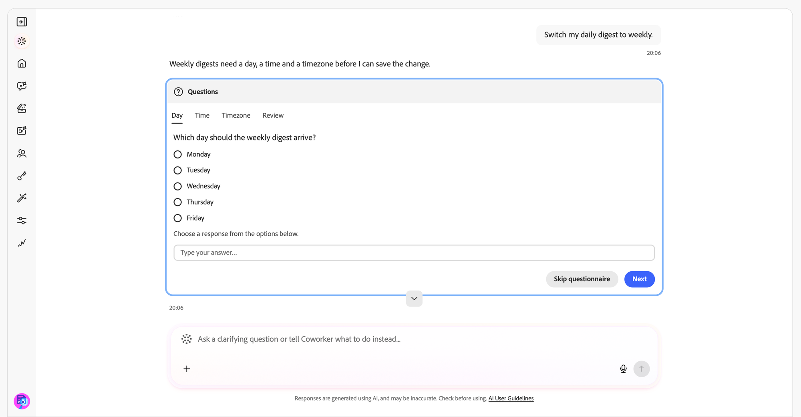

# Compétences en notification {#notification-skills}

Utilisez les compétences en notification dans Adobe CX Enterprise Coworker pour examiner les notifications, identifier les éléments d’action et gérer les préférences de notification par le biais de conversations. Utilisez les notifications que vous recevez déjà dans le panneau de notifications de l’ensemble de vos applications Adobe CX Enterprise.

Résumer les notifications, rechercher des éléments spécifiques et regrouper les notifications répétées en problèmes distincts. Ouvrez une notification dans son application, marquez-la comme lue ou non lue, ou définissez un rappel.

>[!AVAILABILITY]
>
>Les compétences en notification sont disponibles pour tous les clients ayant accès à Adobe CX Enterprise Coworker. Aucune configuration supplémentaire n’est nécessaire pour utiliser les compétences.
>
>Pour recevoir des notifications en [!DNL Slack], votre organisation doit disposer d’un espace de travail [!DNL Slack] connecté.

## Avant de commencer {#before-you-begin}

Avant de commencer, vérifiez que vous disposez des éléments suivants :

* Accès à Adobe CX Enterprise Coworker.
* Accès à une ou plusieurs applications Adobe CX Enterprise qui vous envoient des notifications.
* Un espace de travail [!DNL Slack] connecté pour votre organisation si vous souhaitez recevoir des notifications dans [!DNL Slack].

## Vérifier les notifications et agir en conséquence {#review-and-act}

Commencez par un résumé, puis affinez votre requête et agissez sur une notification spécifique.

1. Ouvrez la discussion avec vos collègues. Pour obtenir des instructions, voir [Prise en main du chat avec un collègue](/help/chat/ui-guide.md).
1. Saisissez une demande dans le champ **[!UICONTROL Demander à un collègue]** puis sélectionnez **[!UICONTROL Envoyer]**. Par exemple :

   *« Qu&#39;est-ce qui mérite mon attention aujourd&#39;hui ?«*

1. Examinez les notifications qui nécessitent une action et celles fournies à des fins de sensibilisation.

   

1. Saisissez une question de suivi pour affiner les résultats. Par exemple :

   *« Parmi ces notifications, y a-t-il des échecs dans Experience Platform que je dois connaître ? »*

   

1. Demandez des détails sur une notification ou ouvrez-la dans son application pour l’examiner.
1. Demander à marquer une notification comme lue ou définir un rappel. Par exemple :

   *« Rappelez-moi demain l’alerte de taux d’événements entrants hautement prioritaire.«*

   

Poursuivez la conversation sans répéter le contexte des requêtes précédentes. Si votre requête peut s’appliquer à plusieurs notifications, applications ou paramètres, répondez à la question de clarification avant de continuer.

Vous recevez une demande de confirmation avant une modification qui va au-delà de votre demande.

## Cas d’utilisation pris en charge {#supported-use-cases}

Utilisez les compétences en matière de notification pour examiner les notifications qui vous sont envoyées, agir sur celles-ci et gérer la manière dont vous les recevez.

>[!NOTE]
>
>Les compétences en matière de notification n’envoient, ne partagent ou ne suppriment pas de notifications.

### Identification des éléments d&#39;action {#identify-action-items}

Demandez à quelles notifications vous devez prêter attention dans vos applications Adobe CX Enterprise.

Exemples d’invites :

* « Qu&#39;est-ce qui mérite mon attention aujourd&#39;hui ? »
* « Attrape-moi. »
* « Quelque chose en attente pour moi ? »

### Résumer les notifications {#summarize-notifications}

Demander un résumé pour une période ou une application. Examinez les éléments d’action séparément des notifications fournies à des fins de sensibilisation. Les notifications répétées sont regroupées en événements distincts et ne sont pas répertoriées individuellement.

Exemples d’invites :

* « Résumer mes notifications de la semaine passée. »
* « Me donner un aperçu de mes notifications du dernier jour. »
* « Résumer mes notifications Adobe Journey Optimizer. »

### Rechercher des notifications spécifiques {#find-specific-notifications}

Filtrez les notifications selon des critères tels que le statut non lu, les demandes d’approbation, les échecs, les erreurs ou les mises à jour de produits.

Exemples d’invites :

* « Afficher uniquement les notifications non lues. »
* « Afficher mes demandes d’approbation. »
* « Existe-t-il des alertes de panne critiques que je dois connaître ? »
* « Afficher les notifications de mise à jour pour Experience Platform. »

### Vérifier les détails de la notification {#review-notification-details}

Demandez les détails complets d’une notification telle qu’elle a été envoyée. Si plusieurs notifications correspondent à votre demande, indiquez laquelle vous voulez dire.

Exemples d’invites :

* « En savoir plus sur la notification de parcours. »
* « Que signifie cette alerte pour moi ? »

### Agir sur les notifications {#act-on-notifications}

Ouvrez une notification dans son application, marquez les notifications comme lues ou non lues, ou définissez un rappel. Choisissez un rappel pour cinq minutes, 15 minutes, une heure ou demain.

Exemples d’invites :

* « Marquer cette notification comme lue. »
* « Marquer cette notification comme non lue. »
* « Me rappeler cette notification dans une heure. »
* « Marquer toutes mes notifications comme lues. »

### Gérez les préférences de notification {#manage-notification-preferences}

Renseignez-vous sur vos paramètres actuels avant de modifier la manière dont vous recevez les notifications. Spécifiez la catégorie de notification ou d’application à mettre à jour.

| Préférence | Modifications disponibles |
| --- | --- |
| Canaux de diffusion | Activez ou désactivez les notifications dans l’application, les notifications par e-mail ou les notifications [!DNL Slack] pour une application ou une catégorie. |
| Fréquence des e-mails | Choisissez une diffusion immédiate par e-mail ou un résumé quotidien ou hebdomadaire. |
| Priorité de catégorie | Choisissez les catégories de notification ayant une priorité élevée. |
| Alertes contextuelles | Choisissez les catégories de notification qui affichent des alertes pop-up. |

Exemples d’invites :

* « Quels sont mes paramètres de notification pour Adobe Journey Optimizer ? »
* « Désactivez les notifications [!DNL Slack] pour Experience Platform. »
* « Basculer mon résumé quotidien sur hebdomadaire. »
* « Désactiver le son des notifications de mise à jour. »
* « Envoyez uniquement des notifications Adobe Journey Optimizer par e-mail. »

Si le Module de conversation des collègues demande des détails sur la planification, spécifiez le jour, l’heure et le fuseau horaire de votre résumé hebdomadaire.

## Plus d’aide sur cette rubrique {#more-help}

Utilisez ces guides pour commencer à utiliser le Module de conversation des collègues ou pour en savoir plus sur l’activité d’alerte Experience Platform.

* [Prise en main du chat des collègues](/help/chat/ui-guide.md)
* [Compétences en alerte client](/help/chat/use-cases/customer-alerts/customer-alerts.md)
