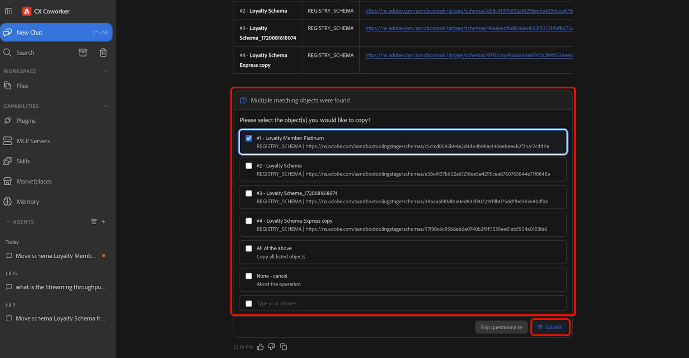

# Compétences en agent pour l’outil Sandbox

>[!AVAILABILITY]
>
>Les compétences agent d’outils Sandbox sont disponibles pour tous les clients ayant accès à Adobe CX Enterprise Coworker. Pour utiliser toutes les fonctionnalités disponibles, vous devez disposer des autorisations suivantes :
>
>**Gérer-sandbox** ou **Afficher-sandbox** : ces autorisations vous permettent d’utiliser les compétences de l’agent d’outils de sandbox pour afficher des sandbox directement dans Coworker.
>
>**Manage-package** : cette autorisation vous permet d’utiliser les compétences Agentic de l’outil Sandbox pour créer des packages directement dans Coworker.

Utilisez les compétences Agentic de l’outil Sandbox pour déplacer les types d’objet pris en charge dans les environnements Adobe Experience Platform en décrivant ce que vous souhaitez accomplir en langage naturel. Grâce à Coworker, vous pouvez découvrir les métadonnées requises, identifier automatiquement les dépendances, créer des packages de migration et migrer des objets par le biais d’une expérience de conversation.

>[!VIDEO](https://video.tv.adobe.com/v/3496706?learn=on)

## Conditions préalables {#prerequisites}

Avant de commencer, vérifiez que vous disposez des éléments suivants :

- L’accès à Adobe Experience Platform, ainsi qu’à l’organisation et au sandbox appropriés.
- Accès aux objets que vous souhaitez découvrir ou migrer.
- Plug-in Adobe CXO installé dans Coworker.

Pour obtenir des instructions sur l’installation de modules externes, consultez le [Guide de l’interface utilisateur de Coworker](https://experienceleague.adobe.com/fr/docs/cx-enterprise-ai/experience-cloud-ai/coworker/chat/ui-guide).

## Utilisation des compétences d’agent pour les outils Sandbox {#use-sandbox-tooling-agentic-skills}

Interagissez avec les compétences Agentic des outils Sandbox via un collègue en utilisant le langage naturel. Décrivez votre objectif aussi clairement que possible. Les requêtes spécifiques produisent les meilleurs résultats, tandis que des invites vagues ou trop brèves peuvent renvoyer des résultats de moindre qualité ou ne pas appeler l&#39;agent.

Pour utiliser les compétences d’agent des outils Sandbox :

1. Accédez à **&#x200B;**.
1. Saisissez une description claire de ce que vous souhaitez accomplir. Par exemple :

   *« Déplacez le schéma Loyalty Member Platinum du sandbox actuel vers le sandbox de démonstration Acme. »*

1. Consultez le tableau des résultats qui indique les sandbox source et cible. Lorsque vous êtes prêt à continuer, sélectionnez **[!UICONTROL Continuer]**, puis sélectionnez **[!UICONTROL Envoyer]** pour confirmer.

   

1. Sélectionnez un ou plusieurs objets à migrer, puis sélectionnez **[!UICONTROL Envoyer]**.

   

1. Passez en revue les objets et les dépendances identifiés par l’agent et confirmez les actions d’opération : *Créer* ou *Utiliser existant*. Lorsque vous êtes prêt(e) à commencer la migration, sélectionnez **[!UICONTROL Continuer]**, puis **[!UICONTROL Envoyer]** pour confirmer. La migration peut prendre plusieurs minutes.

   

1. Une fois la migration terminée, les objets sélectionnés sont disponibles dans le sandbox cible.

   

Pour plus d’informations sur l’utilisation de Coworker, consultez le [Guide de l’interface utilisateur de Coworker](https://experienceleague.adobe.com/fr/docs/cx-enterprise-ai/experience-cloud-ai/coworker/chat/ui-guide).

## Cas d’utilisation pris en charge {#supported-use-cases}

Explorez les méthodes courantes d’utilisation des outils Sandbox. Compétences des agents pour simplifier la gestion des sandbox et la migration des métadonnées.

### Déplacement de métadonnées d’objet entre des sandbox

En tant qu’administrateur de sandbox gérant plusieurs sandbox Adobe Experience Platform, vous pouvez migrer des métadonnées d’objet à l’aide de requêtes en langage naturel au lieu de parcourir manuellement l’interface utilisateur.

À l’aide de Coworker, vous pouvez migrer les objets Adobe Experience Platform pris en charge et leurs métadonnées associées d’un sandbox à un autre en décrivant la migration en langage naturel. Les compétences Agentic en matière d’outils de sandbox identifient automatiquement les dépendances, regroupent les objets requis et assurent une migration fiable entre les environnements.

Par exemple :

- « Déplacez le schéma Luma Loyalty Members Platinum du sandbox actuel vers le sandbox de production. »

### Promouvoir des objets dans plusieurs sandbox (Beta)

>[!NOTE]
>
>La gestion multi-sandbox est actuellement dans Beta et ne prend en charge que les schémas et les jeux de données.

En tant qu’administrateur ou administratrice de sandbox, vous pouvez promouvoir les objets pris en charge d’un sandbox source vers plusieurs sandbox cibles dans un seul workflow. Au lieu d’importer un package dans chaque sandbox individuellement, utilisez vos collègues pour sélectionner des sandbox cibles, examiner les modifications proposées et déployer les configurations de manière cohérente dans les environnements. La gestion multi-sandbox résout automatiquement les dépendances et fournit un aperçu des modifications avant que la promotion ne commence.

Par exemple :

- « Promouvoir le schéma des membres du programme de fidélité dans tous les sandbox régionaux. »

### Promouvoir les audiences entre les sandbox

En tant qu’administrateur de sandbox, vous pouvez promouvoir des audiences entre des environnements sans les recréer ou les reconfigurer manuellement.

Par exemple :

- « Convertissez l’audience « Nom de l’audience » en sandbox d’évaluation. »

Les compétences Agentic (outils pour sandbox) identifient l’audience spécifiée, valident ses dépendances et migrent tous les objets requis vers la sandbox cible.

## Exemples de prompts {#example-prompts}

Utilisez les invites suivantes comme exemples lors de l’interaction avec les compétences Agentic d’outil Sandbox.

### Invites de schéma

Utilisez ces invites lorsque vous connaissez le nom du schéma et le sandbox de destination.

- « Déplacez le schéma « Nom du schéma » du sandbox actuel vers le sandbox de production. »

### Invites d’audience

Utilisez ces invites lorsque vous connaissez le nom de l&#39;audience.

- « Convertissez l’audience « Nom de l’audience » en sandbox d’évaluation. »

## Étapes suivantes {#next-steps}

Après avoir lu ce guide, vous devriez comprendre comment utiliser les compétences Agentic de l’outil Sandbox pour découvrir, regrouper et migrer les objets pris en charge entre les sandbox.

Pour plus d’informations sur l’outil Sandbox, consultez le [Guide de l’outil Sandbox](https://experienceleague.adobe.com/en/docs/experience-platform/sandbox/ui/sandbox-tooling).

