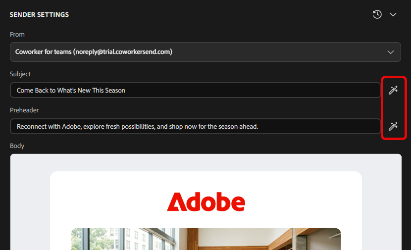
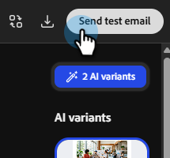

# Créer une campagne par e-mail {#create-an-email-campaign}

Découvrez comment générer et examiner des campagnes par e-mail complètes en quelques minutes.

## Avant de commencer

Vérifiez que vous disposez des éléments suivants :

* Un compte Adobe CX Enterprise Coworker pour les équipes actif ([inscrivez-vous ici](https://coworker-campaigns.experience.adobe.com/){target="_blank"} si ce n’est pas déjà fait).

* Votre marque ajoutée sous **Contexte** > **Marques**.

* (Facultatif mais recommandé) Un modèle d’e-mail HTML téléchargé sous **Contexte** > **Modèles d’e-mail**.

* Un CSV d’audience prêt à être chargé.

* Une idée claire de l’objectif de votre campagne (par exemple, « reconquérir les clients obsolètes » ou « inviter des utilisateurs en évaluation à un webinaire »).

## Étape 1 : démarrer une nouvelle conversation

Depuis la page d’accueil d’, vous pouvez commencer de trois façons :

**Option 1** : Saisissez une invite dans la barre d’invite centrale.

_Quand l’utiliser : quand vous savez exactement ce que vous voulez._

**Option 2** : choisissez un modèle prêt à l’emploi dans la section **Modèles de campagne** sous la barre d’invite.

_Quand l’utiliser : quand vous n’êtes pas sûr de ce que vous voulez._

**Option trois** : utilisez l&#39;option « Aide-moi à m&#39;informer » du menu déroulant de la barre d&#39;invite pour que Coworker for Teams vous guide tout au long de la rédaction de votre invite.

_Quand l&#39;utiliser : Quand vous avez une idée de ce que vous voulez, mais que vous voulez un peu d&#39;aide (ou, utilisez « Surprise Me » pour être surpris)._

{width="800" zoomable="yes"}

## Étape 2 : créer votre invite

Une invite de collaboration solide pour les équipes comprend les éléments suivants :

* L’objectif de la campagne (ce que vous essayez d’atteindre).
* L’audience (son destinataire ou l’origine des données de l’audience).
* Le format et la structure (nombre d’e-mails, cadence, tonalité).
* Repères de marque ou de contexte (références à votre marque, produit ou campagne).

Exemple:

`"Create a single-touch win-back email campaign for customers who bought last year but haven't returned. Use the CSV I am uploading. Make sure the content feels seasonal."`

>[!TIP]
>
>Pour consulter d’autres exemples, voir l’article _Cas d’utilisation_.

>[!NOTE]
>
>Si vous disposez déjà d’un résumé de campagne, chargez-le avec votre invite comme contexte supplémentaire pour le plan qu’il générera pour vous.

Lorsque votre invite est prête, cliquez sur l&#39;icône de flèche vers le haut. Le collaborateur des équipes :

* Générer une stratégie de campagne structurée.
* Demandez votre audience cible, qui sera également utilisée pour la personnalisation du contenu.
* Rédiger un contenu d’e-mail personnalisé pour chaque étape.
* Créez le parcours de manière dynamique en cours de route.
* Regroupez tous les éléments sur un seul tableau de campagne.

## Étape 3 : mettre à jour votre audience

Les audiences sont chargées au moyen de fichiers CSV. Toutes les audiences sont spécifiques à leurs campagnes respectives (elles ne sont pas stockées ailleurs dans votre environnement pour le moment).

1. Après avoir envoyé votre invite, Collègue pour les équipes génère (généralement) un exemple d’audience pour vous. Dans le cas contraire, il vous invite à importer une audience.

1. Importez votre propre audience en chargeant un fichier CSV ou en important des données à partir d’un connecteur disponible.

   >[!NOTE]
   >
   >Alors que Collègue pour les équipes vous permet de continuer à créer votre campagne à l’aide d’un exemple d’audience, vous devez ajouter une audience réelle pour lancer votre campagne.

   >[!IMPORTANT]
   >
   >Excluez les contacts que vous ne souhaitez pas envoyer par e-mail (utilisateurs désabonnés, adresses internes, comptes de test) avant le chargement. Bien que nous activerons progressivement la fonctionnalité pour exclure des utilisateurs spécifiques ou ajouter des attributs au cours de l’évaluation, elle n’est pas disponible immédiatement à partir de la date de lancement.

## Étape 4 : examiner et affiner Campaign Assets

Pour apporter des modifications à votre e-mail, faites défiler l’écran vers la droite. Sous _Campaign Assets_, cliquez sur **Ouvrir l’éditeur**.

Il existe deux façons de mettre à jour votre contenu.

* Apportez manuellement les modifications souhaitées en sélectionnant différentes sections dans l’e-mail (par exemple : remplacez l’objet, mettez à jour une image, etc.).

-ou-

* Utilisez l’interface de conversation pour apporter des modifications en parlant directement à vos collègues pour les équipes. Voici quelques exemples :

  * « Rendre l’objet plus urgent. »
  * « Raccourcissez la copie du corps. »
  * « Rendre le call to action plus fort. »

Vous pouvez également utiliser les boutons d’IA pour affiner votre Objet ou votre Pré-titre.

>[!TIP]
>
>Appuyez sur la touche Échap chaque fois que vous êtes dans un éditeur ou une boîte de dialogue Collègues de campagne (campagnes, parcours, etc.) pour quitter rapidement.

## Étape 5 : envoyer un e-mail de test

Avant de lancer la campagne, envoyez-la vous-même afin de pouvoir la consulter dans une véritable boîte de réception. Utilisez cette option pour vous assurer que le rendu de l’e-mail est correct, que les liens fonctionnent, que toute personnalisation est correcte, etc.

>[!NOTE]
>
>Actuellement, vous ne pouvez envoyer qu’un seul e-mail de test à vous-même, et un seul à la fois.

## Étape 6 : lancer votre campagne

Vous êtes maintenant prêt à [lancer votre campagne](/help/coworker-for-teams/launch-manage-campaign.md#launch-a-campaign).

## Questions fréquentes

**Pourquoi la première réponse prend-elle autant de temps ?**

Il génère pour vous une campagne complète comprenant la stratégie, l’audience dont vous avez besoin, le workflow, etc. La durée moyenne de la première réponse avec votre contenu généré est généralement d’environ une minute.

**Que faire si la sortie de Coworker for Teams n’est pas tout à fait correcte ?**

Cliquez sur l’icône de retour d’informations dans l’en-tête et informez-nous afin que nous puissions améliorer la plateforme.

**Puis-je modifier les e-mails directement ou uniquement par chat ?**

Vous pouvez faire les deux.

**Comment enregistrer une campagne sans la lancer ?**

Toutes les campagnes sont enregistrées automatiquement. Si vous avez besoin d’accéder à des conversations récentes, elles sont disponibles dans la fenêtre sur la gauche (sous **Conversations** si vous n’avez pas créé votre campagne, sous **Campagnes** si vous l’avez fait).

**Existe-t-il une limite de taille de fichier pour mon chargement au format CSV ?**

Oui, la limite de taille est de 8 Mo.

**Que se passe-t-il si mon fichier CSV d’audience renvoie des erreurs ?**

Assurez-vous que votre fichier CSV ne contient pas de caractères masqués « riches ».

**Comment partager un brouillon de campagne avec un coéquipier pour révision ?**

Il n’y a pas de bouton « Partager » pour le moment. Cependant, vous pouvez télécharger le contenu sous HTML ou l’exporter sous forme de document PDF ou Word.
