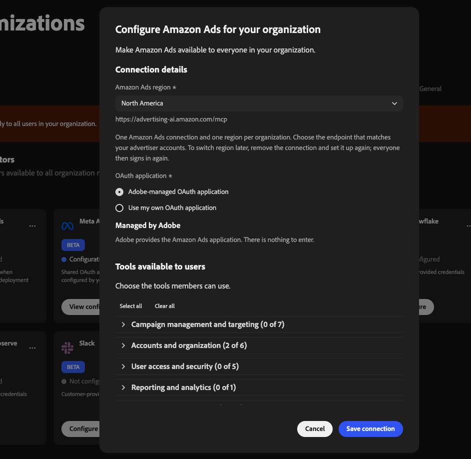

# Connecteur externe Amazon Ads {#amazon-ads}

Utilisez le connecteur externe [!DNL Amazon Ads] pour travailler avec vos données [!DNL Amazon Ads] dans Adobe CX Enterprise Coworker. Une fois que vous avez configuré le connecteur, demandez à vos collaborateurs quels comptes publicitaires vous pouvez accéder et examinez les campagnes, les rapports, la facturation et d’autres informations sur le compte. Le connecteur est un serveur MCP (Model Context Protocol) hébergé par [!DNL Amazon].

>[!AVAILABILITY]
>
>Le connecteur externe [!DNL Amazon Ads] est en version bêta. La documentation et les fonctionnalités peuvent changer.

## Configuration du connecteur {#connector-configuration}

Le processus de configuration du connecteur comprend trois parties distinctes :

* Préparation de **[!DNL Amazon]:** Un administrateur de compte [!DNL Amazon Ads] donne à chaque membre l’accès aux comptes publicitaires dont il a besoin. Si votre entreprise utilise sa propre application OAuth, le propriétaire de l’application confirme son approbation et enregistre l’URL de redirection du collègue.
* **Configuration de l’organisation :** Un administrateur Collègue configure le connecteur une seule fois pour l’ensemble de l’organisation. L’administrateur choisit une région, une application OAuth et les outils que les membres peuvent utiliser.
* **Connexion du membre :** Chaque membre se connecte avec son propre compte [!DNL Amazon]. Les membres ne peuvent accéder qu&#39;aux comptes Advertising que leur compte [!DNL Amazon] est autorisé à utiliser.

L&#39;enregistrement de la configuration de l&#39;organisation ne connecte aucun membre et n&#39;accorde aucune autorisation [!DNL Amazon Ads]. Chaque membre doit déjà disposer de l&#39;accès requis dans [!DNL Amazon Ads] et doit se connecter séparément.

## Conditions préalables {#prerequisites}

Avant de commencer, vérifiez que vous disposez des éléments suivants :

* **Accès des collaborateurs :** compte autorisé à gérer les connecteurs d&#39;organisation, dans une organisation où le connecteur [!DNL Amazon Ads] est disponible.
* **Comptes Advertising :** les comptes publicitaires que vous prévoyez d’utiliser et leur région [!DNL Amazon Ads], ainsi que les membres disposant des autorisations requises pour ces comptes. Pour plus d&#39;informations, voir [Accorder l&#39;accès au compte publicitaire](#grant-member-access).
* **Une décision d’application OAuth :** Choisissez entre les options suivantes :
  * **Application OAuth gérée par Adobe :** Adobe gère l’enregistrement de l’application et ses informations d’identification. L’application gérée doit être disponible dans votre environnement.
  * **Votre propre application OAuth :** Une application [!DNL Login with Amazon] approuvée pour l’API [!DNL Amazon Ads], son identifiant client OAuth et son secret client, ainsi qu’un administrateur pouvant modifier son profil de sécurité. Un profil de sécurité enregistré en lui-même n&#39;accorde pas l&#39;approbation d&#39;API [!DNL Amazon Ads].

La configuration guidée prend en charge une connexion [!DNL Amazon Ads] et une région par organisation. Chaque membre se connecte avec son propre compte [!DNL Amazon]. L&#39;application gérée par Adobe est un enregistrement d&#39;application partagé, pas un compte [!DNL Amazon] partagé.

## Préparation de l’accès à Amazon {#prepare-amazon}

Avant de configurer le connecteur dans Coworker, préparez l’accès à votre application et à votre compte dans [!DNL Amazon]. L’accès à la configuration de l’application et l’accès aux données publicitaires sont distincts. Les membres qui utilisent le connecteur n’ont pas besoin d’autorisations pour modifier l’application.

### Confirmer l’approbation de l’application {#confirm-app-approval}

Si vous utilisez votre propre application OAuth, demandez au propriétaire de l’application de confirmer le profil de sécurité [!DNL Login with Amazon] correct et son approbation de l’API [!DNL Amazon Ads]. La création d&#39;un profil de sécurité ou l&#39;affichage de l&#39;application dans la Developer Console [!DNL Amazon] ne remplace pas l&#39;approbation de l&#39;API [!DNL Amazon Ads]. Pour plus d’informations, consultez [Prise en main du MCP Amazon Ads](https://advertising.amazon.com/API/docs/en-us/mcp/get-started) et [Connexion au serveur MCP Ads à l’aide d’OAuth](https://advertising.amazon.com/API/docs/en-us/mcp/oauth) dans la documentation [!DNL Amazon Ads].

Pour votre propre application, Coworker applique automatiquement les paramètres suivants. Vous ne saisissez pas ces valeurs dans la boîte de dialogue de configuration.

| Paramètre | Valeur |
| --- | --- |
| URL d’autorisation | `https://lwa.amazon.com/ap/oa` |
| URL du jeton | `https://api.amazon.com/auth/o2/token` |
| Portée demandée | `advertising::campaign_management` |
| Clé de vérification pour l’échange de code (PKCE) | Activé |
| Authentification du client du point d’entrée de jeton | `client_secret_post`, comme client confidentiel |
| Enregistrement dynamique des clients | Non pris en charge |
| Délai d’expiration du transport et de l’outil | HTTP en flux continu, 60 secondes |

Si vous utilisez l’application OAuth gérée par Adobe, Adobe gère l’enregistrement de l’application et ses informations d’identification. Vous n’avez pas besoin d’effectuer cette étape ou de saisir les informations d’identification de l’application.

### Enregistrer l’URL de redirection {#register-redirect-url}

Si vous utilisez votre propre application OAuth, enregistrez l’URL de redirection de Coworker dans votre application [!DNL Login with Amazon] :

1. Dans Coworker, ouvrez la boîte de dialogue **[!UICONTROL Configurer Amazon Ads pour votre organisation]**, comme décrit dans [Configurer le connecteur pour votre organisation](#configure-organization). Sélectionnez **[!UICONTROL Utiliser ma propre application OAuth]** pour afficher l’**[!UICONTROL URL de redirection]**, puis copiez la valeur complète.
1. Dans la console [Connexion avec Amazon](https://developer.amazon.com/loginwithamazon/console/site/lwa/overview.html), recherchez le profil de sécurité de votre application. Sélectionnez **[!UICONTROL Gérer]** > **[!UICONTROL Paramètres Web]**, puis sélectionnez **[!UICONTROL Modifier]**.
1. Ajoutez l’URL de redirection complète sous **[!UICONTROL URL de retour autorisées]**, puis enregistrez-la. Si d’autres équipes partagent l’application, conservez les URL existantes et obtenez l’approbation du propriétaire de l’application avant de modifier les paramètres.
1. Notez l’ID client OAuth et le secret client à partir du même profil de sécurité. Vous les saisissez lorsque vous [configurez le connecteur](#configure-organization).

Copiez toujours l’URL de redirection de la boîte de dialogue Collègue dans l’environnement que vous configurez. Ne créez pas l’URL vous-même, n’utilisez pas l’URL de la page du collègue dans votre navigateur ou ne réutilisez pas une URL de redirection à partir d’un autre environnement ou d’un client MCP. Pour plus d’informations, voir [S’inscrire pour se connecter avec Amazon](https://developer.amazon.com/docs/login-with-amazon/register-web.html) dans la documentation [!DNL Amazon].

>[!NOTE]
>
>Si l’URL de **[!UICONTROL redirection]** affiche uniquement le chemin `/connectors/oauth/callback`, votre environnement ne prend pas encore en charge la connexion à ce connecteur. N’enregistrez pas de chemin d’accès partiel et ne devinez pas le nom d’hôte. Contactez votre représentant ou représentante Adobe.

### Accorder l’accès au compte publicitaire {#grant-member-access}

Un administrateur de compte [!DNL Amazon Ads] invite chaque membre à accéder aux comptes publicitaires dont il a besoin :

1. Ouvrez la console [Amazon Ads](https://advertising.amazon.com/), puis sélectionnez **[!UICONTROL Modifier le compte]** pour choisir le compte de l’annonceur ou du responsable.
1. Sélectionnez **[!UICONTROL Administration]** > **[!UICONTROL Accès et paramètres du compte]** > **[!UICONTROL Utilisateurs]** > **[!UICONTROL Inviter des utilisateurs]**. Les options exactes dépendent du type de compte. Invitez le compte [!DNL Amazon] du membre, avec les autorisations minimales pour les tâches qu&#39;il prévoit d&#39;effectuer.
1. Pour un compte Manager, vérifiez si l’accès couvre l’ensemble du compte Manager ou uniquement les annonceurs liés sélectionnés. Demandez au membre d&#39;accepter l&#39;invitation avec le même compte [!DNL Amazon] qu&#39;il utilise pour Coworker.
1. Confirmez que le membre peut sélectionner l&#39;annonceur dans [!DNL Amazon Ads]. Notez le nom de compte, la région et l’ID d’annonceur attendus dans un enregistrement interne approuvé, afin de pouvoir confirmer l’accès ultérieurement dans Coworker.

Choisissez le rôle le moins privilégié qui prend en charge les tâches que vous planifiez. N’accordez pas l’accès administrateur uniquement pour qu’une vérification d’accès réussisse. L’accès à une instance [!DNL Amazon Marketing Cloud] est distinct de l’accès aux campagnes de l’annonceur. Pour plus d’informations, consultez la documentation [!DNL Amazon Ads] suivante :

* [Gestion des utilisateurs dans un compte Manager](https://advertising.amazon.com/help/G4M4JGKGV2VAY9JC)
* [Ajouter ou supprimer des utilisateurs de votre compte](https://advertising.amazon.com/help/GDQVHVQMY9F88PCA)
* [Présentation des autorisations de compte](https://advertising.amazon.com/help/GM4EFDQQPG9LGL3F)
* [Autorisations de l’API Amazon Ads](https://advertising.amazon.com/API/docs/en-us/guides/account-management/permissions)

## Configuration du connecteur pour votre organisation {#configure-organization}

Les administrateurs rendent le connecteur [!DNL Amazon Ads] disponible pour tous les membres de l’organisation. Les modifications apportées à la page d’organisation s’appliquent à tous les utilisateurs de votre organisation. Les membres ne peuvent pas configurer la connexion d&#39;organisation à partir de l&#39;étendue **[!UICONTROL Utilisateur]**.

1. Ouvrez **[!UICONTROL Personnalisations]**, sélectionnez **[!UICONTROL Org]**, puis **[!UICONTROL Connecteurs externes]**. Sur la carte **[!UICONTROL Amazon Ads]**, sélectionnez **[!UICONTROL Configurer]**.

   La boîte de dialogue **[!UICONTROL Configurer Amazon Ads pour votre organisation]** s’ouvre, avec les sections **[!UICONTROL Détails de la connexion]**, **[!UICONTROL Outils disponibles pour les utilisateurs]** et **[!UICONTROL Accès et autorisations]**. Après avoir enregistré la configuration, la carte affiche **[!UICONTROL Configuration enregistrée]** et **[!UICONTROL Configurer]** les modifications apportées à **[!UICONTROL Afficher la configuration]**.

1. Sous **[!UICONTROL Région Amazon Ads]**, sélectionnez la région correspondant à vos comptes publicitaires. Coworker affiche l’URL du serveur MCP pour la région sous la sélection.

   | Zone géographique | URL du serveur MCP |
   | --- | --- |
   | [!UICONTROL Amérique du Nord] (par défaut) | `https://advertising-ai.amazon.com/mcp` |
   | [!UICONTROL Europe] | `https://advertising-ai-eu.amazon.com/mcp` |
   | [!UICONTROL Extrême-Orient] | `https://advertising-ai-fe.amazon.com/mcp` |

   La configuration guidée enregistre une zone géographique. Pour changer de région ultérieurement, supprimez la connexion et configurez-la à nouveau. Chaque membre doit ensuite se reconnecter. Planifiez donc la modification avant de rompre une connexion en cours.

1. Sélectionnez une **[!UICONTROL application OAuth]** :

   * **[!UICONTROL L’application OAuth gérée par Adobe] :** Adobe fournit l’application [!DNL Amazon Ads], vous n’avez donc pas besoin de saisir les informations d’identification de l’application. Chaque membre se connecte avec son propre compte [!DNL Amazon] et autorise l’application Adobe.

     {width="500" zoomable="yes"}

   * **[!UICONTROL Utiliser ma propre application OAuth]:** Chaque membre autorise l’application de votre organisation avec son propre compte [!DNL Amazon]. Sous **[!UICONTROL Votre application Amazon]**, procédez comme suit :

     1. Assurez-vous que l’**[!UICONTROL URL de redirection]** est enregistrée dans votre application. Pour plus d&#39;informations, voir [Enregistrer l&#39;URL de redirection](#register-redirect-url).
     1. Saisissez l’**[!UICONTROL ID d’application Amazon]** et le **[!UICONTROL secret d’application Amazon]**. Le champ **[!UICONTROL ID de l’application Amazon]** prend l’ID client OAuth, et non l’ID de l’annonceur, l’ID d’un compte de responsable ou l’ID de l’application [!DNL Amazon]. Coworker stocke les valeurs que vous saisissez comme secrets d’organisation.
     1. Pour réutiliser plutôt les informations d’identification enregistrées, sélectionnez **[!UICONTROL Utiliser un secret existant]**. Sélectionnez ensuite le **[!UICONTROL secret contenant l’ID d’application]** et le **[!UICONTROL secret contenant le secret d’application]**. Si votre organisation ne dispose pas encore de secrets, ajoutez-les dans **[!UICONTROL Paramètres]** > **[!UICONTROL Secrets]**.

     Les deux informations d’identification sont requises. Saisissez les valeurs d’identification uniquement dans les champs sécurisés. Ne saisissez pas de référence secrète dans un champ de valeur simple.

1. Sous **[!UICONTROL Outils disponibles pour les utilisateurs]**, développez chaque groupe d’outils et sélectionnez les outils dont votre entreprise a besoin. Par défaut, seuls les outils `ads_accounts-list_ads_accounts` et `ads_accounts-get_ads_account` sont sélectionnés. Pour modifier tous les outils en même temps, utilisez **[!UICONTROL Sélectionner tout]** ou **[!UICONTROL Effacer tout]**. Vous devez sélectionner au moins un outil.

   Commencez par utiliser les deux outils de compte pour une première vérification d’accès. Sélectionnez les outils de campagne et de reporting uniquement lorsque votre organisation les a besoin et les approuve. Pour plus d&#39;informations, voir [Groupes d&#39;outils](#tool-groups).

1. Sélectionnez **[!UICONTROL Enregistrer la connexion]**, puis passez en revue les détails du connecteur **[!UICONTROL amazon-ads]** enregistrés.

   | Paramètre | Description |
   | --- | --- |
   | **[!UICONTROL Source]** | URL du serveur MCP pour la région que vous avez sélectionnée. |
   | **[!UICONTROL Authentification]** | La méthode d&#39;authentification, `amazon-ads_login`. |
   | **[!UICONTROL Délai d&#39;expiration de l&#39;outil]** | Temps pendant lequel Coworker attend une réponse de l’outil. |
   | **[!UICONTROL Connexion]** | L’application OAuth utilisée et votre propre statut de connexion. |
   | **[!UICONTROL Outils]** | Les outils sélectionnés pour les membres, avec **[!UICONTROL Sélection de tous]** et **[!UICONTROL Effacement]** les contrôles et un nombre d&#39;outils sélectionnés. |

   {width="700" zoomable="yes"}

L&#39;enregistrement ne vous connecte pas, vous ou un membre, à [!DNL Amazon]. Le statut **[!UICONTROL Connexion]** sur les détails du connecteur fait référence à votre propre connexion, et non à l’organisation. Pour vérifier la connexion, sélectionnez **[!UICONTROL Se connecter]** sur la page des détails du connecteur pour vous connecter avec votre propre compte [!DNL Amazon], puis sélectionnez **[!UICONTROL Tester]**. Le résultat indique **[!UICONTROL Connexion réussie]** ou **[!UICONTROL Échec de la connexion]**, avec les outils ou les erreurs renvoyés. Un résultat réussi ne confirme pas l’accès à une opération d’annonceur spécifique.

Pour modifier ultérieurement les outils disponibles pour les membres, mettez à jour la sélection sous **[!UICONTROL Outils disponibles]** avec **[!UICONTROL Sélectionner tout]** ou **[!UICONTROL Effacer]**, puis sélectionnez **[!UICONTROL Enregistrer la sélection d’outils]**. Au moins un outil doit rester sélectionné. Les membres ne peuvent pas modifier la sélection d’outils.

Pour arrêter de proposer le connecteur à votre organisation, sélectionnez **[!UICONTROL Supprimer]** sur la page des détails du connecteur.

### Groupes d&#39;outils {#tool-groups}

Le connecteur [!DNL Amazon Ads] organise ses outils dans les groupes suivants :

| Groupe d&#39;outils | Outils | Fonctionnement des outils |
| --- | --- | --- |
| [!UICONTROL Gestion et ciblage de campagnes] | 7 | interroger les campagnes, les groupes publicitaires, les annonces, les cibles, les portfolios et leurs associations, et vérifier l’éligibilité des produits ; |
| [!UICONTROL Comptes et organisation] | 6 | Répertoriez et obtenez les comptes publicitaires, et interrogez les liens de l’annonceur et du compte, les comptes du responsable et les comptes de test. |
| [!UICONTROL Accès et sécurité des utilisateurs] | 5 | Répertoriez les utilisateurs, les rôles, les autorisations et les invitations, puis obtenez une invitation. |
| [!UICONTROL Rapports et analyses] | 1 | Récupérez un rapport. La création de rapport n’est pas incluse. |
| [!UICONTROL Amazon Marketing Cloud] | 6 | Lire les workflows et les sources de données, ainsi que l’état et les URL de téléchargement des exécutions existantes. L’exécution du workflow n’est pas incluse. |
| [!UICONTROL Récapitulatifs de la facturation et des finances] | 4 | Lisez les factures, les récapitulatifs de facture, l’utilisation du profil de facturation et les notifications de facturation. |
| [!UICONTROL Amazon Live] | 12 | Lisez les informations sur le canal, la diffusion, la diffusion en direct, les médias, le carrousel et le code de promotion. |
| [!UICONTROL Éligibilité et offres] | 6 | Lisez les informations relatives à l’éligibilité des programmes et des produits, aux offres promotionnelles et aux récompenses, ainsi que les conditions. |

Les outils de chaque groupe peuvent changer lorsque [!DNL Amazon] met à jour le connecteur. La configuration guidée enregistre la liste exacte des outils que vous sélectionnez, même lorsque vous sélectionnez chaque outil. Les outils que vous laissez désélectionnés et les outils que le serveur ajoute ultérieurement ne sont pas disponibles pour les membres tant que vous ne les avez pas sélectionnés.

>[!IMPORTANT]
>
>La liste des outils de configuration est conçue pour lire les données, mais le connecteur dans son ensemble n’est pas en lecture seule. Les membres autorisent la portée `advertising::campaign_management`, qui est plus large que la liste de configuration. Lorsque vous testez la connexion, la liste d’outils peut également inclure les outils renvoyés par le serveur. Passez en revue chaque définition d’outil et les autorisations [!DNL Amazon Ads] de vos membres avant de sélectionner d’autres outils.

## Se connecter en tant que membre {#sign-in-as-a-member}

Une fois qu’un administrateur a configuré le connecteur, chaque membre se connecte avec son propre compte [!DNL Amazon]. Vous n’avez pas besoin d’un secret d’application ou d’un jeton d’accès pour vous connecter.

>[!NOTE]
>
>Si le connecteur indique que la connexion et le **[!UICONTROL Test]** ne sont pas encore disponibles dans votre environnement, arrêtez-vous ici. La configuration d’organisation seule ne rend pas la connexion des membres disponible. Contactez votre représentant ou représentante Adobe.

1. Ouvrez **[!UICONTROL Personnalisations]**, sélectionnez **[!UICONTROL Utilisateur]**, puis **[!UICONTROL Connecteurs externes]**. Recherchez la carte **[!UICONTROL Amazon Ads]**.

1. Si la carte indique **[!UICONTROL Non configuré]**, demandez à votre administrateur de [configurer le connecteur](#configure-organization). Les membres ne peuvent pas configurer le connecteur.

1. Lorsque la carte indique **[!UICONTROL Non connecté]**, sélectionnez **[!UICONTROL Se connecter]**. Autorisez le pop-up de connexion, puis connectez-vous avec le compte [!DNL Amazon] qui a accès à vos comptes publicitaires.

1. Renseignez les invites d&#39;authentification [!DNL Amazon], telles que l&#39;authentification multifacteur (MFA) et l&#39;invite de consentement. Vérifiez le nom de l’application et l’accès demandé avant d’approuver.

   Avec l’application gérée par Adobe, vous autorisez l’application Adobe. Avec votre propre application d’organisation, vous autorisez plutôt cette application .

   >[!IMPORTANT]
   >
   >Continuez uniquement si vous reconnaissez l’application et que votre organisation approuve l’accès demandé.

1. Revenez à Collègue et vérifiez que la carte indique **[!UICONTROL Connecté]**. Sélectionnez **[!UICONTROL Afficher les détails]**, puis passez en revue les **[!UICONTROL outils activés par votre administrateur]**. Les membres peuvent afficher les outils, mais ne peuvent pas les modifier ni supprimer la connexion à l’organisation.

1. Sélectionnez **[!UICONTROL Test]** pour vérifier la découverte d’outils et le statut de la connexion.

Un pop-up fermé ne confirme pas à lui seul que la connexion a réussi. Un test réussi ne confirme pas l’accès à chaque annonceur, campagne, rapport ou instance [!DNL Amazon Marketing Cloud]. Lorsqu’un administrateur se connecte, les autres membres ne sont pas connectés.

Pour déconnecter votre compte [!DNL Amazon] du connecteur, sélectionnez **[!UICONTROL Se déconnecter]**.

## Vérifier l’accès à votre compte publicitaire {#check-account-access}

Pour confirmer les comptes publicitaires que vous pouvez utiliser, exécutez une vérification en lecture seule. Utilisez un compte de test approuvé et vérifiez que votre administrateur a activé les outils `ads_accounts-list_ads_accounts` et `ads_accounts-get_ads_account`. Démarrez ensuite une conversation et saisissez une invite.

Exemple d’invite :

* « À l’aide d’Amazon Ads, répertoriez jusqu’à cinq comptes publicitaires auxquels je peux accéder dans la région configurée. Afficher uniquement le nom du compte, l’ID de compte et la région si ces champs sont renvoyés. Ne créez, ne mettez pas à jour, ne supprimez pas, ne lancez pas, n’exécutez pas de workflows, ne générez pas de rapports et ne modifiez pas les autorisations. Si une limite de liste n’est pas prise en charge, résumez seulement cinq résultats et ne demandez pas de pages supplémentaires. »

Vérifiez que le résultat inclut le compte attendu. Pour afficher plus de détails, demandez à votre collègue d’obtenir les détails de ce compte à l’aide de l’identifiant de compte obtenu à partir du résultat. Ne devinez pas les identifiants de compte et ne demandez pas de campagnes uniquement pour tester la connexion.

Une liste de comptes vide ne signifie pas toujours que le connecteur ne fonctionne pas. Vérifiez le compte [!DNL Amazon] avec lequel vous vous êtes connecté, vos invitations acceptées, les annonceurs liés couverts par un compte Manager et la région configurée. Un compte de test sans campagnes peut également renvoyer une liste de campagnes vide. Si un outil dont vous avez besoin n’est pas activé, contactez votre administrateur. N’utilisez pas un outil qui modifie les données à la place.

## Résolution des problèmes d’accès {#troubleshoot-access}

Si vous ne pouvez pas accéder à vos données [!DNL Amazon Ads], vérifiez les points suivants auprès de votre administrateur :

| Problème | Éléments à vérifier |
| --- | --- |
| La carte **[!UICONTROL Amazon Ads]** ou **[!UICONTROL Configurer]** est manquante | Vérifiez que le connecteur est disponible pour votre organisation et que vous êtes autorisé à gérer les connecteurs d’organisation. Les membres doivent attendre la configuration de l&#39;organisation. |
| La configuration gérée par Adobe est enregistrée, mais la connexion échoue | Contactez votre représentant Adobe pour confirmer que l’application gérée par Adobe est disponible dans votre environnement. Un enregistrement réussi ne confirme pas cela. |
| L’URL de redirection ne correspond pas | Comparez l’**[!UICONTROL URL de redirection]** complète de la boîte de dialogue Collègue avec les **[!UICONTROL URL de retour autorisées]** dans [!DNL Login with Amazon], y compris le schéma, l’hôte et le chemin d’accès. N’utilisez pas d’URL de redirection provenant d’un autre client, d’une autre région ou d’un autre environnement MCP, ni l’URL de la page Collègue de votre navigateur. |
| L’URL de **[!UICONTROL redirection]** affiche uniquement `/connectors/oauth/callback` | Votre environnement n’affiche pas encore l’URL de redirection complète ou ne prend pas en charge la connexion et le **[!UICONTROL test]**. N’enregistrez pas de chemin d’accès partiel et ne devinez pas le nom d’hôte. Contactez votre représentant ou représentante Adobe. |
| Vous ne pouvez pas enregistrer votre propre configuration d’application OAuth | Saisissez l’identifiant client OAuth et le secret client, et conservez au moins un outil sélectionné. Assurez-vous que l’**[!UICONTROL ID de l’application Amazon]** est l’ID client OAuth, et non l’ID de l’annonceur ou l’ID de l’application [!DNL Amazon]. |
| Échec du consentement ou de l’autorisation de l’application | Vérifiez l&#39;approbation de l&#39;API [!DNL Amazon Ads], le profil de sécurité, l&#39;association entre l&#39;ID client et le secret, l&#39;enregistrement de l&#39;URL de redirection et l&#39;application affichée sur l&#39;écran de consentement. Ne partagez pas l’URL de consentement, le code d’autorisation ou les jetons lorsque vous demandez de l’aide. |
| Vous vous connectez, mais les comptes ou les outils sont refusés ou vides | Vérifiez le compte [!DNL Amazon] avec lequel vous vous êtes connecté, votre invitation acceptée, les annonceurs liés couverts par un compte Manager, la région configurée et les autorisations requises par la tâche. L’accès à l’application ou aux outils du partenaire ne confirme pas l’accès de l’annonceur. L&#39;accès à [!DNL Amazon Marketing Cloud] est distinct. |
| [!DNL Amazon Ads] indique que le compte actuel ne peut pas accéder à une page | Sélectionnez **[!UICONTROL Modifier le compte]** et choisissez le compte de l’annonceur ou du responsable. Si le compte est manquant, demandez à son administrateur de vérifier que vous avez accepté l’invitation et que vous êtes affecté au compte. Si le compte est présent mais que User Management n’est pas disponible, demandez à l’administrateur de vérifier votre rôle. |
| Un outil est manquant ou indisponible | Vérifiez la sélection d’outils pour votre organisation, les outils renvoyés par le serveur et vos autorisations [!DNL Amazon Ads]. Les outils que le serveur ajoute ultérieurement ne sont pas sélectionnés automatiquement. Par défaut, seuls les deux outils de compte sont activés. |
| **[!UICONTROL Test]** signale un connecteur personnel portant le même nom | Un connecteur personnel portant le même nom peut être prioritaire sur le connecteur d’organisation. Suivez les instructions indiquées pour supprimer ou renommer uniquement le connecteur personnel en conflit, avec l’approbation de son propriétaire. |
| Le pop-up de connexion est bloqué, ne se termine pas ou le statut n’est pas mis à jour | Laissez la fenêtre contextuelle s’afficher, puis revenez à Collègue pour vérifier le statut et les détails de l’erreur. Ne partez pas du principe que la publication a réussi, car le pop-up s’est fermé ou a affiché une page de destination. |
| Un outil expire ou vous devez vous connecter à plusieurs reprises | Vérifiez le délai d&#39;expiration de l&#39;outil **[!UICONTROL de 60 secondes]**, les détails de l&#39;erreur, la disponibilité du réseau et de [!DNL Amazon], ainsi que la configuration de l&#39;application. |
| Un collègue indique que la configuration n’est pas activée ou qu’un nouveau secret est toujours en cours de configuration | Vérifiez le statut auprès de votre représentant Adobe. Ne créez pas à nouveau les informations d’identification à plusieurs reprises et ne traitez pas un enregistrement ayant échoué comme réussi. |

Lorsque vous contactez l’assistance, incluez uniquement le texte de l’erreur, l’heure de l’erreur, votre environnement, la région sélectionnée et l’option de l’application OAuth. Ne partagez pas de secrets d’application, de jetons d’accès, de codes d’autorisation, d’en-têtes d’autorisation, de paramètres de requête de consentement ou de redirection ou de données de compte client.
