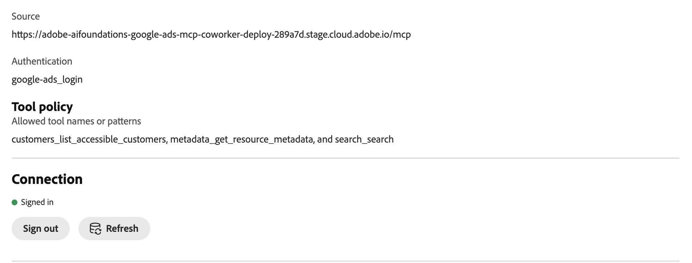

# Connecteur externe Google Ads {#google-ads}

Utilisez le connecteur externe [!DNL Google Ads] pour travailler avec vos données [!DNL Google Ads] dans Adobe CX Enterprise Coworker. Une fois que vous avez configuré le connecteur, demandez à vos collègues quels comptes publicitaires vous pouvez accéder, quels champs et mesures sont disponibles et comment s’effectuent vos campagnes. Le connecteur est un serveur MCP (Model Context Protocol).

>[!AVAILABILITY]
>
>Le connecteur externe [!DNL Google Ads] est en version bêta. La documentation et les fonctionnalités peuvent changer.

## Configuration du connecteur {#connector-configuration}

Le processus de configuration du connecteur comprend deux parties distinctes :

* **Configuration de l’organisation :** un administrateur configure le connecteur une seule fois pour l’ensemble de l’organisation et sélectionne les outils que les membres peuvent utiliser. Adobe fournit l’application OAuth, de sorte qu’il n’y a aucune information d’identification d’application à saisir.
* **Connexion au membre :** chaque membre se connecte avec son propre compte [!DNL Google]. Les membres ne peuvent accéder qu’aux comptes [!DNL Google Ads] auxquels leur compte [!DNL Google] peut accéder.

L’enregistrement de la configuration d’organisation ne permet pas de connecter des membres ni d’accorder l’accès à des comptes [!DNL Google Ads]. Chaque membre doit se connecter séparément.

## Conditions préalables {#prerequisites}

Avant de commencer, vérifiez que vous disposez des éléments suivants :

* **Pour la configuration d’organisation :** compte autorisé à gérer les connecteurs d’organisation dans Coworker.
* **Pour la connexion du membre :** compte [!DNL Google] avec accès aux comptes [!DNL Google Ads] que vous prévoyez d’utiliser.

## Configuration du connecteur pour votre organisation {#configure-organization}

Les administrateurs rendent le connecteur [!DNL Google Ads] disponible pour tous les membres de l’organisation. Les modifications apportées à la page d’organisation s’appliquent à tous les utilisateurs de votre organisation.

1. Ouvrez **[!UICONTROL Personnalisations]**, sélectionnez **[!UICONTROL Organisation]**, puis **[!UICONTROL Connecteurs externes]**. Sur la carte **[!UICONTROL Google Ads]**, sélectionnez **[!UICONTROL Configurer]**.

1. Dans la boîte de dialogue **[!UICONTROL Configurer Google Ads pour votre organisation]**, vérifiez que l’application **[!UICONTROL OAuth]** est **[!UICONTROL une application OAuth gérée par Adobe]**. Adobe fournit l’application [!DNL Google Ads], vous n’avez donc pas besoin de saisir les informations d’identification de l’application. Sous **[!UICONTROL Outils disponibles pour les utilisateurs]**, sélectionnez les outils dont votre entreprise a besoin. Pour plus d’informations, voir [&#x200B; Outils disponibles &#x200B;](#available-tools). Vérifiez le **[!UICONTROL Chaque personne se connecte séparément]** notez-le, puis sélectionnez **[!UICONTROL Enregistrer la connexion]**.

   {width="500" zoomable="yes"}

1. Vérifiez les détails du connecteur **[!UICONTROL google-ads]** enregistrés.

   | Paramètre | Description |
   | --- | --- |
   | **[!UICONTROL Source]** | URL du serveur MCP pour votre environnement. |
   | **[!UICONTROL Authentification]** | La méthode d’authentification, `google-ads_login`. |
   | **[!UICONTROL Politique des outils]** | Noms ou modèles d’outils autorisés. |
   | **[!UICONTROL Connexion]** | Votre propre statut de connexion. |

   {width="700" zoomable="yes"}

Le statut **[!UICONTROL Connexion]** sur les détails du connecteur fait référence à votre propre connexion et non à l’organisation. Chaque membre doit toujours se connecter avec son propre compte. Une fois les membres connectés, ils peuvent sélectionner **[!UICONTROL Tester]** pour tester la découverte d’outils. Pour utiliser le connecteur vous-même, suivez les étapes de la section [Se connecter en tant que membre](#sign-in-as-a-member).

Pour arrêter de proposer le connecteur à votre organisation, sélectionnez **[!UICONTROL Supprimer]** sur la page des détails du connecteur.

### Outils disponibles {#available-tools}

Le connecteur [!DNL Google Ads] fournit les outils suivants :

| Outil | Description |
| --- | --- |
| `customers_list_accessible_customers` | Répertoriez les ID de client auxquels votre compte [!DNL Google] connecté peut accéder directement. |
| `metadata_get_resource_metadata` | Recherchez les champs, mesures et segments que vous pouvez utiliser pour une ressource [!DNL Google Ads], telle qu’une campagne ou un groupe publicitaire. |
| `search_search` | Récupérez [!DNL Google Ads] données de configuration ou de création de rapports. |

## Se connecter en tant que membre {#sign-in-as-a-member}

Une fois qu’un administrateur a configuré le connecteur, chaque membre se connecte avec son propre compte [!DNL Google].

1. Ouvrez **[!UICONTROL Personnalisations]**, sélectionnez **[!UICONTROL Utilisateur]**, puis **[!UICONTROL Connecteurs externes]**. Sur la carte **[!UICONTROL Google Ads]**, sélectionnez **[!UICONTROL Se connecter]**.

   Si la carte indique **[!UICONTROL Non configuré]** ou si le connecteur n’est pas disponible, demandez à votre administrateur de [configurer le connecteur](#configure-organization).

1. Sur l’écran [!DNL Google] **[!UICONTROL Choisir un compte]**, sélectionnez le compte ayant accès à vos comptes [!DNL Google Ads] ou sélectionnez **[!UICONTROL Utiliser un autre compte]**. Effectuez ensuite toutes les étapes de connexion requises par votre organisation, telles que l’authentification unique (SSO), l’authentification multifacteur (MFA) ou la vérification d’identité.

   Les étapes et leur ordre dépendent de votre organisation et des politiques de compte.

   {width="500" zoomable="yes"}.

1. Vérifiez le compte sélectionné et l’application que vous autorisez, puis sélectionnez **[!UICONTROL Continuer]**.

   [!DNL Google] affiche le nom de l’application comme [!DNL Adobe Experience Platform]. Si vous avez déjà utilisé l’application, [!DNL Google] indique que vous vous reconnectez. Les nouveaux utilisateurs peuvent voir différentes invites.

   {width="500" zoomable="yes"}

1. Vérifiez la demande d’accès, puis sélectionnez **[!UICONTROL Continuer]**.

   {width="500" zoomable="yes"}

   >[!IMPORTANT]
   >
   >Continuez uniquement si vous reconnaissez l’application et que votre organisation approuve l’accès demandé.

1. Une fois que [!DNL Google] vous a renvoyé à Coworker, ouvrez les détails du connecteur **[!UICONTROL google-ads]**. Vérifiez que le connecteur affiche **[!UICONTROL Connecté]** et **[!UICONTROL Connecté]**.

   Conservez la valeur par défaut de l’**[!UICONTROL identifiant de ressource]**, sauf indication contraire de votre administrateur. Ce champ définit l’audience du jeton envoyée lorsque vous vous connectez. Pour revenir à la valeur par défaut, effacez le champ et sélectionnez **[!UICONTROL Enregistrer l’identifiant de ressource]**.

   {width="700" zoomable="yes"}.

1. Sélectionnez **[!UICONTROL Test]** pour vérifier que Coworker peut découvrir les outils de connecteur. Ensuite, passez en revue **[!UICONTROL Outils activés par votre administrateur]** pour afficher les outils que vous pouvez utiliser.

   Le **[!UICONTROL Test]** est disponible après votre connexion.

   {width="700" zoomable="yes"}

Pour déconnecter votre compte [!DNL Google] du connecteur, sélectionnez **[!UICONTROL Se déconnecter]**. Les détails du connecteur affichent également le paramètre **[!UICONTROL Délai d’expiration de l’outil]** et une commande **[!UICONTROL Actualiser]**.

Un statut **[!UICONTROL Connecté]** ne confirme pas l’accès à un compte publicitaire spécifique ou l’exécution réussie de chaque rapport. Pour confirmer votre accès, [vérifiez votre accès au compte publicitaire](#check-ad-account-access).

## Vérifier l’accès à votre compte publicitaire {#check-ad-account-access}

Pour confirmer quels comptes [!DNL Google Ads] vous pouvez utiliser, démarrez une conversation et saisissez une invite.

Exemple d’invite :

* « Quels comptes Google Ads puis-je accéder ? »

Coworker utilise l’outil `customers_list_accessible_customers` pour répertorier les ID de client auxquels votre compte [!DNL Google] peut accéder directement. Il s’agit d’une vérification d’accès au compte, et non d’un rapport de performance. Si vous utilisez un compte Manager, la liste n’inclut pas tous les comptes associés.

Avant de demander un rapport, procédez comme suit :

* Sélectionnez un compte dans la liste.
* Spécifiez une période avec une date de début et une date de fin.
* Demandez à votre collègue de trouver les champs et les mesures disponibles pour le rapport.

## Résolution des problèmes d’accès {#troubleshoot-access}

Si vous ne pouvez pas accéder à vos données [!DNL Google Ads], vérifiez les points suivants auprès de votre administrateur :

| Zone | Éléments à vérifier |
| --- | --- |
| compte [!DNL Google] | Vous vous êtes connecté avec le compte [!DNL Google] qui a accès au compte [!DNL Google Ads]. |
| Autorisations de compte | Votre compte [!DNL Google] dispose d’autorisations pour les comptes [!DNL Google Ads] que vous souhaitez utiliser. |
| Comptes de responsable | Si vous accédez à un compte via un compte de responsable, votre administrateur a confirmé la configuration du compte de responsable requise. |
| Sélection d’outil | Votre administrateur a activé les outils dont vous avez besoin sous **[!UICONTROL Outils disponibles pour les utilisateurs]**. |
| Identifiant de la ressource | L’**[!UICONTROL identifiant de ressource]** utilise la valeur par défaut, sauf indication contraire de votre administrateur. |
