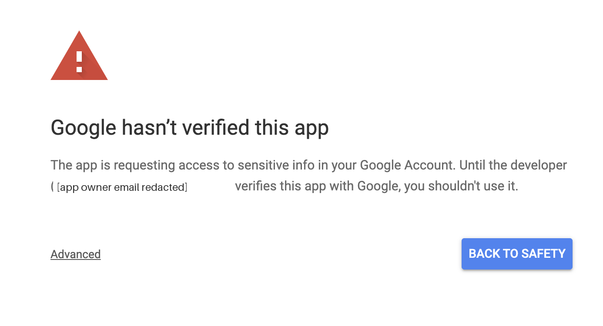

# Connecteur externe BigQuery Google {#google-bigquery}

Utilisez le connecteur externe [!DNL Google BigQuery] pour explorer et interroger vos données [!DNL BigQuery] dans Adobe CX Enterprise Coworker. Après avoir configuré le connecteur, demandez à Coworker de répertorier les jeux de données et les tables, d’expliquer un schéma de table et d’exécuter des requêtes SQL en lecture seule. Le connecteur est un serveur MCP (Model Context Protocol) hébergé par [!DNL Google] sur `https://bigquery.googleapis.com/mcp`.

>[!AVAILABILITY]
>
>Le connecteur externe [!DNL Google BigQuery] est en version bêta. La documentation et les fonctionnalités peuvent changer.

## Configuration du connecteur {#connector-configuration}

Le processus de configuration du connecteur comprend trois parties distinctes :

* Préparation de **[!DNL Google Cloud]:** un administrateur [!DNL Google Cloud] prépare un projet de requête, active l’API [!DNL BigQuery] et accorde aux membres les rôles de gestion des identités et des accès (IAM) requis.
* **Configuration de l’organisation :** Un administrateur Collègue configure le connecteur une seule fois pour l’ensemble de l’organisation. L’administrateur connecte l’application OAuth [!DNL Google] de l’organisation et sélectionne les outils que les membres peuvent utiliser.
* **Connexion du membre :** Chaque membre se connecte avec son propre compte [!DNL Google]. Les membres ne peuvent accéder qu&#39;aux projets et aux jeux de données auxquels leur identité [!DNL Google] peut accéder.

Le connecteur utilise une application OAuth qui appartient à votre organisation. Adobe ne fournit pas d’application OAuth [!DNL Google] pour ce connecteur. L&#39;enregistrement de la configuration de l&#39;organisation ne connecte aucun membre et n&#39;accorde aucune autorisation [!DNL BigQuery]. Une connexion réussie à [!DNL Google] n’accorde pas non plus l’accès au jeu de données, car l’IAM [!DNL Google Cloud] contrôle l’accès à vos données.

## Conditions préalables {#prerequisites}

Avant de commencer, vérifiez que vous disposez des éléments suivants :

* **Pour la préparation de [!DNL Google Cloud] :** un administrateur [!DNL Google Cloud] qui peut activer les API, accorder des rôles IAM et créer un client OAuth dans [!DNL Google Auth Platform].
* **Pour la configuration de l&#39;organisation :** Un compte avec l&#39;autorisation de gérer les connecteurs d&#39;organisation dans Coworker. Vous avez également besoin de l’ID client et du secret client d’un client d’application web OAuth [!DNL Google], ou des secrets d’organisation existants qui les contiennent.
* **Pour la connexion du membre :** une identité [!DNL Google] que l’audience de l’application OAuth autorise et qui possède les rôles IAM requis.

Connaître l’identifiant du projet de requête et les jeux de données que les membres doivent lire. Le projet de requête exécute des tâches de requête et les paie. Les données peuvent résider dans un autre projet et le client OAuth peut également appartenir à un autre projet. Pour un projet pilote, un projet peut contenir le client OAuth, les tâches de requête et les jeux de données.

## Préparer [!DNL Google Cloud] {#prepare-google-cloud}

Avant de configurer le connecteur dans Coworker, préparez votre projet et l&#39;accès des membres dans [!DNL Google Cloud]. La création de l’application OAuth et l’octroi de l’accès aux données sont des tâches distinctes. Les membres qui utilisent le connecteur n’ont pas besoin d’autorisations pour modifier l’application OAuth.

### Préparer le projet de requête {#prepare-query-project}

Un administrateur [!DNL Google Cloud] prépare le projet qui exécute les traitements de requête :

1. Dans la [console Google Cloud](https://console.cloud.google.com/), sélectionnez ou créez un projet.
1. Activez l’API [!DNL BigQuery], si elle n’est pas déjà activée. L’activation de l’API active également le serveur MCP distant [!DNL BigQuery].
1. Choisissez la facturation pour le [sandbox BigQuery](https://docs.cloud.google.com/bigquery/docs/sandbox), puis définissez les [quotas de requêtes personnalisées](https://docs.cloud.google.com/bigquery/docs/custom-quotas) appropriés par jour pour le projet de requête.

>[!IMPORTANT]
>
>Les requêtes en lecture seule peuvent toujours entraîner des frais. Les coûts de [!DNL BigQuery] dépendent des octets analysés par une requête, et non du nombre de lignes renvoyées. Une clause `LIMIT` contrôle les lignes renvoyées, mais elle ne réduit généralement pas les octets analysés. Utilisez des exécutions sèches, des colonnes explicites, des filtres de partition et des quotas de requête quotidiens pour contrôler les coûts.

Pour plus d’informations, voir [Utiliser le serveur MCP distant BigQuery](https://docs.cloud.google.com/bigquery/docs/use-bigquery-mcp) dans la documentation [!DNL Google Cloud].

### Octroi de rôles IAM {#grant-iam-roles}

Accordez les rôles suivants aux [!DNL Google] identités de vos membres. Utilisez un groupe géré si possible et préférez l’accès aux données au niveau du jeu de données.

| Rôle | Où l’accorder | Rôle |
| --- | --- | --- |
| [!UICONTROL Utilisateur De L’Outil MCP] (`roles/mcp.toolUser`) | Projets utilisés pour les appels MCP | Effectuer des appels d’outil MCP. |
| [!UICONTROL Utilisateur du traitement BigQuery] (`roles/bigquery.jobUser`) | Le projet de requête | Exécutez les traitements de requête. |
| [!UICONTROL Visionneuse de données BigQuery] (`roles/bigquery.dataViewer`) | Jeux de données ou projets de données autorisés | Lire des données et des métadonnées. |

N’accordez pas la permission à [!UICONTROL BigQuery Data Editor], [!UICONTROL BigQuery Data Owner] ou [!UICONTROL BigQuery Admin] uniquement pour utiliser ce connecteur en lecture seule. Une politique de refus [pour les outils de MCP en lecture-écriture](https://docs.cloud.google.com/mcp/prevent-read-write-tool-use) constitue une mesure de protection supplémentaire. Demandez à votre administrateur [!DNL Google Cloud] de vérifier d&#39;abord la portée de la politique de refus, car elle peut affecter d&#39;autres clients et services MCP [!DNL Google]. Pour plus d’informations, voir [Rôles et autorisations IAM BigQuery](https://docs.cloud.google.com/bigquery/docs/access-control).

## Configuration du connecteur pour votre organisation {#configure-organization}

Les administrateurs rendent le connecteur [!DNL Google BigQuery] disponible pour tous les membres de l’organisation. Les modifications apportées à la page d’organisation s’appliquent à tous les utilisateurs de votre organisation.

1. Ouvrez **[!UICONTROL Personnalisations]**, sélectionnez **[!UICONTROL Org]**, puis **[!UICONTROL Connecteurs externes]**. Sur la carte **[!UICONTROL BigQuery Google]**, sélectionnez **[!UICONTROL Configurer]**.

   Si le connecteur est déjà configuré, la carte affiche **[!UICONTROL Afficher la configuration]** à la place.

1. Dans la boîte de dialogue **[!UICONTROL Configurer BigQuery Google pour votre organisation]**, copiez l’**[!UICONTROL URL de redirection]** sous **[!UICONTROL Votre application Google]**.

   L’URL de redirection diffère selon les environnements et les régions. Par conséquent, copiez toujours la valeur exacte de la boîte de dialogue. N’utilisez pas l’URL de la page Collègue dans votre navigateur ou l’URL du serveur MCP [!DNL BigQuery]. Si un client OAuth diffuse plusieurs environnements, enregistrez séparément chaque URL de redirection requise.

1. Dans la [plateforme d’authentification Google](https://console.cloud.google.com/auth/overview), préparez le client OAuth de votre organisation :

   1. Configurez **[!UICONTROL Branding]** et **[!UICONTROL Audience]**. Pour une application externe en cours de test, ajoutez les membres prévus en tant qu’utilisateurs et utilisatrices de test. Remplissez les exigences de publication et de vérification de [!DNL Google] avant une utilisation plus large.
   1. Dans **[!UICONTROL Data Access]**, ajoutez la portée `https://www.googleapis.com/auth/bigquery`.
   1. Sous **[!UICONTROL Clients]**, créez ou sélectionnez un client OAuth avec le type d’application **[!UICONTROL Web]**.
   1. Ajoutez l’URL de redirection que vous avez copiée dans **[!UICONTROL les URI de redirection autorisés]**.
   1. Obtenez l’**[!UICONTROL ID client]** et le **[!UICONTROL Secret client]** par le biais du processus de gestion des secrets approuvé de votre organisation.

   Les membres autorisent cette application qui appartient à votre organisation, et non une application fournie par Adobe. Excluez le secret client des captures d’écran, des conversations et de la documentation.

1. Sous **[!UICONTROL D&#39;où proviennent les informations d&#39;identification]**, sélectionnez l&#39;une des options suivantes :

   * **[!UICONTROL Saisissez le nouveau] :** saisissez l’**[!UICONTROL ID client OAuth Google]** et le **[!UICONTROL secret client OAuth Google]**. Coworker stocke les valeurs que vous saisissez comme secrets d’organisation.
   * **[!UICONTROL Utiliser un secret existant] :** Sélectionnez les secrets d’organisation enregistrés qui contiennent l’ID client et le secret client.

   N’utilisez pas de secrets personnels pour un connecteur d’organisation.

   {width="500" zoomable="yes"}

1. Développez le groupe d&#39;outils **[!UICONTROL Exploration et requête]**. Gardez les sept outils sélectionnés ou sélectionnez uniquement les outils dont vos membres ont besoin. Vous devez sélectionner au moins un outil. Pour plus d&#39;informations, voir [Outils disponibles](#available-tools).

   Consultez les avis sous **[!UICONTROL Accès et autorisations]** :

   * **[!UICONTROL Outils en lecture seule]:** La portée OAuth est large et n’empêche pas les modifications par elle-même. Gardez les rôles IAM de vos membres en lecture seule.
   * **[!UICONTROL Les requêtes en lecture seule peuvent entraîner des frais] :** utilisez des exécutions à sec et des quotas de requêtes. Une clause `LIMIT` contrôle les lignes renvoyées, mais pas nécessairement les octets analysés.
   * **[!UICONTROL Chaque personne se connecte séparément]:** Chaque membre a besoin des rôles IAM requis.

   Sélectionnez **[!UICONTROL Enregistrer la connexion]**. La carte d’organisation affiche **[!UICONTROL Configuration enregistrée]** et **[!UICONTROL Afficher la configuration]**.

L&#39;enregistrement de la configuration ne vous connecte pas, vous ou un membre, à [!DNL Google]. L’enregistrement ne confirme pas non plus que n’importe qui peut interroger un jeu de données. Pour utiliser le connecteur vous-même, suivez les étapes de la section [Connexion en tant que membre](#sign-in-as-a-member).

### Outils disponibles {#available-tools}

Le connecteur [!DNL Google BigQuery] fournit les outils en lecture seule suivants :

| Outil | Description |
| --- | --- |
| `list_dataset_ids` | Répertorier les jeux de données d’un projet que vous spécifiez. |
| `get_dataset_info` | Lire les métadonnées d’un jeu de données. |
| `list_table_ids` | Répertorier les tables et les vues d’un jeu de données. |
| `get_table_info` | Lecture du schéma et des métadonnées d&#39;une table. |
| `execute_sql_readonly` | Exécutez des requêtes SQL en lecture seule ou une exécution d’essai pour estimer les octets analysés par une requête. |
| `get_query_results` | Récupérez les résultats d’une requête ou vérifiez une requête de longue durée. |
| `get_job` | Vérifiez le statut, les erreurs et les statistiques d’une tâche de requête. |

Pour les workflows de requête, gardez `execute_sql_readonly`, `get_query_results` et `get_job` sélectionnés ensemble, de sorte que Coworker puisse suivre un traitement de requête de longue durée. Coworker ne propose pas les outils `execute_sql` et `cancel_job` du serveur MCP [!DNL BigQuery]. Les outils que [!DNL Google] ajoute ultérieurement au serveur ne sont pas activés automatiquement. Pour plus d’informations sur les outils, consultez la [référence MCP BigQuery](https://docs.cloud.google.com/bigquery/docs/reference/mcp).

Tenez compte des limites suivantes lorsque vous utilisez les outils :

* [!DNL Google] documente une limite de 3 000 lignes pour les résultats de la requête et un délai d&#39;expiration de requête par défaut de trois minutes. N’utilisez pas le connecteur pour exporter des tableaux complets.
* Les outils ne peuvent pas répertorier les projets. Indiquez un ID de projet connu dans votre demande.
* Le SQL en lecture seule ne prend pas en charge les instructions qui modifient les données ou les ressources, ou les requêtes sur [!DNL Google Drive] tables externes.
* Les résultats des requêtes, les schémas, les listes d’accès aux jeux de données et le langage SQL peuvent apparaître dans la conversation. Assurez-vous que l’accès respecte la politique de gestion des données de votre entreprise.

## Se connecter en tant que membre {#sign-in-as-a-member}

Une fois qu’un administrateur a configuré le connecteur, chaque membre se connecte avec son propre compte [!DNL Google]. Vous n’avez pas besoin du secret client OAuth pour vous connecter.

1. Ouvrez **[!UICONTROL Personnalisations]**, sélectionnez **[!UICONTROL Utilisateur]**, puis **[!UICONTROL Connecteurs externes]**. Sur la carte **[!UICONTROL BigQuery Google]**, qui affiche **[!UICONTROL Non connecté]**, sélectionnez **[!UICONTROL Se connecter]**.

   Si la carte indique qu&#39;un administrateur doit configurer le connecteur, demandez à votre administrateur de [configurer le connecteur](#configure-organization).

1. Sur l’écran [!DNL Google] **[!UICONTROL Choisir un compte]**, sélectionnez le compte disposant de l’accès IAM requis ou sélectionnez **[!UICONTROL Utiliser un autre compte]**. Effectuez ensuite toutes les étapes de connexion requises par votre organisation, telles que l’authentification unique (SSO) ou l’authentification multifacteur (MFA).

   Ce compte peut différer du compte que vous utilisez pour vos collègues.

   {width="500" zoomable="yes"}

1. Si [!DNL Google] affiche **[!UICONTROL Google n&#39;a pas vérifié cette application]**, confirmez l&#39;application et son propriétaire auprès de votre administrateur. Continuez uniquement si la politique de votre organisation pour les applications de test l’autorise. Sinon, sélectionnez **[!UICONTROL Retour à la sécurité]** et demandez au propriétaire de l&#39;application de résoudre les exigences en matière d&#39;audience, de publication ou de vérification.

   {width="500" zoomable="yes"}

   Vérifiez le nom de l’application et l’accès demandé sur l’écran de consentement. Sélectionnez ensuite **[!UICONTROL Continuer]** pour terminer le flux de consentement [!DNL Google].

   [!DNL Google] demande l’autorisation d’afficher et de gérer vos données [!DNL BigQuery] et d’afficher l’adresse e-mail de votre compte [!DNL Google]. Il s’agit de la portée [!DNL BigQuery] standard, même si Coworker ne propose que des outils en lecture seule.

   Dans les captures d’écran, l’application est nommée adobe.io. L’application de votre entreprise affiche son propre nom. Ce nom ne signifie pas qu’Adobe fournit l’application OAuth.

   >[!IMPORTANT]
   >
   >Continuez uniquement si vous reconnaissez l’application et que votre organisation approuve l’accès demandé.

   {width="500" zoomable="yes"}

1. Revenez à Coworker, puis passez en revue les **[!UICONTROL outils activés par votre administrateur]** dans les détails du connecteur. Les membres peuvent afficher les outils mais ne peuvent pas modifier la sélection d&#39;outils. Pour vérifier la connexion, sélectionnez **[!UICONTROL Tester]**.

   {width="700" zoomable="yes"}

Une connexion réussie, un test ou une liste d’outils ne confirme pas que vous pouvez interroger un jeu de données spécifique. Pour confirmer votre accès, [vérifiez votre accès BigQuery](#check-bigquery-access). Si un collègue indique que la connexion est terminée, reconnectez-vous.

## Vérifier votre accès à [!DNL BigQuery] {#check-bigquery-access}

Pour confirmer que vous pouvez lire vos données, démarrez une nouvelle conversation et saisissez une invite en lecture seule. Remplacez les espaces réservés par des projets et des tableaux auxquels votre identité [!DNL Google] peut accéder.

Exemples d’invites :

* « Répertorier les jeux de données dans le projet `YOUR_PROJECT_ID`. »
* « À l’aide de `YOUR_QUERY_PROJECT_ID` pour les tâches de requête, inspectez le schéma de `YOUR_DATA_PROJECT.YOUR_DATASET.YOUR_TABLE`, estimez l’analyse avec une exécution d’essai, puis renvoyez un résumé agrégé. »

Vérifiez que les résultats incluent les jeux de données ou les données attendus. Préférez les colonnes explicites, les agrégats et les filtres de partition aux demandes de contenu de tableau brut. Nommer un projet dans une demande ne modifie pas votre identité de connexion et ne vous accorde pas l’accès à ce projet.

## Résolution des problèmes d’accès {#troubleshoot-access}

Si la connexion ou l’accès échoue, vérifiez les points suivants auprès de votre administrateur :

| Problème | Éléments à vérifier |
| --- | --- |
| La carte indique que le connecteur n’est pas configuré ou qu’un administrateur doit le configurer | La configuration de l’organisation est enregistrée pour votre organisation principale. |
| `redirect_uri_mismatch` | L’**[!UICONTROL URL de redirection]** exacte de la boîte de dialogue Collègue est enregistrée dans les **[!UICONTROL URI de redirection autorisés]** sur le client de l’application web. |
| `invalid_client` | L’ID client et le secret client appartiennent au client de l’application web et les secrets d’organisation sélectionnés sont corrects. |
| `access_denied` ou un avertissement indiquant que [!DNL Google] n’a pas vérifié l’application | Le propriétaire de l’application vérifie l’audience, teste l’éligibilité des utilisateurs et le statut de vérification. N’approuvez pas une application que vous ne reconnaissez pas. |
| La connexion est terminée ou le jeton a expiré | Reconnectez-vous en tant que membre. |
| Autorisation refusée pour `mcp.tools.call` | Le rôle [!UICONTROL Utilisateur de l’outil MCP] et toute politique de refus IAM applicable. |
| Autorisation refusée pour `bigquery.jobs.create` | Le rôle [!UICONTROL Utilisateur de la tâche BigQuery] sur le projet de requête. |
| Accès refusé pour une table | Le rôle [!UICONTROL Visionneuse de données BigQuery] sur le jeu de données et le compte [!DNL Google] avec lequel vous vous êtes connecté. |
| `SERVICE_DISABLED` | L&#39;API [!DNL BigQuery] est activée dans le projet identifié par l&#39;erreur. |
| Le quota de requêtes quotidien est dépassé. | Quota de requêtes du projet, avec l’administrateur de projet. |
| Échec d’une requête d’insertion, de mise à jour, de suppression, de création ou de suppression de données | Le connecteur est en lecture seule et ne prend pas en charge les modifications apportées aux données ou aux ressources. |

Lorsque vous contactez l’assistance, ne partagez pas les secrets client, les jetons d’accès, les codes d’autorisation ou les données client.
