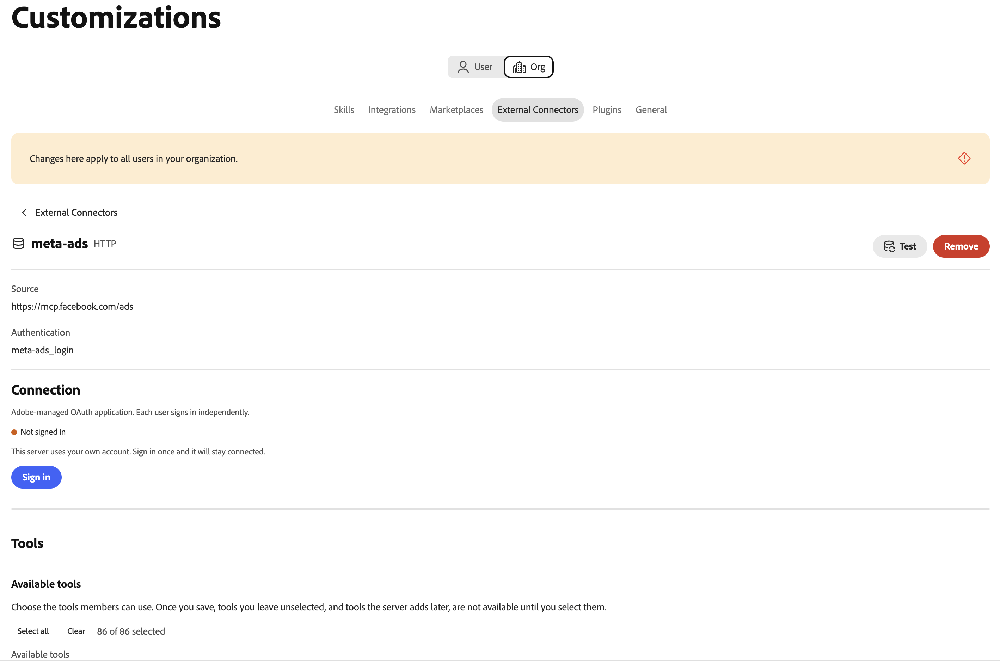

# Connecteur externe Meta Ads {#meta-ads}

Utilisez le connecteur externe [!DNL Meta Ads] pour travailler avec vos données publicitaires [!DNL Meta] dans Adobe CX Enterprise Coworker. Une fois que vous avez configuré le connecteur, demandez à vos collègues de créer des rapports sur les performances des annonces, de gérer les campagnes et les audiences, d’utiliser les catalogues de produits, etc. Le connecteur est un serveur MCP (Model Context Protocol) hébergé par [!DNL Meta].

>[!AVAILABILITY]
>
>Le connecteur externe [!DNL Meta Ads] est en version bêta. La documentation et les fonctionnalités peuvent changer.

## Configuration du connecteur {#connector-configuration}

Le processus de configuration du connecteur comprend deux parties distinctes :

* **Configuration de l’organisation :** un administrateur configure le connecteur une seule fois pour l’ensemble de l’organisation. L’administrateur choisit l’application OAuth et sélectionne les outils que les membres peuvent utiliser.
* **Connexion au membre :** chaque membre se connecte avec son propre compte [!DNL Facebook]. Les membres ne peuvent accéder qu’aux ressources [!DNL Meta] autorisées par leur identité [!DNL Facebook] et l’application autorisée.

L’enregistrement de la configuration de l’organisation ne permet pas de connecter des membres ni d’accorder l’accès aux comptes publicitaires. Chaque membre doit se connecter séparément.

## Conditions préalables {#prerequisites}

Avant de commencer, vérifiez que vous disposez des éléments suivants :

* **Pour la configuration d’organisation :** compte autorisé à gérer les connecteurs d’organisation dans Coworker.
* **Pour la connexion des membres :** compte [!DNL Facebook] ayant accès aux comptes publicitaires, aux entreprises, aux pages ou aux autres ressources [!DNL Meta] que vous prévoyez d’utiliser.
* **Pour votre propre application OAuth (facultatif) :** application [!DNL Meta] gérée par votre organisation, avec son identifiant d’application et son secret d’application.

## Configuration du connecteur pour votre organisation {#configure-organization}

Les administrateurs rendent le connecteur [!DNL Meta Ads] disponible pour tous les membres de l’organisation. Les modifications apportées à la page d’organisation s’appliquent à tous les utilisateurs de votre organisation.

1. Ouvrez **[!UICONTROL Personnalisations]**, sélectionnez **[!UICONTROL Organisation]**, puis **[!UICONTROL Connecteurs externes]**. Sur la carte **[!UICONTROL Meta Ads]**, sélectionnez **[!UICONTROL Configurer]**.

1. Dans la boîte de dialogue **[!UICONTROL Configurer Meta Ads pour votre organisation]**, passez en revue les **[!UICONTROL Détails de la connexion]**, puis sélectionnez une application **[!UICONTROL OAuth]** :

   * **[!UICONTROL Application OAuth gérée par Adobe ]:** Adobe fournit l’application [!DNL Meta Ads], vous n’avez donc pas besoin de saisir les informations d’identification de l’application. Chaque membre se connecte toujours avec son propre compte [!DNL Facebook] après l’enregistrement.

     {width="500" zoomable="yes"}

   * **[!UICONTROL Utiliser ma propre application OAuth] :** votre organisation fournit sa propre application [!DNL Meta]. Les membres autorisent votre application, et non l’application Adobe. Sous **[!UICONTROL Votre application Meta]**, procédez comme suit :

     1. Copiez l’**[!UICONTROL URL de redirection]** et ajoutez-la aux paramètres de connexion de votre application [!DNL Meta]. Utilisez la valeur exacte affichée dans la boîte de dialogue, car l’URL de redirection diffère entre les environnements.
     1. Sous **[!UICONTROL D’où proviennent les informations d’identification]**, sélectionnez **[!UICONTROL Saisir nouveau]**, puis saisissez l’**[!UICONTROL ID de l’application Meta]** et le **[!UICONTROL secret de l’application Meta]**. Recherchez l’ID d’application dans les paramètres de base de votre application [!DNL Meta]. Un collègue stocke le secret de l’application comme secret d’organisation. Pour réutiliser les informations d’identification enregistrées pour la même application à la place, sélectionnez **[!UICONTROL Utiliser un secret existant]**.
     1. Rendez l’application disponible pour les membres qui se connecteront. Demandez à votre administrateur d’application [!DNL Meta] de confirmer les autorisations requises et les exigences de révision d’application pour l’utilisation prévue.

     L’indicateur **[!UICONTROL Découvert à partir du serveur MCP]** confirme que Coworker a trouvé le connecteur. Cela ne confirme pas que les informations d’identification de votre application sont valides ou que les membres se sont connectés. Pour actualiser la découverte, sélectionnez **[!UICONTROL Découvrir à nouveau]**.

     {width="500" zoomable="yes"}.

1. Sous **[!UICONTROL Outils disponibles pour les utilisateurs]**, développez chaque groupe d’outils et sélectionnez les outils dont votre entreprise a besoin. Pour modifier tous les outils en même temps, utilisez **[!UICONTROL Tout sélectionner]** ou **[!UICONTROL Tout effacer]**. Pour plus d&#39;informations, voir [Groupes d&#39;outils](#tool-groups). Sélectionnez ensuite **[!UICONTROL Enregistrer la connexion]**.

   {width="500" zoomable="yes"}

1. Examinez les détails du connecteur **[!UICONTROL meta-ads]** enregistrés. Si vous le souhaitez, sélectionnez **[!UICONTROL Test]** pour vérifier que Coworker peut découvrir les outils de connecteur.

   | Paramètre | Description |
   | --- | --- |
   | **[!UICONTROL Source]** | Le serveur MCP [!DNL Meta Ads], `https://mcp.facebook.com/ads`. |
   | **[!UICONTROL Authentification]** | La méthode d’authentification, `meta-ads_login`. |
   | **[!UICONTROL Connexion]** | L’application OAuth utilisée et votre propre statut de connexion. |
   | **[!UICONTROL Outils]** | Les outils sélectionnés pour les membres, avec les contrôles **[!UICONTROL Tout sélectionner]** et **[!UICONTROL Effacer]** et un nombre d&#39;outils sélectionnés. |

   {width="700" zoomable="yes"}

Le statut **[!UICONTROL Non connecté]** sur les détails du connecteur fait référence à votre propre connexion et non à l’organisation. Pour utiliser le connecteur vous-même, sélectionnez **[!UICONTROL Se connecter]** et suivez les étapes décrites dans [Se connecter en tant que membre](#sign-in-as-a-member).

Pour arrêter de proposer le connecteur à votre organisation, sélectionnez **[!UICONTROL Supprimer]** sur la page des détails du connecteur.

### Groupes d&#39;outils {#tool-groups}

Le connecteur [!DNL Meta Ads] organise ses outils en groupes suivants :

* [!UICONTROL Rapports et informations]
* [!UICONTROL Publicités, campagnes et audiences]
* [!UICONTROL  Catalogues et produits ]
* [!UICONTROL  Signaux et jeux de données ]
* [!UICONTROL Tests A/B et études de portance]
* [!UICONTROL Journaux d’activité]
* [!UICONTROL Aide et dépannage]

Par exemple, le groupe [!UICONTROL Rapports et informations] comprend des outils tels que `ads_insights_performance_trend` et `ads_insights_industry_benchmark`. Les outils de chaque groupe peuvent changer à mesure que [!DNL Meta] met à jour le connecteur.

>[!IMPORTANT]
>
>Tous les outils ne sont pas en lecture seule. Certains outils peuvent modifier les campagnes, les budgets, les audiences, les catalogues ou d’autres ressources publicitaires. Sélectionnez uniquement les outils que votre organisation prévoit que les membres utilisent.

Après l&#39;enregistrement, les outils que vous laissez non sélectionnés ne sont pas disponibles pour les membres tant que vous ne les avez pas sélectionnés. Pour confirmer quels outils les membres peuvent utiliser, consultez la section **[!UICONTROL Outils disponibles]** de la page des détails du connecteur.

## Se connecter en tant que membre {#sign-in-as-a-member}

Une fois qu’un administrateur a configuré le connecteur, chaque membre se connecte avec son propre compte [!DNL Facebook]. Vous n’avez pas besoin d’un secret d’application ou d’un jeton d’accès pour vous connecter.

1. Ouvrez **[!UICONTROL Personnalisations]**, sélectionnez **[!UICONTROL Utilisateur]**, puis **[!UICONTROL Connecteurs externes]**.

1. Sur la carte **[!UICONTROL Meta Ads]**, sélectionnez **[!UICONTROL Se connecter]**.

   Si la carte indique **[!UICONTROL Non configuré]** ou si le connecteur n’est pas disponible, demandez à votre administrateur de [configurer le connecteur](#configure-organization).

1. Connectez-vous à [!DNL Facebook] et renseignez toutes les invites requises, telles que l&#39;authentification unique (SSO), l&#39;authentification multifacteur (MFA), le consentement ou la vérification d&#39;identité.

   L’ordre de ces invites dépend de vos politiques de compte et d’organisation. Les nouveaux utilisateurs peuvent également voir des invites pour accorder des autorisations et sélectionner des ressources.

1. Vérifiez le compte [!DNL Facebook] et l’application que vous autorisez, puis effectuez l’une des opérations suivantes :

   * Pour conserver vos paramètres précédents, sélectionnez **[!UICONTROL Continuer]**.
   * Pour vérifier ou modifier l’autorisation, sélectionnez **[!UICONTROL Modifier les paramètres]**.
   * Pour utiliser un autre compte [!DNL Facebook], sélectionnez **[!UICONTROL Connexion à un autre compte]**.

   Avec l’application gérée par Adobe, vous autorisez le [!DNL Adobe Experience Cloud]. Avec l’application de votre propre organisation, le nom et les invites de l’application sont différents.

   {width="400" zoomable="yes"}

   >[!IMPORTANT]
   >
   >L’application reçoit un accès continu aux informations que vous partagez et [!DNL Meta] des enregistrements lorsqu’elle accède à ces informations. Continuez uniquement si votre organisation approuve l’accès demandé.

1. Une fois que [!DNL Facebook] vous a renvoyé à Coworker, ouvrez les détails du connecteur **[!UICONTROL meta-ads]**. Vérifiez que le connecteur affiche **[!UICONTROL Connecté]** et **[!UICONTROL Connecté]**.

   Détails du connecteur {width="700" zoomable="yes"}

1. Consultez **[!UICONTROL Outils activés par votre administrateur]** pour afficher les outils que vous pouvez utiliser.

Les détails du connecteur affichent également le paramètre **[!UICONTROL Délai d’expiration de l’outil]** et les commandes suivantes :

* **[!UICONTROL Recharger les outils] :** actualisez la liste des outils.
* **[!UICONTROL Test] :** vérifier que Coworker peut découvrir les outils du connecteur.
* **[!UICONTROL Déconnexion] :** déconnectez votre compte [!DNL Facebook] du connecteur.

Un statut **[!UICONTROL Connecté]** ne confirme pas l’accès à un compte publicitaire spécifique ou l’exécution réussie de chaque outil. Pour confirmer votre accès, [vérifiez votre accès au compte publicitaire](#check-ad-account-access).

## Vérifier l’accès à votre compte publicitaire {#check-ad-account-access}

Pour confirmer les comptes publicitaires que vous pouvez utiliser, démarrez une conversation et saisissez une invite en lecture seule.

Exemple d’invite :

* « Quels comptes publicitaires Meta puis-je accéder ? Répertoriez-les sans rien changer. »

Si votre administrateur a activé l’outil `ads_get_ad_accounts`, Collègue répertorie les comptes publicitaires auxquels vous pouvez accéder. Pour chaque compte, le collaborateur affiche l’entreprise propriétaire, l’éligibilité du MCP et la disponibilité des rapports. Choisissez un compte accessible avant de demander des rapports ou d’effectuer des actions.

## Résolution des problèmes d’accès {#troubleshoot-access}

Si vous ne pouvez pas accéder à vos ressources [!DNL Meta], vérifiez les points suivants :

| Zone | Éléments à vérifier |
| --- | --- |
| compte [!DNL Facebook] | Vous vous êtes connecté avec le compte [!DNL Facebook] qui a accès au compte publicitaire. |
| Autorisations des ressources | Votre compte [!DNL Facebook] dispose d’autorisations pour les comptes publicitaires, les entreprises ou les pages que vous souhaitez utiliser. |
| Autorisation de l’application | Vous avez autorisé l’application et partagé les ressources requises. Pour vérifier l’autorisation, déconnectez-vous et reconnectez-vous, puis sélectionnez **[!UICONTROL Modifier les paramètres]**. |
| Outils activés | Votre administrateur a activé les outils dont vous avez besoin sous **[!UICONTROL Outils disponibles pour les utilisateurs]**. |
| Votre propre application OAuth | L’URL de redirection correspond exactement, l’ID d’application et le secret d’application sont corrects et les membres ont accès à l’application. Confirmez les autorisations requises auprès de votre administrateur d’application [!DNL Meta]. |
